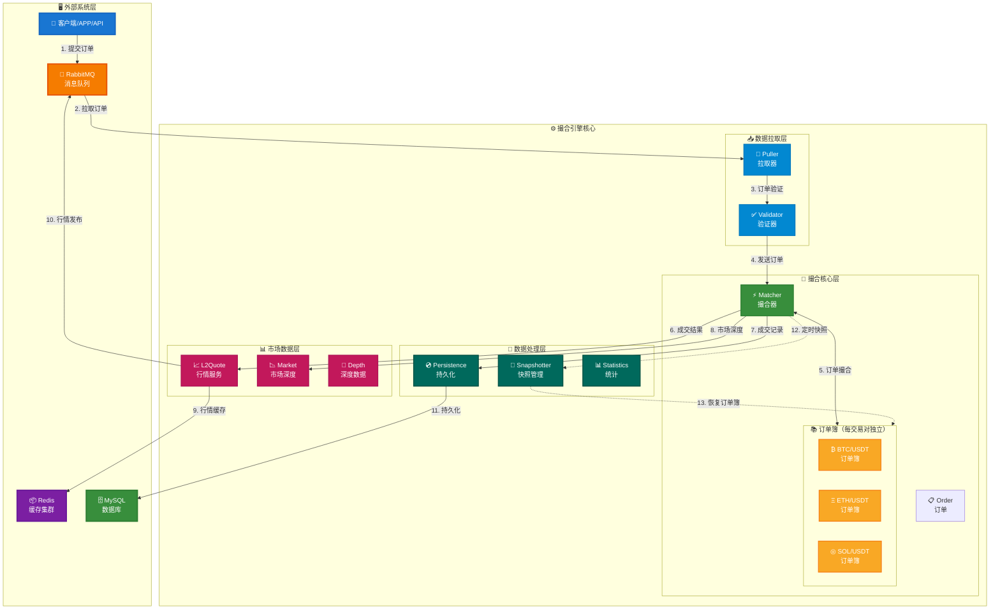
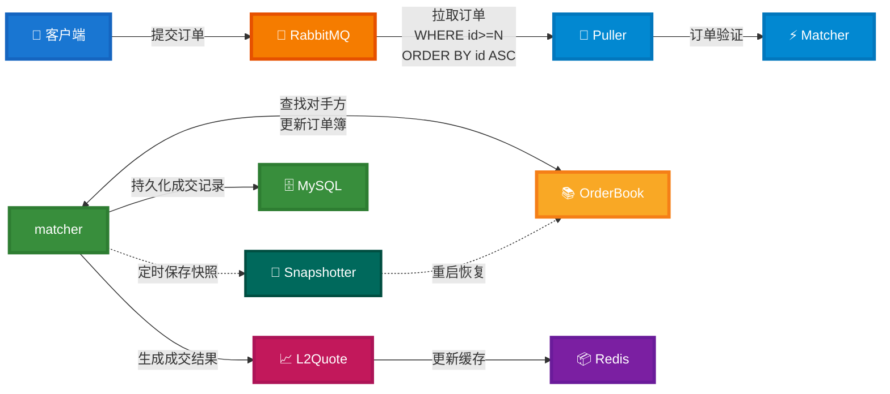
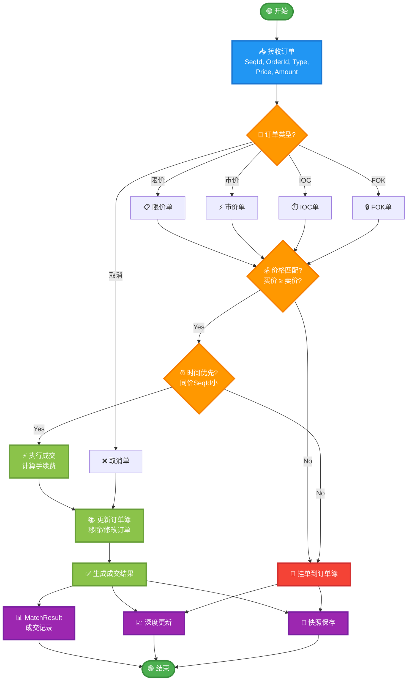

# market_match 项目拆解

## 整体流程

### 整体流程图

### 架构组成

**外部系统层：**

客户端 API：客户与交易系统交互入口

RabbiMQ：消息队列，负责建立通道，传递消息

Reids：缓存数据，保存快照

Mysql：持久化出具，存储用户信息，交易信息

**数据拉取层：**

Puller：负责将数据库中的数据按照指定的顺序批次拉取到撮合系统中进行撮合

validatore：验证器，校验系统开启或者重启后状态是否一致

**数据处理层：**

Persistence：持久化数据，并将持久化的数据存入 mysql

Snapshotter：快照生成器，负责生成快照，上传快照，下载快照

Statistic：统计器，负责记录各个处理时间的过程节点中，系统处理耗时情况，任务积压情况

**市场数据层：**

Depth：从订单簿拿数据买卖盘深度信息，支持多级深度，实时计算当前盘口深度，批量打包深度信息

Market：消费 Depth 数据，批量打包最多 90 条数据，通过RabbitMQ 发给前端，定时推送，监控性能

L2Quote：生成 K 线，Ticker 数据，缓存查询数据到 redis，向 MQ 发送实情推送，保存和恢复行情

**撮合核心层：**

Matcher：核心执行撮合订单，根据不同的订单类型和策略执行撮合

OrderBook：撮合器依赖的底层数据，记录当前的所有买卖盘信息，可从快照中恢复

### 运行流程

~~~mermaid

flowchart TB
    start([🚀 系统启动]) --> config["⚙️ 加载配置"]
    config --> init["🔧 初始化组件\n日志/统计/快照\nRedis/RabbitMQ\n撮合引擎/市场模块"]
    init --> load_symbols["📋 加载交易对列表\nBTC/USDT\nETH/USDT\nSOL/USDT"]
    load_symbols --> loop_symbol{"🔄 遍历交易对"}

    loop_symbol --> check_snapshot{"📸 检查快照\n./sp/"}

    check_snapshot -->|"Yes"| load_snapshot["📂 加载快照\nGob反序列化"]
    check_snapshot -->|"No"| create_empty["🆕 创建空订单簿\nFromId = 0"]

    load_snapshot --> get_lastid["🔢 获取最后订单ID"]
    create_empty --> get_lastid

    get_lastid --> init_puller["🔄 初始化拉取器\n从lastId+1开始拉取"]
    init_puller --> start_matcher["⚡ 启动撮合器\n单线程处理"]
    start_matcher --> start_l2quote["📈 启动L2行情服务\n并行计算K线"]
    start_l2quote --> start_mq["🐰 启动行情推送\n定时批量发送"]

    start_mq -.-> snapshot_scheduler["📸 启动快照调度器\n每60秒保存一次"]
    start_mq --> ready([✅ 系统就绪\n开始接收订单])

    style start fill:#4caf50,color:#fff,stroke:#388e3c,stroke-width:4px
    style ready fill:#4caf50,color:#fff,stroke:#388e3c,stroke-width:4px
    style config fill:#2196f3,color:#fff,stroke:#1976d2,stroke-width:3px
    style init fill:#2196f3,color:#fff,stroke:#1976d2,stroke-width:3px
    style load_symbols fill:#2196f3,color:#fff,stroke:#1976d2,stroke-width:3px
    style loop_symbol fill:#ff9800,color:#fff,stroke:#f57c00,stroke-width:3px
    style check_snapshot fill:#ff9800,color:#fff,stroke:#f57c00,stroke-width:3px
    style load_snapshot fill:#8bc34a,color:#fff,stroke:#689f38,stroke-width:3px
    style create_empty fill:#f44336,color:#fff,stroke:#d32f2f,stroke-width:3px
    style init_puller fill:#9c27b0,color:#fff,stroke:#7b1fa2,stroke-width:3px
    style start_matcher fill:#9c27b0,color:#fff,stroke:#7b1fa2,stroke-width:3px
    style start_l2quote fill:#9c27b0,color:#fff,stroke:#7b1fa2,stroke-width:3px
    style start_mq fill:#9c27b0,color:#fff,stroke:#7b1fa2,stroke-width:3px
    style snapshot_scheduler fill:#00bcd4,color:#fff,stroke:#0097a7,stroke-width:3px
~~~

整个撮合系统的运行流程：

1. 启动配置项
2. 启动并注册http 和端口号
3. 启动日志组件
4. 启动统计模块即性能模块
5. 启动并初始化快照模块，获取s3manager.NewUploader
6. 启动 redis 缓存系统
7. 启动rabbitmq 消息传送通道模块
8. 初始化match 撮合模块
9. 启动 maket 市场模块
10. 启动Exchange，开始执行撮合
11. 启动校验器模块，校验器模块主要作用为验证系统重启后数据是否发生了变动
12. 自循环，开始服务

## 数据流程

### 数据流程图

### 多分片数据流转

~~~mermaid

flowchart TB
    subgraph shared["🔗 共享资源"]
        MySQL["🗄️ MySQL数据库"]
        Redis["📦 Redis缓存"]
        MQ["🐰 RabbitMQ"]
    end

    subgraph btc["₿ BTC/USDT 分片"]
        BTC_Ch["📨 Channel\n容量5000"]
        BTC_Puller["🔄 Puller"]
        BTC_Matcher["⚡ Matcher\n单线程"]
        BTC_Book["📚 OrderBook\n订单簿"]
    end

    subgraph eth["Ξ ETH/USDT 分片"]
        ETH_Ch["📨 Channel\n容量5000"]
        ETH_Puller["🔄 Puller"]
        ETH_Matcher["⚡ Matcher\n单线程"]
        ETH_Book["📚 OrderBook\n订单簿"]
    end

    subgraph sol["◎ SOL/USDT 分片"]
        SOL_Ch["📨 Channel\n容量5000"]
        SOL_Puller["🔄 Puller"]
        SOL_Matcher["⚡ Matcher\n单线程"]
        SOL_Book["📚 OrderBook\n订单簿"]
    end

    MySQL --> BTC_Puller
    MySQL --> ETH_Puller
    MySQL --> SOL_Puller

    BTC_Puller --> BTC_Ch
    BTC_Ch --> BTC_Matcher
    BTC_Matcher --> BTC_Book

    ETH_Puller --> ETH_Ch
    ETH_Ch --> ETH_Matcher
    ETH_Matcher --> ETH_Book

    SOL_Puller --> SOL_Ch
    SOL_Ch --> SOL_Matcher
    SOL_Matcher --> SOL_Book

    BTC_Matcher --> shared
    ETH_Matcher --> shared
    SOL_Matcher --> shared

    style btc fill:#e3f2fd,stroke:#1976d2,stroke-width:3px
    style eth fill:#f3e5f5,stroke:#7b1fa2,stroke-width:3px
    style sol fill:#fff8e1,stroke:#f9a825,stroke-width:3px
    style shared fill:#e8f5e9,stroke:#388e3c,stroke-width:3px
~~~

### 数据流转过程

1. 用户提交订单，
2. RabbiMQ 通过分片识别它归属于那个片区，并将数据存放到数据库中，主键为自增 id
3. puller 定时从数据库中拉取订单，并将订单发送给撮合器
4. 撮合器按照订单的类型和指定的策略进行撮合
5. 撮合结果 序列化为 json 字符串
6. 定时将一批序列化订单结构体信息及成交结果发送给行情通道中，将序列化交易结果发从给持久化数据库和订阅客户端，定时保存并上传新的快照

## 订单簿数据

本项目中订单簿是根据价格优先和 seqid（从小到大）优先执行订单撮合顺序的排序

底层的二叉树使用了红黑树排序

### 红黑树的比较器

红黑树使用必须有比较器，以下是红黑树比较器实现逻辑

其中-1 代表插入左子节点，1 代表插入右子节点，0 表示重复不插入

~~~go
func Comparator(a, b interface{}) int {
	orderA := a.(*Order)
	orderB := b.(*Order)

	if orderA.BuyOrSell == Buy {
		switch {
		case orderA.Price.GreaterThan(orderB.Price) ||
			(orderA.Price.Equal(orderB.Price) && orderA.SeqId < orderB.SeqId):
			return -1
		case orderA.SeqId == orderB.SeqId:
			return 0
		default:
			return 1
		}
	} else {
		switch {
		case orderA.Price.LessThan(orderB.Price) ||
			(orderA.Price.Equal(orderB.Price) && orderA.SeqId < orderB.SeqId):
			return -1
		case orderA.SeqId == orderB.SeqId:
			return 0
		default:
			return 1
		}
	}
}
~~~

### 比较器代码详解

本项目红黑树中每个节点的 key：**整个 Order 对象就是 Key，但实际比较的是 (Price, SeqId) 组合，同时还会用到订单状态是卖单还是买单**

买树和卖树的最优成交价都是最左子节点（非 nil 节点），即该左子节点是整个树中沿着左支一直走，能拿到的最后一个值

对于**买单**来说，**系统优先成交的是购入价最高的单且购入价最高且 seqid 越小的单**，所以这种单是最优对手单，被放在树最左侧

对于**卖单**来说，**系统优先成交的是出售价最低的单且购入价最高且 seqid 越小的单**，所以这种单是最优对手单，被放在树最左侧

代码运行逻辑：

1. 获得两个单，其中 A 单是待入树的单，B 单是红黑树中原有的节点上挂的单
2. 如果 A 单是买单，则执行
   1. 如果 **A 单价格> B 单价格**或者 **（A 单价格等于 B 单且 A 单 seqid<B 单 seqid）**，return -1
   2. 如果 **A 单 seqid=B 单 seqid**，return 0
   3. 默认执行，return 1
3. 否则，表示 A 单是卖单，执行
   1. 如果 **A 单价格< B 单 价格** 或者 **（A 单价格等于 B 单且 A 单 seqid<B 单 seqid）**，return -1
   2. 如果 **A 单 seqid=B 单 seqid**，return 0
   3. 默认执行，return 1

## 订单撮合流程

### 订单撮合流程图

什么数据结构

~~~mermaid

sequenceDiagram
    participant C as 👤 客户端
    participant MQ as 🐰 RabbitMQ
    participant P as 🔄 Puller
    participant V as ✅ Validator
    participant M as ⚡ Matcher
    participant OB as 📚 OrderBook
    participant L2 as 📈 L2Quote
    participant R as 📦 Redis
    participant DB as 🗄️ MySQL

    rect rgb(200, 220, 255)
        Note over C,DB: 📝 阶段1：订单提交
    end

    C->>MQ: 1️⃣ 提交订单
    Note over MQ: 包含：SeqId, OrderId, UserId, Type, Price, Amount

    rect rgb(220, 255, 220)
        Note over MQ,DB: 📥 阶段2：订单拉取
    end

    MQ->>P: 2️⃣ Puller拉取
    Note over P: WHERE id >= N ORDER BY id ASC limit 2000

    P->>V: 3️⃣ 验证订单
    Note over V: 检查格式、余额、权限

    rect rgb(255, 240, 200)
        Note over V,DB: ⚡ 阶段3：订单撮合
    end

    alt ✅ 验证通过
        V->>M: 4️⃣ 发送订单
        M->>OB: 5️⃣ 查找对手方

        alt 🎯 找到匹配
            OB-->>M: 6️⃣ 返回匹配订单
            M->>M: 7️⃣ 执行撮合
            M->>OB: 8️⃣ 更新订单簿

            rect rgb(240, 220, 255)
                Note over M,R: 📊 阶段4：结果处理
            end

            M->>L2: 9️⃣ 生成成交数据
            L2->>R: 🔟 更新Redis缓存
            M->>DB: 1️⃣1️⃣ 持久化成交记录
            M->>MQ: 1️⃣2️⃣ 发布成交结果
        else ❌ 无匹配
            M->>OB: 6️⃣ 挂单
            M->>L2: 7️⃣ 更新深度
            L2->>R: 8️⃣ 更新缓存
        end

        rect rgb(255, 220, 220)
            Note over M,R: 📸 阶段5：快照保存
        end

        M-.->>OB: 1️⃣3️⃣ 定时保存快照
        OB-.->>M: 1️⃣4️⃣ 重启恢复

    else ❌ 验证失败
        V->>MQ: 4️⃣ 返回错误
    end
~~~

### 订单结构体

~~~
type Order struct {
	SeqId          int64
	UserId         int64
	OrderId        int64
	BuyOrSell      OrderBuyOrSell   // 买/卖方向
	Type           OrderType        // LIMIT / MARKET / FOK / IOC
	State          OrderState       // 订单当前状态（Submitted、Filled、SelfTradeDecreased…）
	Price          decimal.Decimal
	UnfilledAmount decimal.Decimal  // 剩余还能成交的数量
	CircuitRate    decimal.Decimal  // 滑点熔断保护比例
	CreateAt       int64
	Stp            SelfTradeWMType  // STP自成交策略 DC/CAD
	PullTime       int64
	Extra          string           // 批量撤单用
	Taker          string
	Maker          string
}

~~~

### 订单结果结构体

~~~
type OrderResult struct {
	OrderId        int64             `json:"order-id"`
	UserId         int64             `json:"user-id"`
	Role           string            `json:"role"`       // "taker" / "maker"
	Price          *decimal.Decimal   `json:"price,omitempty"`
	UnfilledAmount *decimal.Decimal   `json:"unfilled-amount,omitempty"` // taker剩余
	FilledAmount   *decimal.Decimal   `json:"filled-amount,omitempty"`   // 本次变动量（成交/减量）
	State          string            `json:"state,omitempty"`           // 本次事件标签
	Taker          string            `json:"taker"`
	Maker          string            `json:"maker"`
}

~~~

撤单操作类型角色

| 操作类型       | 返回的订单   | 角色设置 | 说明                            |
| :------------- | :----------- | :------- | :------------------------------ |
| **撤单操作**   | 被撤销的订单 | `taker`  | 撤单请求本身是主动操作（taker） |
| **普通撮合**   | 对手方订单   | `maker`  | 对手方是被动等待成交（maker）   |
| **自成交处理** | 对手方订单   | `maker`  | 对手方是被动方（maker）         |

**关键理解点：**

- `Role` 字段表示的是**操作本身的角色**，而不是被处理订单的原始角色
- 撤单是一个"主动"操作，所以角色是 "taker"
- 撮合是一个"被动"等待成交的过程，所以角色是 "maker"
- 自成交处理虽然涉及取消订单，但它仍然是基于对手方订单的处理，所以返回的角色是 "maker"

~~~
示例：
// 撤单操作中
results = append(results,
    &OrderResult{
        OrderId:        targetOrder.OrderId,  // 被撤销的订单ID
        Role:           "taker",              // 撤单请求的角色
        UnfilledAmount: &targetOrder.UnfilledAmount,
        State:          state,                // 撤单后的状态
        UserId:         order.UserId,         // 撤单请求的用户
        Taker:          order.Taker,          // 撤单请求的Taker标识
        Maker:          order.Maker,          // 撤单请求的Maker标识
    })
    
// 正常撮合/自成交
return &OrderResult{
    OrderId:      oppoOrder.OrderId,
    Role:         "maker",  // ✅ 撮合对手方角色是 maker
    FilledAmount: &matchAmount,
    // ...
}
~~~

### 订单状态

| 常量                        | 字符串                      | 含义说明                                                     | 典型来源                                                     |
| --------------------------- | --------------------------- | ------------------------------------------------------------ | ------------------------------------------------------------ |
| submittedState              | submitted                   | **已挂单（未成交）**订单成功进入订单簿，还没有任何成交。     | 限价 Maker 单成功挂簿                                        |
| partialFilledState          | partial-filled              | **部分成交**已经成交一部分，还有余量留在订单簿，可以继续被撮合。 | 限价单被吃掉一部分，剩余还在盘上                             |
| filledState                 | filled                      | **全部成交**订单余量全部吃完，订单结束，移出订单簿。         | 正常撮合，全部匹配完成                                       |
| canceledState               | canceled                    | **正常撤销（完全撤销）**原本是 submitted，一笔都没成交，被用户 / 系统撤单，直接取消。 | 用户单笔撤单、系统撤单，订单从未成交                         |
| partialCancelState          | partial-canceled            | **部分撤销**之前已经有一部分成交，剩下没成交的余量被撤销。   | 一个单子部分成交之后，再发起撤单                             |
| failedState                 | failed                      | **撤销失败**发了撤单指令，但是在订单簿找不到这个订单：已经成交、已经撤过、单号不存在。 | matchCancel /matchBatchCancel 里面的 else 分支               |
| precisionCancelState        | precision-canceled          | **精度不足取消**cash 市价买场景：剩余资金不够买**最小交易单位**，直接取消这笔 taker 单，不进簿、不成交。 | 你刚才看的 `unitPrice.GreaterThan(order.UnfilledAmount)` 分支 |
| circuitCancelState          | circuit-canceled            | **熔断取消 / 风控回路取消**行情熔断、风控触发，订单被平台风控取消。 | 全局行情熔断、风控开关触发                                   |
| selfTradeDecreaseState      | self-trade-decreased        | **自成交减量（DC），还有余量**STP-DC 模式，同用户订单碰撞，不真实成交，只扣减一部分余量，订单还有剩余，继续留在簿 / 继续撮合。 | DC 分支，maker 扣一部分、还剩余量留在簿                      |
| selfTradePartialCancelState | self-trade-partial-canceled | **自成交减量后余量耗尽，订单结束**DC 自成交减量扣完之后，余量归零，订单生命周期结束。对应你 `stOrderState()` 流转目标态。 | DC：taker 或者 maker 被 DC 扣干净了                          |
| selfTradeCancelState        | self-trade-canceled         | **自成交直接取消（CB 模式）**STP-CB：同用户碰撞，两边直接取消，不成交、不减量，直接作废。 | CB 策略，碰撞后双向取消                                      |
|                             | Error                       | 异常错误，程序异常、内部未知错误                             |                                                              |
|                             | SystemCanceled              | **系统撤单**：系统后台触发的撤销（比如风控、停盘、过期、强平），区别于用户主动撤单 |                                                              |

**区分点**：

**普通撤单和自成交撤单**：

- `canceledState` / `partialCancelState`：**正常用户 / 系统撤单链路（matchCancel、matchBatchCancel）**
- `selfTradeCancelState` / `selfTradePartialCancelState` / `selfTradeDecreaseState`：**撮合碰撞瞬间 STP 自成交逻辑产生，不是外部下发撤单指令**

**partial-filled（正常部分成交） 和 self-trade-decreased（DC 减量）**

- `partial-filled`：真实成交，有资产划转、计入 K 线
- `self-trade-decreased`：DC 自成交，**只是扣订单内部余量，不发生真实资产交割，下游账户模块要跳过记账**

**precision-canceled** 

和普通 cancel 完全不一样：它不是撤单，是**订单进来撮合的时候，前置校验就判定买不起最小单位，直接作废**，订单从来没有进订单簿。

### 订单状态流转

~~~
创建订单 → Submitted
    ↓
┌──────────────────────────────────────┐
│  撮合处理                             │
├──────────────────────────────────────┤
│                                      │
├─ 完全成交 ─────────────────────────→ Filled
│                                      │
├─ 部分成交 + 撤单 ─────────────────→ PartialCanceled
│                                      │
├─ 未成交 + 撤单 ───────────────────→ Canceled
│                                      │
├─ 自成交触发 ─────────────────────→ SelfTradeCanceled
│                                      │
├─ 熔断机制触发 ───────────────────→ CircuitCanceled
│                                      │
├─ 系统撤单 ────────────────────────→ SystemCanceled
│                                      │
└─ 精度问题 ────────────────────────→ PrecisionCanceled
~~~

### 订单分类

#### 限价单

只有达到指定的价格才成交

~~~mermaid

flowchart TB
    subgraph Title["📋 限价单撮合详细流程 matchLimit()"]
    end

    START([开始 matchLimit]) --> LOOP1{"循环检查 order.isFilled() || order.isSelfTrade()?"}

    LOOP1 -->|"True|已成交或自成交"| RETURN1["finalizeTaker(order) 返回taker结果"]
    RETURN1 --> END([结束])

    LOOP1 -->|"False|继续撮合"| PEEK["oppoOrder := peekOppoOrder(order) 获取最佳对手单"]

    PEEK --> CHECK_OPPO{"oppoOrder == nil || !matchAble(order, oppoOrder)"}

    CHECK_OPPO -->|"True|无对手单或价格不匹配"| ENQUEUE["book.Enqueue(order) 挂单到订单簿"]

    ENQUEUE --> RETURN2["finalizeTaker(order) 返回taker结果"]
    RETURN2 --> END

    CHECK_OPPO -->|"False|价格可匹配"| MATCH["tmpOrderResult := matchOrder(book, order, oppoOrder) 执行撮合"]

    MATCH --> CHECK_RESULT{"tmpOrderResult != nil?"}

    CHECK_RESULT -->|"False|精度取消"| LOOP1

    CHECK_RESULT -->|"True|撮合成功"| APPEND1["results = append(results, tmpOrderResult) 添加成交结果"]

    APPEND1 --> CHECK_OPPO_STATE{"oppoOrder状态检查 isFilled() || isSelfTradeCanceled() || isSelfTradePartialCanceled()"}

    CHECK_OPPO_STATE -->|"True|对手单完成"| DEQUEUE["book.Dequeue(oppoOrder.OrderId) 对手单出队"]

    DEQUEUE --> CHECK_PRICE{"oppoOrder.isFilled() || oppoOrder.isPartialFilled()"}

    CHECK_PRICE -->|"True|成交或部分成交"| UPDATE_PRICE["price = oppoOrder.Price 更新成交价格"]

    UPDATE_PRICE --> LOOP1

    CHECK_PRICE -->|"False|未成交"| LOOP1

    CHECK_OPPO_STATE -->|"False|对手单未完成"| CHECK_PRICE

    style START fill:#4caf50,color:#fff,stroke:#388e3c,stroke-width:4px
    style END fill:#4caf50,color:#fff,stroke:#388e3c,stroke-width:4px
    style ENQUEUE fill:#f44336,color:#fff,stroke:#d32f2f,stroke-width:3px
    style MATCH fill:#ff9800,color:#fff,stroke:#f57c00,stroke-width:3px
~~~

订单流转过程：

1. 进入自循环
2. 检查 taker 状态是否为已成交，自撤销，部分自撤销，append(results, finalizeTaker(order))，break
3. 如果不是，取对手单
   1. 如果对手单不存在，或者不匹配，则将该订单挂到订单簿中（挂单价为限价单预期成交价），append(results, finalizeTaker(order))，break
   2. 否则执行撮合，获得撮合结果
      1. 如果撮合结果为 nil，append(results, tmpOrderResult)
      2. 否则，continue（这个场景适用于匹配到的对手单也是自己发起的，按照自成交策略，返回空）
      3. 检查对手单状态是否为完全成交，自撤销，部分自撤销，如果是则下架该maker 单
      4. 同时检查如果对手单状态是完全成交或者部分成交，则将对手单的价格设置为返回值中的价格

#### 市价单

按照盘口市价吃单，如果吃完所有还有剩余则挂在盘口

~~~mermaid

flowchart TB
    subgraph Title["📊 市价单撮合详细流程 matchMarket()"]
    end

    START([开始 matchMarket]) --> LOOP1{"循环检查 order.isFilled() || order.isSelfTrade()?"}

    LOOP1 -->|"True|已成交或自成交"| RETURN1["finalizeTaker(order) 返回taker结果"]
    RETURN1 --> END([结束])

    LOOP1 -->|"False|继续撮合"| PEEK["oppoOrder := peekOppoOrder(order) 获取最佳对手单"]

    PEEK --> CHECK_OPPO{"oppoOrder == nil?"}

    CHECK_OPPO -->|"True|无对手单"| RETURN2["finalizeTaker(order) 市价单直接返回"]
    RETURN2 --> END

    CHECK_OPPO -->|"False|有对手单"| CHECK_CIRCUIT{"len(results) > 0 && !order.CircuitRate.Equals(0) && 价格超出熔断范围?"}

    CHECK_CIRCUIT -->|"True|触发熔断"| RETURN3["finalizeTaker(order.SetState(CircuitCanceled)) 熔断取消"]
    RETURN3 --> END

    CHECK_CIRCUIT -->|"False|未触发熔断"| MATCH["tmpOrderResult := matchOrder(book, order, oppoOrder) 执行撮合"]

    MATCH --> CHECK_RESULT{"tmpOrderResult != nil?"}

    CHECK_RESULT -->|"False|精度取消"| RETURN4["finalizeTaker(order.SetState(PrecisionCanceled)) 精度取消"]
    RETURN4 --> END

    CHECK_RESULT -->|"True|撮合成功"| APPEND1["results = append(results, tmpOrderResult) 添加成交结果"]

    APPEND1 --> CHECK_OPPO_STATE{"oppoOrder状态检查 isFilled() || isSelfTradeCanceled() || isSelfTradePartialCanceled()"}

    CHECK_OPPO_STATE -->|"True|对手单完成"| DEQUEUE["book.Dequeue(oppoOrder.OrderId) 对手单出队"]

    DEQUEUE --> UPDATE_PRICE1["price = oppoOrder.Price 更新成交价格"]

    UPDATE_PRICE1 --> LOOP1

    CHECK_OPPO_STATE -->|"False|对手单未完成"| CHECK_PARTIAL{"oppoOrder.isPartialFilled()?"}

    CHECK_PARTIAL -->|"True|部分成交"| UPDATE_PRICE2["price = oppoOrder.Price 更新成交价格"]

    UPDATE_PRICE2 --> CHECK_ORDER_STATE{"检查order状态"}

    CHECK_PARTIAL -->|"False|未部分成交"| CHECK_ORDER_STATE

    CHECK_ORDER_STATE -->|"SelfTradePartialCanceled"| RETURN5["finalizeTaker(order.SetState(SelfTradePartialCanceled)) 自成交部分取消"]
    RETURN5 --> END

    CHECK_ORDER_STATE -->|"SelfTradeCanceled"| RETURN6["finalizeTaker(order.SetState(SelfTradeCanceled)) 自成交取消"]
    RETURN6 --> END

    CHECK_ORDER_STATE -->|"Filled|订单完成"| RETURN7["finalizeTaker(order.SetState(Filled)) 订单完成"]
    RETURN7 --> END

    CHECK_ORDER_STATE -->|"其他|继续循环"| LOOP1

    style START fill:#4caf50,color:#fff,stroke:#388e3c,stroke-width:4px
    style END fill:#4caf50,color:#fff,stroke:#388e3c,stroke-width:4px
    style MATCH fill:#ff9800,color:#fff,stroke:#f57c00,stroke-width:3px
    style DEQUEUE fill:#9c27b0,color:#fff,stroke:#7b1fa2,stroke-width:3px
~~~

订单流转过程讲解：

代码运行逻辑：

1. 开启自循环
2. 判断 taker 订单状态是否为已成交，自撤销，部分自撤销，如果是则append(results, finalizeTaker(order))并 break
3. 取对手单，如果没有对手单append(results, finalizeTaker(order.SetState(Canceled)))
4. 如果有对手单，
   1. 如果成交的结果列表长度大于0，即第一笔交易存在且 第一笔成交价\*（1-takerfok.CircuitRate）>=oppoOrder.Price或第一笔成交价\*（1+takerfok.CircuitRate）<=oppoOrder.Price，则 append(results, finalizeTaker(order.SetState(CircuitCanceled))执行熔断并 break 。目的是为了保护第一笔交易和第二笔交易存在巨大的滑点，但是此时 fok 订单会产生部分成交的情况。这种情况和标准的 fok 不符合
   2. 继续执行撮合
      1. 撮合结果tmpOrderResult不等于 nil，成交下单，results = append(results, tmpOrderResult)
      2. 撮合结果tmpOrderResult等于 nil（可能是自成交），判断taker 单状态是否为PrecisionCanceled，
         1. 如果是append(results,inalizeTaker(order.SetState(PrecisionCanceled) 并break
         2. 不是，继续循环执行撮合
      3. 对手单是完全成交或者自撤销或者部分自撤销，
         1. 是下架该对手单，
         2. 如果是完全成交则将对手单价格赋值给返回的价格
         3. continue 循环匹配
      4. 对手单不是完全成交或者自撤销或者部分自撤销
         1. 如果对手单是部分自成交，则将价格赋值给返回的价格
         2. 如果taker 单是自成交部分撤销，append(results, finalizeTaker(order.SetState(SelfTradePartialCanceled)))
         3. 如果taker 单是自撤销，append(results, finalizeTaker(order.SetState(SelfTradeCanceled)))
         4. 如果 taker 单是完全成交，append(results, finalizeTaker(order.SetState(Filled)))，否则continue
         5. break

#### FOK

只能在一笔交易中全部成交，或者全部不成交

预检-撮合成功是原子性的

~~~mermaid

flowchart TB
    subgraph Title["🔒 FOK单撮合详细流程 matchFok()"]
    end

    START([开始 matchFok]) --> PRECHECK["canFilledFokOrder(order) 预检查是否能全部成交"]

    PRECHECK --> CHECK_PRE{"ok == false?"}

    CHECK_PRE -->|"True|无法全部成交"| RETURN1["finalizeTaker(order) 订单取消"]
    RETURN1 --> END([结束])

    CHECK_PRE -->|"False|可以全部成交"| LOOP1{"循环检查 order.isFilled() || order.isSelfTrade()?"}

    LOOP1 -->|"True|已成交或自成交"| RETURN2["finalizeTaker(order) 返回结果"]
    RETURN2 --> END

    LOOP1 -->|"False|继续撮合"| PEEK["oppoOrder := peekOppoOrder(order) 获取最佳对手单"]

    PEEK --> CHECK_OPPO{"oppoOrder == nil"}

    CHECK_OPPO -->|"True|无对手单"| RETURN3["finalizeTaker(order.SetState(Canceled)) 订单取消"]
    RETURN3 --> END

    CHECK_OPPO -->|"False|有对手单"| CHECK_CIRCUIT{"len(results) > 0 && !order.CircuitRate.Equals(0) && 价格超出熔断范围?"}

    CHECK_CIRCUIT -->|"True|触发熔断"| RETURN4["finalizeTaker(order.SetState(CircuitCanceled)) 熔断取消"]
    RETURN4 --> END

    CHECK_CIRCUIT -->|"False|未触发熔断"| MATCH["tmpOrderResult := matchOrder(book, order, oppoOrder) 执行撮合"]

    MATCH --> CHECK_RESULT{"tmpOrderResult != nil?"}

    CHECK_RESULT -->|"False|精度取消"| RETURN5["finalizeTaker(order.SetState(PrecisionCanceled)) 精度取消"]
    RETURN5 --> END

    CHECK_RESULT -->|"True|撮合成功"| APPEND1["results = append(results, tmpOrderResult) 添加成交结果"]

    APPEND1 --> CHECK_OPPO_STATE{"oppoOrder状态检查 isFilled() || isSelfTradeCanceled() || isSelfTradePartialCanceled()"}

    CHECK_OPPO_STATE -->|"True|对手单完成"| DEQUEUE["book.Dequeue(oppoOrder.OrderId) 对手单出队"]

    DEQUEUE --> CHECK_FILLED{"oppoOrder.isFilled()"}

    CHECK_FILLED -->|"True|完全成交"| UPDATE_PRICE["price = oppoOrder.Price 更新成交价格"]

    UPDATE_PRICE --> LOOP1

    CHECK_FILLED -->|"False|部分成交"| LOOP1

    CHECK_OPPO_STATE -->|"False|对手单未完成"| LOOP1

    style START fill:#4caf50,color:#fff,stroke:#388e3c,stroke-width:4px
    style END fill:#4caf50,color:#fff,stroke:#388e3c,stroke-width:4px
    style PRECHECK fill:#ff9800,color:#fff,stroke:#f57c00,stroke-width:3px
    style MATCH fill:#ff9800,color:#fff,stroke:#f57c00,stroke-width:3px
~~~

代码运行逻辑：

1. 首先执行预检，判断taker 单是否可以完全成交，如果可以则继续进行撮合，如果不可以直接 return
   1. 确定 takaer 是卖单还是买单
   2. 卖单：拿买树，进入循环
      1. 取出第一个订单order，
      2. 如果开启订单保护且fokOrder.Price*（1-CircuitRate）>=order.Price，超出范围，return   false, CircuitCanceled
      3. 如果订单maker 价格大于等于 takerfok 价格，
         1. 累加 maker 的UnfilledAmount，
         2. 校验maker 的UnfilledAmount>=takerfok的UnfilledAmount 
            1. 校验成功 return true, Filled
            2. 校验失败，执行循环
         3. 检验失败 return false, Canceled
   3. 买单：拿卖树，进入循环
      1. 取出第一个订单order，
         1. 如果开启订单保护且fokOrder.Price*（1+CircuitRate）<=order.Price，超出范围，return   false, CircuitCanceled
         2. 如果订单maker 价格大于等于 takerfok 价格，
            1. 累加 maker 的UnfilledAmount，
            2. 校验maker 的UnfilledAmount>=takerfok的UnfilledAmount 
               1. 校验成功 return true, Filled
               2. 校验失败，执行循环
            3. 检验失败 return false, Canceled
2. 开启自循环
3. 判断 taker 订单状态是否为已成交，自撤销，部分自撤销，如果是则append(results, finalizeTaker(order))并 break
4. 取对手单，如果没有对手单append(results, finalizeTaker(order.SetState(Canceled)))
5. 如果有对手单，
   1. 如果成交的结果列表长度大于0，即第一笔交易存在且 第一笔成交价\*（1-takerfok.CircuitRate）>=oppoOrder.Price或第一笔成交价\*（1+takerfok.CircuitRate）<=oppoOrder.Price，则 append(results, finalizeTaker(order.SetState(CircuitCanceled))执行熔断并 break 。目的是为了保护第一笔交易和第二笔交易存在巨大的滑点，但是此时 fok 订单会产生部分成交的情况。这种情况和标准的 fok 不符合，**这个机制应该是市价单才有的机制**，存疑
   2. 继续执行撮合
      1. 撮合结果tmpOrderResult不等于 nil，成交下单，results = append(results, tmpOrderResult)
      2. 撮合结果tmpOrderResult等于 nil（可能是自成交），判断taker 单状态是否为PrecisionCanceled，
         1. 如果是append(results,inalizeTaker(order.SetState(PrecisionCanceled) 并break
         2. 不是，继续循环执行撮合
      3. 对手单是完全成交或者自撤销或者部分自撤销，
         1. 是下架该对手单，
         2. 如果是完全成交则将对手单价格赋值给返回的价格
         3. continue 循环匹配
      4. 对手单不是完全成交或者自撤销或者部分自撤销
         1. 如果对手单是部分自成交，则将价格赋值给返回的价格
         2. 如果taker 单是自成交部分撤销，append(results, finalizeTaker(order.SetState(SelfTradePartialCanceled)))
         3. 如果taker 单是自撤销，append(results, finalizeTaker(order.SetState(SelfTradeCanceled)))
         4. 如果 taker 单是完全成交，append(results, finalizeTaker(order.SetState(Filled)))，否则continue
         5. break

#### IOC

立刻成交，能成交多少，就成交多少，剩下没有成交成功的原路返回

代码运行逻辑：

1. 进入自循环
2. 如果order 已经完全成交，则append(results, finalizeTaker(order))  break
3. 否则，从订单簿中取出对手单
   1. 如果有对手单位 nil，或撮合价格不匹配，则append(results, finalizeTaker(order)) break
   2. 否则append(results, matchOrder(book, order, oppoOrder))
      1. 如果对手单全部成交，下架对手单

#### Cancel

撤销订单，如果订单还在订单簿上只能撤销剩余量，如果不在订单簿上不能撤销

执行流程：

1. 取对应的订单targetOrder
   1. targetOrder 不为 nil，
      1. 如果订单状态Submitted 变为canceledState
      2. 如果订单状态PartialFilled 变为partialCancelState
      3. 如果订单状态Filled 变为filledState
      4. 如果订单状态SelfTradeDecreased 变为partialCancelState
      5. 返回订单状态
2. 如果取不到订单，返回订单状态failedState

##### 撤单影响性校验

校验余额，确保用户有足够的余额

校验数量和价格，确保订单参数合理

校验订单状态，对特定状态的订单进行撤单操作

订单存在性校验，每次撤单前都需要验证订单有没有在订单簿中

##### 核心逻辑

1. **先检查订单是否存在**：`book.Find(order.OrderId)` - 如果不在订单簿中，返回 `failedState`
2. **根据当前状态转换**：
   - 未成交订单 → 完全撤销
   - 部分成交订单 → 部分撤销（保留已成交部分）
   - 完全成交订单 → 保持成交状态（实际上撤单无效）
3. **从订单簿移除**：使用 `book.Dequeue(order.OrderId)` 将订单从队列中移除

##### 允许撤单的状态

| 状态                   | 说明         | 撤单后状态           | 是否允许撤单                       |
| :--------------------- | :----------- | :------------------- | :--------------------------------- |
| **Submitted**          | 初始挂单状态 | `canceledState`      | ✅ **允许**                         |
| **PartialFilled**      | 部分成交     | `partialCancelState` | ✅ **允许**                         |
| **Filled**             | 完全成交     | `filledState`        | ✅ **允许**（返回成功但无实际撤销） |
| **SelfTradeDecreased** | 自成交减少   | `partialCancelState` | ✅ **允许**                         |

##### 不允许撤单的状态：

| 状态                         | 说明           | 为何不允许撤单               |
| :--------------------------- | :------------- | :--------------------------- |
| **Canceled**                 | 已撤单         | 已经是撤单状态，无法再次撤单 |
| **PartialCanceled**          | 部分撤单       | 已经是撤单状态，无法再次撤单 |
| **Failed**                   | 失败           | 订单处理失败，不在订单簿中   |
| **Error**                    | 错误           | 订单出错，不在订单簿中       |
| **CircuitCanceled**          | 熔断撤单       | 由熔断机制触发，已处理       |
| **SystemCanceled**           | 系统撤单       | 由系统触发，已处理           |
| **SelfTradeCanceled**        | 自成交撤单     | 由自成交保护机制处理         |
| **SelfTradePartialCanceled** | 自成交部分撤单 | 由自成交保护机制处理         |
| **PrecisionCanceled**        | 精度问题撤单   | 由精度校验处理               |

#### SystemCancel

系统撤单，场景比如订单有效期到了，系统会定时将过期订单撤销

~~~mermaid

flowchart TB
    subgraph Title["⚙️ 系统取消详细流程 matchSystemCancel()"]
    end

    START([开始 matchSystemCancel]) --> FIND["order := FindOrder(orderId) 查找待取消订单"]

    FIND --> CHECK_EXISTS{"order != nil"}

    CHECK_EXISTS -->|"True|订单存在"| SET_STATE["order.State = SystemCanceled 设置系统取消状态"]

    SET_STATE --> GET_AMOUNT["unfilledAmount := order.UnfilledAmount 获取未成交金额"]

    GET_AMOUNT --> CALCULATE["计算已成交金额 amount - unfilledAmount"]

    CALCULATE --> REMOVE["RemoveOrder(order) 从订单簿移除"]

    REMOVE --> RETURN_RESULT["返回系统取消结果 包含订单信息、状态、未成交金额"]
    RETURN_RESULT --> END([结束])

    CHECK_EXISTS -->|"False|订单不存在"| RETURN_NOT_FOUND["订单不存在 记录日志"]
    RETURN_NOT_FOUND --> END

    style START fill:#4caf50,color:#fff,stroke:#388e3c,stroke-width:4px
    style END fill:#4caf50,color:#fff,stroke:#388e3c,stroke-width:4px
    style SET_STATE fill:#ff9800,color:#fff,stroke:#f57c00,stroke-width:3px
    style REMOVE fill:#f44336,color:#fff,stroke:#d32f2f,stroke-width:3px
~~~

执行流程：

1. 取对应的订单targetOrder
   1. targetOrder 不为 nil，
      1. 如果订单状态Submitted 变为canceledState
      2. 如果订单状态PartialFilled 变为partialCancelState
      3. 如果订单状态Filled 变为filledState
      4. 如果订单状态SelfTradeDecreased 变为partialCancelState
      5. 返回订单状态
2. 如果取不到订单，返回订单状态failedState

#### BatchCancel

批量撤销订单

执行流程：

1. 将待清理的数据解压到列表中
2. 遍历清理列表
   1. 取对应的订单targetOrder
      1. targetOrder 不为 nil，
         1. 如果订单状态Submitted 变为canceledState
         2. 如果订单状态PartialFilled 变为partialCancelState
         3. 如果订单状态Filled 变为filledState
         4. 如果订单状态SelfTradeDecreased 变为partialCancelState
         5. 返回订单状态
   2. 如果取不到订单，返回订单状态failedState

#### 自成交策略

- AST：按照正常策略正常执行
- DC：减量自成交，比如卖 3eth，买 2eth，按照 DC 策略，执行后变为卖 1eth
- CO：删除旧单，新下单为买 2eth，旧单为卖 3eth，按照 CO 策略，执行后变为买 2eth
- CN：删除新单，新下单为买 2eth，旧单为卖 3eth，按照 CN 策略，执行后变为卖 3eth
- CB：删除旧单，新下单为买 2eth，旧单为卖 3eth，按照 CB 策略，执行后变为卖单和买单都是 0eth

### 自成交逻辑

#### 基于基础币

代码执行流程：

1. 如果taker 单自成交模式为 CB
   1.  分别标记taker 单，maker 单，以及订单状态
   2. return OrderResult
2. 否则判断自成交模式为 CO
   1. 分别标记taker 单，maker 单，以及订单状态
   2. return OrderResult
3. 否则判断为 CN
   1.  taker 单，状态标记为自撤销或自部分撤销，返回 nil
4. 否则，走 DC 模式
   1. 从 maker 和 taker 的未成交量中获取最小值为matchAmount
   2. 如果 taker 的未成交量=maker 的未成交量（走 CB 模式）
      1.  分别标记taker 单，maker 单，以及订单状态
      2. return OrderResult
   3. 否则判断 taker 未成交量>maker 未成交量
      1. order 未成交量-=matchAmount
      2. 分别标记taker 单，maker 单，以及订单状态
      3. return OrderResult
   4. 否则（ taker 未成交量<maker 未成交量）
      1. 分别标记taker 单，maker 单，以及订单状态
      2. maker 未成交量-=matchAmount
      3. return OrderResult

#### 基于报价币

代码执行流程：

1. 如果taker 单自成交模式为 CB
   1.  分别标记taker 单，maker 单，以及订单状态
   2. return OrderResult
2. 否则判断自成交模式为 CO
   1. 分别标记taker 单，maker 单，以及订单状态
   2. return OrderResult
3. 否则判断为 CN
   1.  taker 单，状态标记为自撤销或自部分撤销，return   nil
4. 否则，走 DC 模式
   1. 计算orderAmount （即taker 未成交量/最小售价）即剩余usdc 可购多少 eth
   2. 根据orderAmount 和 maker 未成交量，取最小值为matchAmount
   3. 按照matchAmount *maker 出售单价计算matchCashAmount
   4. 如果matchCashAmount>taker 未成交量（剩余的 usdc）或者orderAmount>maker 未成交量，直接 Fatal
   5. 如果 taker 的未成交量=maker 的未成交量（走 CB 模式）
      1. 如果taker未成交量>matchCashAmount
         1. taker未成交量-=matchCashAmount
         2. 分别标记taker 单，maker 单，以及订单状态
         3. return OrderResult
      2. 分别标记taker 单，maker 单，以及订单状态（ 走 CB 模式）
      3. return OrderResult
   6. 否则判断 orderAmount 未成交量>maker 未成交量
      1. order 未成交量-=matchCashAmount
      2. 分别标记taker 单，maker 单，以及订单状态
      3. return OrderResult
   7. 否则（ taker 未成交量<maker 未成交量）
      1. 分别标记taker 单，maker 单，以及订单状态
      2. maker 未成交量-=matchAmount
      3. return OrderResult

### 撮合订单流程

本项目的撮合过程中，只有市价买单可以通过 usdc 发起交易获取 eth

市价卖单，限价单，fok，ioc 只能通过 eth 交易

实际交易中，买单都是用 usdc 换 eth，卖单都是用 eth 换 usdc

代码流程：

1. 如果order.sql （taker 单）小于等于 oppoOrder.SeqId（从订单簿中拿到的订单），报错
2. 根据订单类型为限价单，市价单，fok，ioc 走不同的撮合流程

### 订单匹配规则

价格优先，时间优先。

先看有没有最优价，再从最优价里面选时间在前面的先成交。

如果taker 是买单，则 taker 出的价钱要大于等于 maker 的价钱

如果 taker 是卖单，则 taker 出的价钱要小于等于 maker 的价钱

最后的成家价是由买卖双方的最低价决定的，最后的成交量是由 双方可成交剩余量决定

#### 基于订单量匹配（基础币 eth）

代码运行逻辑

1. 获取 taker 和 maker 中最小的UnfilledAmount 为matchAmount
2. 判断是否为自成交且 STP>0
   1. 如果判断结果为真，则根据自成交的逻辑执行交易
   2. 计算matchAmount 为taker 和 maker 中 amount 的最小值
   3. 否则按照正常的交易执行，扣减 taker 和 maker 中的matchAmount
      1. 如果matchAmount>taker 未成交量则Fatal
      2. taker 的未成交量-=matchAmount
      3. 如果 taker 未成交量=0 标记 taker 成交，否则标记 taker 部分成交
   4. 返回匹配好的值

#### 基于金额匹配（报价币 usdc 或其他）

适用场景只有市价单中买单，即用 usdc 购买 eth，代码运行逻辑为

1. 获取对手盘中的最优对手单单价，并统一精度
2. 如果对手盘价格大于 taker.UnfilledAmount（报价币余量），则设置 订单状态= PrecisionCanceled，return
3. 如果 takerid 和 makerid 是一样的，且 STP>0 则 return  执行自成交策略
4. 否则执行一下逻辑
   1. 根据 taker 剩余资金量除以最佳对手单单价截断 0 并统一精度，计算出orderAmount，即 taker 的剩余资金可以购买多少基础币
   2. 根据计算出的 taker 可购买的基础币以及对手单未成交的基础币，取两者的最小值matchAmount
   3. 计算购买matchAmount 需要的matchCashAmount=matchAmount*对手单的单价
   4. 如果matchAmount>对手单的未成交量，或者matchCashAmount>taker 单的UnfilledAmount，Fatal 报错。（这里是为了确保精度计算没有问题，因为计算过程中可能因为截断存在计算出错的情况，规避成交 eth 比对手单能够提供的 eth 还要错，或者成交需要的 usdc 大于taker 提供的 usdc）
   5. 执行撮合，正常的交易执行，扣减 taker 和 maker 中的matchAmount
      1. 如果matchAmount>taker 未成交量则Fatal
      2. taker 的未成交量-=matchAmount
      3. 如果 taker 未成交量=0 标记 taker 成交，否则标记 taker 部分成交
   6. 返回匹配好的值

## 快照流程

### 快照流程图

~~~mermaid

flowchart TB
    subgraph Title["📸 快照保存流程图"]
    end

    subgraph Config["⚙️ 配置参数"]
        C1["scheduler.snapshot: [0, 60000]\n偏移: 0ms\n间隔: 60000ms (60秒)"]
        C2["app.seq: 0\n序列偏移"]
        C3["snapshot.keep-num: 10\n保留最近10个快照"]
    end

    subgraph Init["🚀 定时器初始化"]
        I1["scheduler.NewTickerSnapshot()\n创建快照定时器"]
        I2["baseMs = 0ms\nintervalMs = 60000ms\nseqOffset = 60秒 × seq"]
        I3["返回 Ticker 对象\n下一次触发时间 = now + baseMs + seqOffset"]
        I4["启动 goroutine\n监听 snapshotTicker.C 通道"]
    end

    subgraph Timer["⏰ 定时器触发"]
        T1{"snapshotTicker.C\n收到信号"}
        T2["当前时间 >= 触发时间?"]
        T3["克隆订单簿\nbook.Clone()"]
        T4["发送到快照通道\nsnapshotChan <- cloneBook"]
    end

    subgraph Save["💾 快照保存"]
        S1["接收 cloneBook\n<-snapshotChan"]
        S2["序列化订单簿\nGobEncode(cloneBook)"]
        S3["生成文件名\n{symbol}.snapshot.{lastId}"]
        S4{"配置是否启用S3?"}
        S5["保存到本地文件\n./sp/{symbol}.snapshot.{lastId}"]
        S6["上传到S3\n备份到云存储"]
    end

    subgraph Cleanup["🧹 清理旧快照"]
        CL1["检查快照数量\n是否 > keep-num"]
        CL2["删除最早的快照文件"]
        CL3["更新快照元数据\nlastId, timestamp"]
    end

    subgraph Error["❌ 错误处理"]
        E1{"序列化失败?"}
        E2{"写入文件失败?"}
        E3{"上传S3失败?"}
        E4["记录错误日志\n但不终止程序"]
        E5["返回错误\n继续下次定时"]
    end

    subgraph Recovery["🔄 恢复流程"]
        R1["startExchange()\n启动撮合引擎"]
        R2["snapshotter.GetLastSnapshotId(symbol)\n获取最后快照ID"]
        R3{"lastId > 0?"}
        R4["加载最新快照\nsnapshotter.Load(symbol, ctype, lastId)"]
        R5["初始化空订单簿\nmatch.InitOrderBook(0, symbol)"]
        R6["从 lastId+1 开始拉取订单\npuller.Init(ch, symbol, lastId+1)"]
    end

    Config --> Init
    Init --> Timer

    I1 --> I2 --> I3 --> I4

    T1 --> T2
    T2 -->|"Yes"| T3 --> T4
    T2 -->|"No|未到时间"| T1
    T4 --> Save

    Save --> S1 --> S2 --> S3 --> S4
    S4 -->|"No"| S5
    S4 -->|"Yes"| S6
    S5 & S6 --> Cleanup

    S2 --> E1
    S5 --> E2
    S6 --> E3
    E1 & E2 & E3 --> E4 --> E5

    Cleanup --> R1

    R1 --> R2 --> R3
    R3 -->|"Yes"| R4
    R3 -->|"No|首次启动"| R5
    R4 & R5 --> R6

    style Title fill:#4caf50,color:#fff,stroke:#388e3c,stroke-width:4px
    style Init fill:#e3f2fd,stroke:#1976d2,stroke-width:2px
    style Save fill:#fff3e0,stroke:#f57c00,stroke-width:2px
    style Cleanup fill:#f3e5f5,stroke:#7b1fa2,stroke-width:2px
    style Recovery fill:#e8f5e9,stroke:#388e3c,stroke-width:2px
    style Error fill:#ffebee,stroke:#d32f2f,stroke-width:2px
~~~

## K 线

### K 线流程图

~~~mermaid

flowchart TB
    subgraph Title["🕯️ K线生成流程图"]
    end

    subgraph Config["⚙️ 配置参数"]
        C1["K线周期：9种\n1min, 5min, 15min, 30min\n60min, 4hour, 1day, 1week, 1month"]
        C2["定时器配置：\n每100ms检查是否需要推送"]
        C3["缓存策略：\n在内存中缓冲，更新时合并"]
    end

    subgraph Input["📥 成交结果输入"]
        I1["成交结果\nMatchResult"]
        I2["包含字段：\nId, Price, Amount, Ts, Symbol"]
        I3["发送到 mrChan\nmrChan <- bytesJson"]
    end

    subgraph Process["⚙️ 并行计算单元"]
        subgraph K1["1分钟K线"]
            K1_1["计算K线ID\nTs / 60000 × 60000"]
            K1_2["更新OHLC\nopen/close/high/low"]
            K1_3["累加成交量\nvol += amount"]
            K1_4["更新时间戳"]
        end

        subgraph K5["5分钟K线"]
            K5_1["计算K线ID\nTs / 300000 × 300000"]
            K5_2["更新OHLC"]
            K5_3["累加成交量"]
            K5_4["更新时间戳"]
        end

        subgraph K15["15分钟K线"]
            K15_1["计算K线ID\nTs / 900000 × 900000"]
            K15_2["更新OHLC"]
            K15_3["累加成交量"]
            K15_4["更新时间戳"]
        end

        subgraph K30["30分钟K线"]
            K30_1["计算K线ID\nTs / 1800000 × 1800000"]
            K30_2["更新OHLC"]
            K30_3["累加成交量"]
            K30_4["更新时间戳"]
        end

        subgraph K60["1小时K线"]
            K60_1["计算K线ID\nTs / 3600000 × 3600000"]
            K60_2["更新OHLC"]
            K60_3["累加成交量"]
            K60_4["更新时间戳"]
        end

        subgraph K4H["4小时K线"]
            K4H_1["计算K线ID\nTs / 14400000 × 14400000"]
            K4H_2["更新OHLC"]
            K4H_3["累加成交量"]
            K4H_4["更新时间戳"]
        end

        subgraph K1D["1天K线"]
            K1D_1["计算K线ID\nTs / 86400000 × 86400000"]
            K1D_2["更新OHLC"]
            K1D_3["累加成交量"]
            K1D_4["更新时间戳"]
        end

        subgraph K1W["1周K线"]
            K1W_1["计算K线ID\nTs / 604800000 × 604800000"]
            K1W_2["更新OHLC"]
            K1W_3["累加成交量"]
            K1W_4["更新时间戳"]
        end

        subgraph K1M["1月K线"]
            K1M_1["计算K线ID\n(年/月) × 月开始时间戳"]
            K1M_2["更新OHLC"]
            K1M_3["累加成交量"]
            K1M_4["更新时间戳"]
        end
    end

    subgraph Timer["⏰ 定时推送机制"]
        T1["定时器触发\n每100ms"]
        T2["检查是否有K线更新"]
        T3{"更新数量 > 0?"}
        T4["批量打包K线数据"]
        T5["发送到MQ"]
        T6["更新Redis缓存"]
    end

    subgraph Output["📤 输出"]
        O1["RabbitMQ\n行情队列"]
        O2["Redis\n缓存"]
        O3["推送格式：\nJSON数组包含所有周期的K线"]
    end

    Input --> Process
    I1 -.->|"并行计算"| K1
    I1 -.->|"并行计算"| K5
    I1 -.->|"并行计算"| K15
    I1 -.->|"并行计算"| K30
    I1 -.->|"并行计算"| K60
    I1 -.->|"并行计算"| K4H
    I1 -.->|"并行计算"| K1D
    I1 -.->|"并行计算"| K1W
    I1 -.->|"并行计算"| K1M

    Timer --> T1 --> T2 --> T3
    T3 -->|"Yes"| T4 --> T5
    T3 -->|"No|无更新"| T1
    T5 --> Output
    T4 --> T6 --> Output

    style Title fill:#4caf50,color:#fff,stroke:#388e3c,stroke-width:4px
    style Input fill:#e3f2fd,stroke:#1976d2,stroke-width:2px
    style Process fill:#fff8e1,stroke:#f9a825,stroke-width:2px
    style Timer fill:#f3e5f5,stroke:#7b1fa2,stroke-width:2px
    style Output fill:#e8f5e9,stroke:#388e3c,stroke-width:2px
~~~

## 市场深度

### 市场深度更新流程图

~~~mermaid
flowchart TB
    subgraph Title["📊 市场深度更新流程图"]
    end

    subgraph Config["⚙️ 配置参数"]
        C1["min-depth-update-interval-ms: 100 深度更新间隔: 100ms"]
        C2["min-stacked-depth-update-interval-ms: 1000 堆叠深度间隔: 1秒"]
        C3["default-update-interval-ms: 1000 默认更新间隔: 1秒"]
        C4["depth.steps: [0.0001, 0.001, 0.01] 深度档位"]
    end

    subgraph Input["📥 输入"]
        I1["成交事件触发 matcher中撮合成功"]
        I2["workMark = true 标记有更新"]
        I3["发送到 depthChan"]
    end

    subgraph Timer1["⏰ 深度定时器1（100ms）"]
        T1_1{"minDepthTicker.C 每100ms触发"}
        T1_2{"workMark == true?"}
        T1_3["market.BuildAndReportDepth(book) 构建深度数据"]
        T1_4["发送到 depthChan"]
        T1_5["workMark = false 重置标记"]
    end

    subgraph Timer2["⏰ 深度定时器2（1秒）"]
        T2_1{"stackedTicker.C 每1秒触发"}
        T2_2["market.BuildAndReportDepthPercent10(book) 构建10%档位深度"]
        T2_3["发送到 depthChan"]
    end

    subgraph DepthCalc["📊 深度计算"]
        D1["从订单簿提取数据"]
        D2["买单集合 (Buy Set) 价格降序"]
        D3["卖单集合 (Sell Set) 价格升序"]
        D4["按档位分组 DepthSteps"]
        D5["计算深度数据 [bids, asks]"]
    end

    subgraph Batch["📦 批量打包"]
        B1["接收 depth 数据"]
        B2["批量收集 最多90条"]
        B3["打包成 JSON 数组 [depth1, depth2, ...]"]
        B4["发送到发布队列"]
    end

    subgraph Output["📤 输出"]
        O1["RabbitMQ 发布到 exchange"]
        O2["前端订阅 WebSocket/HTTP"]
        O3["深度格式示例 {type:depth,bids:[[price,amount]],asks:[[price,amount]]}"]
    end

    Input --> I1 --> I2 --> I3
    I3 --> Timer1

    T1_1 --> T1_2
    T1_2 -->|"Yes|有更新"| T1_3 --> T1_4 --> T1_5
    T1_2 -->|"No|无更新"| T1_1
    T1_4 --> Batch

    T2_1 --> T2_2 --> T2_3 --> Batch

    I3 --> DepthCalc
    DepthCalc --> D1 --> D2 & D3
    D2 --> D4
    D3 --> D4
    D4 --> D5 --> Batch

    Batch --> O1 --> O2
    Batch --> O3

    style Title fill:#4caf50,color:#fff,stroke:#388e3c,stroke-width:4px
    style Config fill:#e3f2fd,stroke:#1976d2,stroke-width:2px
    style Timer1 fill:#fff3e0,stroke:#f57c00,stroke-width:2px
    style Timer2 fill:#f3e5f5,stroke:#7b1fa2,stroke-width:2px
    style DepthCalc fill:#e8f5e9,stroke:#388e3c,stroke-width:2px
    style Batch fill:#fff8e1,stroke:#f9a825,stroke-width:2px
~~~

## 缺失数据解决方案流程图

~~~mermaid
flowchart TB
    subgraph Title["❌ 数据缺失场景及解决方案"]
    end

    subgraph Problem1["📸 问题1：快照缺失"]
        P1_1["场景：首次启动新币对"]
        P1_2["影响：校验器 Fatal，程序崩溃"]
        P1_3{"解决方案"}
        P1_4["方案A：首次启动自动创建空快照 match.InitOrderBook(0, symbol) snapshotter.DumpSnapshot()"]
        P1_5["方案B：首次部署禁用校验 validate.enabled = false"]
        P1_6["方案C：手动创建初始快照 API: POST /snapshot/create"]
    end

    subgraph Problem2["🕯️ 问题2：K线数据缺失"]
        P2_1["场景：Redis缓存丢失或首次启动"]
        P2_2["影响：K线图表显示空白"]
        P2_3{"解决方案"}
        P2_4["方案A：从数据库重建K线 SELECT成交记录 按时间聚合计算OHLC"]
        P2_5["方案B：从历史快照恢复 加载最近快照 重新处理lastId之后的订单"]
        P2_6["方案C：定时快照K线状态 与订单簿快照一起保存 l2quote/snapshot.go"]
    end

    subgraph Problem3["📊 问题3：深度数据缺失"]
        P3_1["场景：订单簿为空或初始化中"]
        P3_2["影响：盘口显示空白"]
        P3_3{"解决方案"}
        P3_4["方案A：返回空深度 {bids:[],asks:[]} 前端显示空盘口"]
        P3_5["方案B：从快照恢复 加载订单簿状态 立即可用"]
        P3_6["方案C：缓存最近深度 Redis存储 重启后快速恢复"]
    end

    subgraph Problem4["💾 问题4：成交记录缺失"]
        P4_1["场景：Persistence批量插入失败"]
        P4_2["影响：成交记录不完整"]
        P4_3{"解决方案"}
        P4_4["方案A：重试机制 失败后重试3次 间隔递增"]
        P4_5["方案B：消息队列缓冲 RabbitMQ持久化 确保不丢失"]
        P4_6["方案C：定期校验 从订单簿重新计算 补全缺失记录"]
    end

    subgraph Monitor["📊 监控与告警"]
        M1["定时检查数据完整性"]
        M2["Redis监控 连接状态、数据量"]
        M3["数据库监控 主从同步、延迟"]
        M4["快照一致性检查 订单簿 vs 成交记录"]
        M5["告警通知 钉钉/企微/邮件"]
    end

    subgraph Recovery["🔄 自动恢复流程"]
        R1["检测数据异常"]
        R2{"异常类型"}
        R3["快照缺失 → 自动创建"]
        R4["K线缺失 → 从DB重建"]
        R5["深度缺失 → 返回空或恢复"]
        R6["记录日志 通知管理员"]
    end

    P1_1 --> P1_2 --> P1_3
    P1_3 --> P1_4
    P1_3 --> P1_5
    P1_3 --> P1_6

    P2_1 --> P2_2 --> P2_3
    P2_3 --> P2_4
    P2_3 --> P2_5
    P2_3 --> P2_6

    P3_1 --> P3_2 --> P3_3
    P3_3 --> P3_4
    P3_3 --> P3_5
    P3_3 --> P3_6

    P4_1 --> P4_2 --> P4_3
    P4_3 --> P4_4
    P4_3 --> P4_5
    P4_3 --> P4_6

    Monitor --> R1 --> R2
    R2 --> R3
    R2 --> R4
    R2 --> R5
    R3 & R4 & R5 --> R6

    style Title fill:#f44336,color:#fff,stroke:#d32f2f,stroke-width:4px
    style Problem1 fill:#ffebee,stroke:#d32f2f,stroke-width:2px
    style Problem2 fill:#fff3e0,stroke:#f57c00,stroke-width:2px
    style Problem3 fill:#e3f2fd,stroke:#1976d2,stroke-width:2px
    style Problem4 fill:#f3e5f5,stroke:#7b1fa2,stroke-width:2px
    style Monitor fill:#e8f5e9,stroke:#388e3c,stroke-width:2px
    style Recovery fill:#fff8e1,stroke:#f9a825,stroke-width:2px
~~~

## 代码接口

### 订单簿

~~~
type OrderBook struct {
 Symbol string
 FromId int64
 cache map[int64]*Order
 BuySet *TreeSet
 SellSet *TreeSet
}
func (book *OrderBook) Cache() map[int64]*Order
func (book *OrderBook) CheckOrderBookAndClear()
func (book *OrderBook) Clone() (newBook *OrderBook)
func (book *OrderBook) Dequeue(orderId int64)
func (book *OrderBook) Enqueue(order *Order)
func (book *OrderBook) Find(orderId int64) *Order
func (book *OrderBook) GenMatchResult(order *Order) *MatchResultWithAskBid
func (book *OrderBook) Match(order *Order) (price decimal.Decimal, results []*OrderResult)
func (book *OrderBook) Peek(buyOrSell OrderBuyOrSell) *Order
func (book *OrderBook) Report()
func (book *OrderBook) SetCache(order *Order)
func (book *OrderBook) String() string
func (book *OrderBook) Take(buyOrSell OrderBuyOrSell, size int64) (values []*Order)
func (book *OrderBook) asksLessPrice(price decimal.Decimal) (values []*Order)
func (book *OrderBook) bidsGreater(price decimal.Decimal) (values []*Order)
func (book *OrderBook) canFilledFokOrder(fokOrder *Order) (bool, OrderState)
func (book *OrderBook) matchBatchCancel(order *Order) (price decimal.Decimal, results []*OrderResult)
func (book *OrderBook) matchCancel(order *Order) (price decimal.Decimal, results []*OrderResult)
func (book *OrderBook) matchFok(order *Order) (price decimal.Decimal, results []*OrderResult)
func (book *OrderBook) matchIoc(order *Order) (results []*OrderResult)
func (book *OrderBook) matchLimit(order *Order) (price decimal.Decimal, results []*OrderResult)
func (book *OrderBook) matchLimitMaker(order *Order) (results []*OrderResult)
func (book *OrderBook) matchMarket(order *Order) (price decimal.Decimal, results []*OrderResult)
func (book *OrderBook) matchSystemCancel(order *Order) (price decimal.Decimal, results []*OrderResult)
func (book *OrderBook) orderSet(buyOrSell OrderBuyOrSell) (orderSet *TreeSet)
func (book *OrderBook) peekOppoOrder(order *Order) *Order
func (book *OrderBook) removeFromOrderSet(order *Order) bool

match.OrderBook on pkg.go.dev
~~~

### persistence

~~~
type Persisten struct {
 DB *sql.DB
 selectPrepare string
 selectStmt *sql.Stmt
 symbol string
 mrChan chan []byte
 mrBatchChan chan [][]byte
}

func (p *Persisten) GaugePersistChan()
func (p *Persisten) GetMatchResult(fromId int64, toId int64) map[int64]string
func (p *Persisten) createSql(datas [][]byte) *string
func (p *Persisten) goBatch()
func (p *Persisten) goPersistence()
func (p *Persisten) initPersistenceInfo()
func (p *Persisten) insertData(datas [][]byte)

persistence.Persisten on pkg.go.dev
~~~

### DB

~~~
type DbInfo struct {
 DataSourceName string
 symbol string
 Prepare string
 DB *sql.DB
 dbStmt *sql.Stmt
 pullerInterval time.Duration
 ch chan *match.Order
}
func (d *DbInfo) GoPuller(ch chan *match.Order, fromId int64)
func (d *DbInfo) InitSymbolConf()
func (d *DbInfo) getOrdersFromDb(fromId int64) (orders []*match.Order)
func (d *DbInfo) initDbInfo(symbol string)
func (d *DbInfo) pullOrder(fromId int64) (orders []*match.Order)

puller.DbInfo on pkg.go.dev
~~~

### rabbitmq

~~~
type RabbitMq struct {
 Id int
 Uris []string
 Connection *amqp.Connection
 amqpChannel *amqp.Channel
 publishChan chan *PublishContent
}
func (rabbitMq *RabbitMq) ChooseUri() string
func (rabbitMq *RabbitMq) Init(id int, uris []string)
func (rabbitMq *RabbitMq) Publish(publishContent *PublishContent)
func (rabbitMq *RabbitMq) connect() error
func (rabbitMq *RabbitMq) reconnect()

rabbitmq.RabbitMq on pkg.go.dev
~~~

### l2Quote

~~~
type L2quote struct {
 symbol string // 交易对名称, 初始化时传入
 redisClient *redis.Client // redisClient连接实例，初始化时传入
 mrChan chan []byte // 传入match result的channel， 初始化时传入
 snapshotPath string // 镜像路径， 初始化时传入
 mqExchangeName string // rabbitMQ的exchange名称， 初始化时传入
 mqSendIntervalMS int64 // 向MQ中发送kline与market.detail的时间间隔， 初始化时传入
 klineForwardLimit int64 // kline向前重绘补全的限制值， 初始化时传入
 mqBatchSize int // mq发送打包大小， 初始化时传入
 snapshotMaxHistoryNum int64 // 快照保留的数量, 初始化时传入
 makeNewKlineAtSec int // 每分钟第几秒钟检测是否需要新建空kline, 初始化时传入

 redisCache []map[int64]int // redis update的缓存
 quotation *Quotation // 内存行情结构体
 marketDetail *kline // 24小时汇总
 ticker *Ticker //ticker message
 mqSendChan chan *MqMessage // mq汇总发送队列
 sendMRID int64 // 行情发送点标记
 sendMarketMRID int64 // market detail发送点标记
 lastSnapshotTime int // 最后一次快照时间
 ctx context.Context
}
func (L *L2quote) Init() int64
func (L *L2quote) Run()
func (L *L2quote) UploadToS3(pathName string)
func (L *L2quote) buildL2quoteSnapshotPath(id int64) string
func (L *L2quote) buildMarket(ts int64)
func (L *L2quote) buildMarket24Hour(ts int64)
func (L *L2quote) buildMarketCurDay(ts int64)
func (L *L2quote) buildMarketPriceCurDayVol24Hour(ts int64)
func (L *L2quote) checkRedisKline()
func (L *L2quote) checkSnapShot()
func (L *L2quote) genSnapshotPath() string
func (L *L2quote) genSnapshotPathTmp() string
func (L *L2quote) getAllCurrentKline(ts int64)
func (L *L2quote) getCurrentKline(klineType string, ts int64)
func (L *L2quote) getLastSnapshot() (q Quotation, err error)
func (L *L2quote) getMaxMRIDFromRedis() (int64, error)
func (L *L2quote) initKlineFromSnapshots()
func (L *L2quote) klineToRedisFormat(k *kline, klineType string) (string, int64, string)
func (L *L2quote) klineUpdater(mrCh chan *match.MatchResult, klineType string, wg *sync.WaitGroup)
func (L *L2quote) market(mrCh chan *match.MatchResult, wg *sync.WaitGroup)
func (L *L2quote) recoverFromSnapshot() error
func (L *L2quote) reportKlines(ts int64)
func (L *L2quote) saveKlinesToRedis() error
func (L *L2quote) sendAllKlines(ts int64)
func (L *L2quote) sendMarketDetail(ts int64)
func (L *L2quote) sendToMQ(mqCh chan *MqMessage)
func (L *L2quote) sendTradeDetail(mr *match.MatchResult)
func (L *L2quote) syncTickerMessage()
func (L *L2quote) takeSnapShot()
func (L *L2quote) trade(mrCh chan *match.MatchResult, wg *sync.WaitGroup)
func (L *L2quote) updateKline(mr *match.MatchResult, ts int64, klineType string)
func (L *L2quote) updateMarketDetail(mr *match.MatchResult, ts int64)
func (L *L2quote) updateMarketDetail24Hour(mr *match.MatchResult, ts int64)
func (L *L2quote) updateMarketDetailCurDay(mr *match.MatchResult, ts int64)
func (L *L2quote) updateMarketDetailPriceCurDayVol24Hour(mr *match.MatchResult, ts int64)

l2quote.L2quote on pkg.go.dev
~~~

