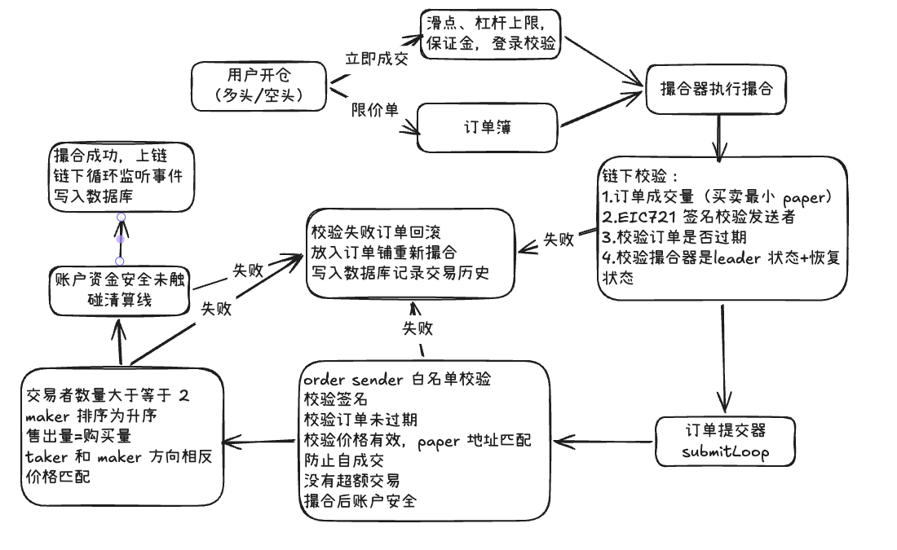
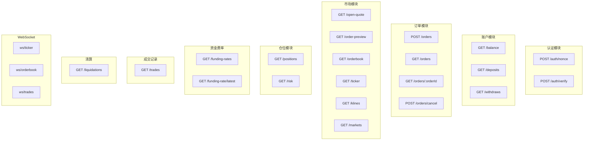
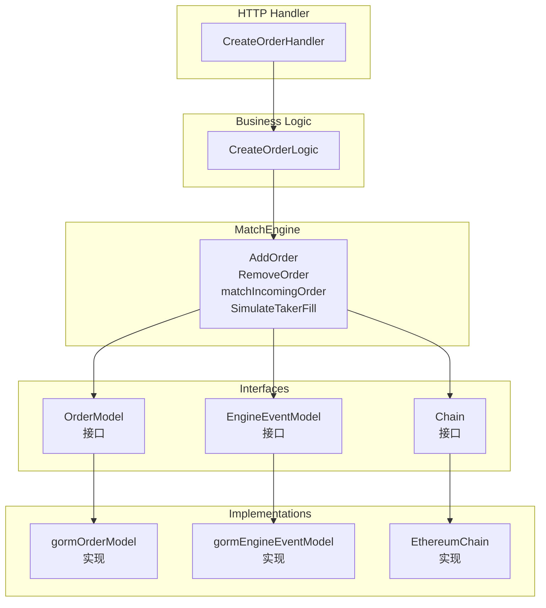

# 整体架构图

~~~mermaid

flowchart TB
    subgraph Client["客户端层"]
        User[用户前端]
        API[REST API网关]
    end

    subgraph Core["核心撮合引擎"]
        MatchEngine[MatchEngine<br/>撮合引擎]
        OrderBook[OrderBook<br/>内存订单簿]
        EventQueue[eventQueue<br/>事件通道 8192缓冲]
        LeaderElection[Leader选举<br/>Redis分布式锁]
    end

    subgraph Storage["存储层"]
        PostgreSQL[(PostgreSQL<br/>订单/事件/成交)]
        Redis[(Redis<br/>Leader锁)]
        Chain[Blockchain<br/>链上结算]
    end

    subgraph Background["后台任务"]
        EventLoop[eventLoop<br/>事件循环]
        MatchLoop[match<br/>定时撮合]
        SubmitLoop[submitLoop<br/>链上提交]
        PruneExpired[pruneExpired<br/>过期清理]
    end

    User -->|1. 提交订单| API
    API -->|2. AddOrder| MatchEngine
    MatchEngine -->|3. appendOrderEvent| PostgreSQL
    MatchEngine -->|4. enqueueLocalEvent| EventQueue
    EventQueue -->|5. consumeEngineEvent| EventLoop
    EventLoop -->|6. match| MatchLoop
    MatchLoop -->|7. insertResting| OrderBook
    OrderBook -->|8. 成交| MatchEngine
    MatchEngine -->|9. queuePendingTrade| SubmitLoop
    SubmitLoop -->|10. BuildMatchTradeData| Chain
    MatchEngine -->|11. Leader选举| Redis
    MatchEngine -->|12. RestorePendingOrders| PostgreSQL


~~~

## 架构讲解

本项目为永续合约撮合系统，采取链上验证，链下撮合的架构，这种架构好处是将撮合交易放到链下，可以极大的节省 gas 费，可以吞吐大量订单。链上部分只负责校验撮合结果，链上的各个 节点都已看到交易数据，符合 dex 设计理念。不好的地方在，链下撮合过程不透明。

## 架构模块介绍

**客户端层 ：**

用户前端、API、网关：用户发起的请求api，经过网关，实现和永续合约的交互

handler：注册api接口

auth：用户登录鉴权

**数据拉取层：**

puller：定时从数据中的持久化撮合表中拉取数据

事件通道：将相应事件放入对应通道

**核心撮合引擎：**

svc：撮合引擎运行的环境上下文

订单簿：记录市场数据，撮合交易的数据来源，恢复系统数据来源，记录市场深度快照

engine：撮合器，执行撮合，和模拟撮合结果

**数据存储层：**

postgreSql：持久化数据库，存储订单时间成交量

redis：缓存数据库，缓存用户登录令牌，K 线数据，主节点锁

**链上交互层：**

chain：负责调用链上合约相关代码

websoket：定时获取链上 ticker 信息

listener：监听制定的链上事件信息

funding：获取和更新链上的资金费率情况

**市场数据层：**

market：展示市场 K 线数据

## 系统启动和重启

启动和重启的过程格式一样的，具体的步骤如下：

1. 加载配置项
2. 设置上下文信息ctx，并 new 一个新的上下文，
3. new 一个新的有效的 client 获取和链上合约交互句柄，并验证该句柄对接的合约地址与链和本地设置的合约地址和链是一致的
4. 启动链上监听模块，监听链上质押信息，指数价信息（并同时开启 K 线）
5. 给 ctx 设置指数价
6. 初始化一个撮合引擎，并将撮合引擎赋值给 ctx 的撮合器和订单簿
7. 注册路由的 websoket
8. 启动撮合引擎（分为单机模式和多机模式，如果是重启，则需要恢复订单簿**（恢复逻辑见单机模式和多机模式撮合）**。如果是新系统启动，则创建空订单簿）
9. 启动清算机器人
10. 启动资金费率维护程序

# 撮合

## 撮合总流程图

~~~mermaid
sequenceDiagram
    participant User as 用户
    participant API as REST API
    participant Engine as MatchEngine
    participant Queue as eventQueue
    participant DB as PostgreSQL
    participant Book as OrderBook
    participant Chain as Blockchain

    rect rgb(240, 248, 255)
        Note over User,Chain: 订单提交流程
        User->>API: POST /orders
        API->>Engine: AddOrder(order)
        Engine->>Engine: appendOrderEvent()
        Engine->>DB: INSERT engine_events
        Engine->>Queue: enqueueLocalEvent(ev)
    end

    rect rgb(255, 250, 240)
        Note over User,Chain: 事件循环处理 (eventLoop)
        loop pollTicker (100ms)
            Queue-->>Engine: <-eventQueue
            Engine->>Engine: consumeEngineEvent()
            Engine->>Engine: applyEngineEvent(ev)
            alt order_accepted
                Engine->>Book: matchIncomingOrder()
                Book-->>Engine: 撮合结果
            end
        end
    end

    rect rgb(240, 255, 240)
        Note over User,Chain: 定时撮合 (matchTicker)
        loop matchTicker (1s)
            Engine->>Engine: match()
            Engine->>Book: matchOrderBook()
            Book-->>Engine: 交叉撮合
        end
    end

    rect rgb(255, 240, 245)
        Note over User,Chain: 链上提交 (submitTicker)
        loop submitTicker (1s)
            Engine->>Engine: submitTrades()
            Engine->>Chain: BuildMatchTradeData()
            Chain-->>Engine: txHash
            Engine->>DB: UPDATE order status
        end
    end
~~~


## 单机模式撮合

单机模式启动撮合引擎的逻辑：

1. 如果redis 配置为 nil，表示单机模式
   1. 将本节点设置为主节点
   2. 恢复主节点的状态
      1. 检查是否为主节点
      2. 设置当前最大号位 0
      3. 如果事件列表不为 nil
         1. 获取当前ctx 中的最大区块号，如果可以获取成功，则将获取到的值赋值为当前最大区块号变量
      4. 清空缓存
      5. 从数据库中拉取Pending 订单
      6. 回放已经提交到链上但是还没有确认的订单
      7. 设置最大区块号
      8. 标记主节点恢复成功
2. 开启事件循环协程
3. 开启提交事件循环协程

## 多节点模式撮合

多节点模式启动撮合引擎逻辑：

1. 如果redis 配置不为 nil，表示多机模式
   1. 开启抢主节点协程
      1. 设置定时器
      2. 进入 for 循环
         1. 检查是否有停止信号
         2. 如果当前环境中没有主节点
            1. 尝试成为主节点
               1. 如果 redis 配置为 nil，标记存在主节点，主节点未恢复
               2. 查主节点是否存在
               3. 不存在则 return
               4. 存在则标记主节点存在，主节点状态未恢复
               5. 恢复主节点状态
                  1. 检查是否为主节点
                  2. 设置当前最大号位 0
                  3. 如果事件列表不为 nil
                     1. 获取当前ctx 中的最大区块号，如果可以获取成功，则将获取到的值赋值为当前最大区块号变量
                  4. 清空缓存
                  5. 从数据库中拉取Pending 订单
                  6. 回放已经提交到链上但是还没有确认的订单
                  7. 设置最大区块号
                  8. 标记主节点恢复成功
         3. 否则，尝试给主节点续租
            1. 如果续租失败设置无主节点
         4. 检查是否有停止信号，或定时器定时传入的信号
2. 开启事件循环
3. 开启提交事件循环

抢主和续租前面的检查是为了防止，系统停止信号发出时，后面续租和抢主正要进行。

抢主和续租后面的检查为了续租和抢主执行后，重新循环执行  这个不太对

## 事件循环协程

事件循环协程为，订单交易信息流转的通道，运行逻辑为：

1. 注册定时puller 定时器，和 match 定时器
2. 进入for 循环
   1. 如果有结束信号，则 return
   2. 如果有交易事件传入
      1. 如果是主节点且主节点是恢复状态
         1. 如果 WAL 表存在则，获取最大事件号，从表中拉取最大事件号后指定量的数据，并消费该事件
         2. 否则，直接消费该事件
         3. 执行撮合
   3. puller 定时器被触发
      1. 如果是主节点且主节点是恢复状态
         1. 拉取事件并消费
         2. 执行撮合
   4. match 定时器被触发
      1. 如果是主节点且主节点是恢复状态
         1. 执行撮合

## 提交循环协程

将本地撮合好的交易事件结果列表，提交到链上，并等待链上响应，验证数据，写入数据库，具体的执行流程为：

1. 注册定时器
2. 进入 for 循环
   1. 触发上下文停止信号，return
   2. 定时器被触发
      1. 如果是主节点且主节点为恢复状态
         1. 执行提交撮合结果
            1. 加锁
               1. 判断是否待提交列表长度为 0，如果是直接 return
               2. 如果不是，将pendingTrades 值拷贝给一个新的变量，清空列表
            2. 解锁
         2. 初始化一个规定大小的待上链列表
            1. 循环吧值拷贝的内容添加到待上链列表
               1. 如果大小超过或者等于限制，则执行上链，并等待结果，验证数据，写入数据库
               2. 如果循环结束，大小都没有超过限制，而且待上传列表长度大于 0，也执行上传操作

## 订单消费

~~~mermaid
stateDiagram-v2
    direction LR
    [*] --> Pending: 用户提交订单（内存入簿）
    Pending --> PartialFill: 内存撮合，部分成交
    Pending --> Filled: 内存撮合，一次性全部成交
    Pending --> Cancelled: 用户撤单 / 订单过期

    PartialFill --> PartialFill: 后续继续撮合，又成交一部分
    PartialFill --> Filled: 剩余余量全部撮合完成
    PartialFill --> Cancelled: 用户撤单（剩余部分取消）

    Filled --> Settled: 成交送入submitBatch，链上交易成功
    Filled --> Rollback: 链上结算失败，触发回滚

    Rollback --> Pending: 数量回写回订单簿，重新变为待成交挂单
    Rollback --> Cancelled: 回滚后订单不再保留

    Settled --> [*]: 订单终态，结算完成
    Cancelled --> [*]: 订单终态，已取消

    note right of Pending: 订单已入订单簿\n尚未成交 / 等待对手盘\nStatus = 0
    note right of PartialFill: 已有部分成交\n还有剩余余量挂在盘口\nStatus = 1
    note right of Filled: 内存撮合全部完成\n等待链上结算（临时状态）\nStatus = 2
    note right of Settled: 链上交易成功、收据Status=1\n写入trade表，MatchSettled事件\n真正终态
    note right of Rollback: 链上revert / 提交失败\n执行rollbackMatch，余量归还订单簿\n产生MatchRollback事件
    note right of Cancelled: 主动撤单 / 超时过期\n从订单簿移除余量\nStatus = 3
~~~


撮合流程从订单生命周期开始到结束，这个过程中执行撮合的只能是主节点且主节点已恢复状态，注意所有事件消费的流程都会在 WAL 表中重新生成一条记录，后续撮合器按照记录回放执行，具体流程如下：

1. 获取事件，执行消费
   1. 判断交易事件是否为 nil 或者当前事件号<=最大事件号
      1. 如果是则 return（在本系统中只会按照事件号往后消费）
   2. 使用引擎判断该事件目前所在状态
      1. 如果是 accept 状态：
         1. 将交易事件数据解压
         2. 判断交易中有没有订单，没有 return 并打印报错日志
         3. 计算订单中Paper 的绝对值并赋值给remain
         4. 如果payload.Remain 还有值，用该值赋值给remain
         5. 调用matchIncomingOrder方法，并执行（入参为，订单和 remain）
            1. 判断订单 nil 或待匹配的值 为 nil 或待匹配的值小于等于0 或订单过期，return
            2. 获得或者创建一个订单簿
            3. 加锁，并注册一个 defer 解锁
            4. 从订单簿中查订单是否存在，是则 return
            5. 清理订单簿中过期的订单
            6. 循环吃对手簿中的余量（调用nextMatchableMakerLocked），如果还有剩余则挂入订单簿（调用insertRestingLocked）
      2. 如果是撤销状态：
         1. 调用执行撤单操作（入参 ，orderId）
            1. 加锁
            2. 只拷贝订单簿
            3. 解锁
            4. 从订单簿中按照订单 id 找到该订单并删除
      3. 如果是回滚状态
         1. 将交易事件中的数据解压，如果解压报错为 nil，则 return
         2. 判断该交易的剩余额度是否为 10 的倍数，得到matchAmt
            1. 如果不是 10 的倍数，或者matchAmt<=0，return
         3. 执行回滚操作（入参为，订单和matchAmt）
            1. 获取或创建订单簿
            2. 加锁，并注册 defer 解锁
            3. 遍历订单中的 taker 单和 maker 单，确认他们是否在订单簿中，（订单状态变为 rollback）
               1. 如果不在，重新插入
               2. 如果在增加matchAmt
      4. return nil
   3. 重新设置最大处理事件号 seqid

## 订单撮合

~~~mermaid
flowchart TB
    subgraph Enter["新订单进入"]
        A[AddOrder]
        B[写入orders表<br/>写入engine_events]
    end

    subgraph Match1["matchIncomingOrder"]
        C[计算Taker价格]
        D{订单簿中有对手盘?}
        E[nextMatchableMakerLocked<br/>遍历所有档位找最优]
    end

    subgraph Found["有对手盘"]
        F[撮合成功]
        G{还有剩余?}
        H[挂入订单簿<br/>等待下次撮合]
        I[完全成交<br/>不挂入订单簿]
    end

    subgraph Match2["matchOrderBook（定时）"]
        J[bestCrossPairLocked<br/>找最优买卖交叉]
        K{存在交叉?}
        L[撮合交叉对]
    end

    subgraph NoMatch["无对手盘"]
        M[挂入订单簿<br/>等待被其他Taker吃掉]
    end

    A --> B
    B --> C
    C --> D
    D -->|是| E
    D -->|否| M
    E --> F
    F --> G
    G -->|是| H
    G -->|否| I
    H --> L
    J --> K
    K -->|是| L
    K -->|否| Stop[结束]
~~~


本项目中WAL 表只有一个，所以撮合时需要遍历所有的订单簿，进行撮合，撮合逻辑为：

1. 加锁
2. 注册defer ，解锁
3. 遍历所有的订单簿，分别执行撮合

### 撮合逻辑

#### 撮合订单簿上的挂单

本项目中撮合逻辑为买一卖一有交叉则执行（找最优买单和卖单时一定比较双方地址不能出现自成交），订单簿上执行自撮合，撮合逻辑为：

1. 加锁
2. 注册 defer，解锁
3. for 循环
   1. 清理过期脏数据
   2. 获取有交叉的卖一单和买一单，如果获取不到，则 break，获取过程如下：
      1. 获取买一单和卖一单的 paper 量，并取最小值，如果最小值为 0，则 break
      2. 默认设置买树的订单为 taker，卖树的订单为 maker，成交价为卖树的订单价格
      3. 判断 买树单比卖树单更靠前，则 taker=卖树单，maker=买树单，成交价格为买树单的价格
      4. 加入 WAL表，如果添加失败打印报错日志，并 break
      5. 分别对买树和卖树执行深度和价格档位额加减操作

#### 撮合还未入订单簿的新单

执行流程为：

1. 判断订单 nil 或待匹配的值 为 nil 或待匹配的值小于等于0 或订单过期，return
2. 获得或者创建一个订单簿
3. 加锁，并注册一个 defer 解锁
4. 从订单簿中查订单是否存在，是则 return
5. 清理订单簿中过期的订单
6. 循环吃对手簿中的余量，如果还有剩余则挂入订单簿，吃单的过程如下：
   1. 通过调用matchIncomingOrder 方法调用**`nextMatchableMakerLocked`**方法
      1.  选择对手盘
      2. 如果对手盘为空，返回 return nil ，false
      3. 遍历对手盘所有档位
         1. 检查价格是否交叉
         2. 遍历档位内的订单（FIFO顺序）
         3. 跳过无效订单和自成交
         4. 返回最优可撮合的Maker订单

| 设计                 | 原因                                 |
| :------------------- | :----------------------------------- |
| **共用WAL表**        | 简化表结构，保证事件顺序全剧统一     |
| **事件包含perp字段** | 消费时可以路由到对应的orderBook      |
| **内存按perp隔离**   | 撮合只在同交易对内进行，不能跨交易对 |

这种设计在**单机多交易对**场景下非常高效，避免了多表管理。但要注意：

- ✅ **优点**：事件顺序清晰，便于重放和恢复
- ⚠️ **缺点**：高并发时 ListAfter 可能成为瓶颈（无perp索引优化）

## 挂单价

本项目中订单模式有两种，限价单和市价单：

用户构建订单时的流程为：

1. GET /open-quote → 参考价 P_ref（卖一/买一）
2. 用户选择滑点容忍度（如 0.5%）
3. 计算签名限价 P_limit = P_ref × (1 ± bps/10000)，开多为加，开空为减
4. 生成 EIP-712 签名订单（paper/credit 按 P_limit 构造） 
5. POST /orders → 撮合引擎

通过滑点方式模拟市价单 ，如果容忍度为 0，即为限价单

订单簿上的价格，即为计算出来的签名限价

## 用户模拟流程图

~~~mermaid
sequenceDiagram
    participant Client as 客户端
    participant API as REST API
    participant Engine as MatchEngine
    participant Queue as eventQueue
    participant DB as 数据库
    participant Book as OrderBook
    participant Chain as 区块链

    rect rgb(220, 220, 250)
        Note over Client, Chain: 场景1：用户提交订单并成交
        Client->>API: POST /orders {paperAmount, creditAmount}
        API->>Engine: AddOrder(order)
        
        Engine->>DB: INSERT orders (status=0)
        Engine->>DB: INSERT engine_events (order_accepted)
        
        alt 有eventModel (HA模式)
            Engine->>Queue: enqueueLocalEvent()
            Note over Queue: 非阻塞，队列满则日志警告
        else 无eventModel (单机模式)
            Engine->>Engine: matchIncomingOrder()
        end
        
        Engine-->>API: 订单已接收
        API-->>Client: 202 Accepted
        
        Note over Engine: 等待eventLoop处理
        Queue->>Engine: consumeEngineEvent()
        Engine->>Engine: applyEngineEvent()
        
        Engine->>Book: matchIncomingOrder()
        Book->>Book: 遍历对手盘
        Book->>Book: 价格交叉检查
        Book->>Book: 计算成交数量
        
        alt 有可成交对手
            Book->>Engine: 返回Maker订单
            Engine->>Engine: enqueueMatch()
            Engine->>DB: INSERT engine_events (match_enqueued)
            Engine->>Engine: applyFillLocked()
            
            Note over Engine: 定时任务触发
            Engine->>Engine: submitTrades()
            Engine->>Chain: Perpetual.trade()
            Chain-->>Engine: txReceipt
            
            Engine->>DB: UPDATE orders (status=2)
            Engine->>DB: INSERT engine_events (match_settled)
        else 无可成交对手
            Book->>Book: insertRestingLocked()
            Note over Book: 挂入订单簿等待
        end
    end

    rect rgb(255, 230, 230)
        Note over Client, Chain: 场景2：定时交叉撮合
        loop matchTicker (1秒)
            Engine->>Engine: match()
            Engine->>Book: matchOrderBook()
            
            Book->>Book: bestCrossPairLocked()
            Book->>Book: 找最优买卖交叉对
            
            alt 存在交叉
                Book->>Engine: 返回交叉对
                Engine->>Engine: enqueueMatch()
                Engine->>DB: INSERT engine_events
                Engine->>Engine: applyFillLocked()
            else 无交叉
                Book-->>Engine: 无交叉
            end
        end
    end

    rect rgb(230, 255, 230)
        Note over Client, Chain: 场景3：订单恢复
        Engine->>Engine: recoverLeaderState()
        Engine->>DB: SELECT MAX(id) FROM engine_events
        Engine->>DB: SELECT * FROM orders\nWHERE status IN (0,1)
        Engine->>Book: restoreOrder()
        Engine->>Book: insertRestingLocked()
        
        Engine->>DB: SELECT * FROM engine_events\nWHERE event_type='match_enqueued'
        Engine->>Engine: reserveRestoredMatch()
        Engine->>Engine: queuePendingTrade()
    end
~~~


# 订单簿

## 结构

本订单簿采取，链表+档位列表的模式，记录订单 簿上的数据。

本项目中FIFO 比较先后的方式插入，返回值为插入数据的指针，所以无论是删除列表中的订单还是在entries 删除订单都可以通过指针实现O（1）删除

订单簿在运行过程中，每一次写入执行都需要加锁，保证同时只有一笔交易写

~~~go
// OrderBook 价档 + FIFO 队列订单簿（买单价高优先，卖单价低优先，同价时间优先）。
type OrderBook struct {
	Perp    string
	bids    *bookSide
	asks    *bookSide
	entries map[string]*bookEntry
	mu      sync.RWMutex
}

type bookEntry struct {
	order  *model.Order
	remain *big.Int
	price  *big.Int
	side   *bookSide
	level  *priceLevel
	elem   *list.Element // 在 level.queue 中的位置  是该订单的指针
}

type bookSide struct {
	isBuy  bool
	book   *OrderBook
	levels map[string]*priceLevel // priceKey -> level
	head   *priceLevel            // 最优价档（买=最高价，卖=最低价）
}

type priceLevel struct {
	priceKey string
	price    *big.Int
	totalRem *big.Int
	queue    *list.List // FIFO: 元素为 *bookEntry
	prev     *priceLevel
	next     *priceLevel
}
~~~

## 买卖链表增删的逻辑

卖链表：撮合引擎作为第三方根据卖方的期望成交价排序，价格越低表示卖方越想快速成交，所以卖树 谁价格低谁在前

买链表：撮合引擎作为第三方根据买方的期望成交价排序，价格越高表示买方越想快速成交，所以买树 谁价格高谁在前

链表的实现逻辑：

1. 判断投档是否为空，如果是则把待比较的lvl位设置为头档，return
2. 如果头档不为空，比较lvl 和头档的大小，取最优的为头档，并设置头档和第二档的前后节点指针的指针值，return
3. 将头档设置为当前档位
4. 循环，比较当前档位和lvl 哪一个更优，找到lvl 的最佳位置（如果是买树**lvlPrev价格 >lvl 价格>lvlNext价格**，如果是卖树**lvlPrev价格 <lvl 价格<lvlNext价格**），当前档位不行则比较下一个档位
5. 设置lvl的 Prev 指针为lvlPrev和 Next 指针为lvlNext，lvlPrev 的Next 指针lvl，lvlNext 的 Prev 指针lvl
6. 删除档位时，根据 key 在档位树上执行删除操作
7. 如果删除档位为 head 档位，需要把headNext 设置为 head，新的headPrev 不为 nil 则设置为 nil，
8. 如果不是 head 档，只需要遍历找到该档位，删除该档位，并设置lvlPrev 的Next 指针为lvlNext，lvlNext 的 Prev 指针为lvlPrev

## 每个档位下入队和出队的逻辑

队列中按 FIFO 的顺序排列，在同等价位中比较，放在比它优先级高的后面，优先级低的前面，并且会返回该添加元素的指针位置。

基于上面的逻辑，每个档位下队列的增删改逻辑为：

入队：

1. 按照价格获得档位，
2. 判断该档位是否存在
   1. 不存在则新增档位，并插入该 lvl
   2. 否则执行入队，并把该订单的剩余容量，加到档位的容量记录中

执行入队：

1. 遍历当前档位链表，找到第一个【比当前entry更新】的订单
2. 如果当前entry时间更早，插到 existing 的前面 ，break
3. 循环走完没找到插入点：说明当前entry是最新的，放队尾
4. 把链表节点指针存回 bookEntry.elem，用于后续O(1)删除

出队：

1. 空防护entry == nil || entry.level == nil || entry.elem == nil 如果这三个任意满足一个，return
2. 获取 该价格档位的**汇总剩余总量**（这个档位所有订单数量之和）
3. 减去当前这条订单的剩余量 `entry.remain`
4. 防止负数（异常数据保护，账面不能为负），小于 0 就置 0
5. 利用之前保存的 `elem *list.Element` 指针，**O (1) 从双向链表删除该订单节点**，不需要遍历
6. 清理 entry 上的引用：`elem`、`level` 置 nil，标记这条 entry 已经脱离盘口，防止后续误操作。
7. 判断当前档位的订单队列是否已经空了，是则执行删档位

## FIFO 比较逻辑

FIFO 比较逻辑根据一下三个数据大小来比较：

1. 按照创建时间来判断，谁创建时间早，谁靠前
2. 如果同时创建，则按照订单order. id 来判断，谁订单order. id 小谁靠前
3. 如果 order.id 是一样的，则按照order.OrderId来判断，谁小谁在前

# 快照保存

订单簿定期设置定时器，定期保存快照，并将快照保存到持久化数据库中

# k 线数据

启动监听币安交易所接口时，启动

RecordSpotIndexPrice 将现货指数价写入各周期 K 线

EnsureHistoricalKlines 若库内 K 线不足则从 Binance 回填。

# 订单上链逻辑

submitBatch 批量提交待结算撮合记录上链

对每笔撮合：编码 tradeData → 调用合约Perpetual.trade → 等待区块收据；链上成功才更新订单业务库、追加match_settled 等 WAL事件

执行逻辑：

1. 基础依赖检查：订单业务model、成交记录model为空，无法持久化成交结果，检查成立，所有这批待结算撮合全部回滚，恢复内存订单簿
2. 循环处理批次内每一笔撮合记录（单条串行等待上链，不是并发）
   1. 解析本次撮合数量，字符串转大数
   2. 链客户端不存在，无法上链结算，直接回滚
   3. 二次校验：Taker或者Maker订单已经过期，不再上链，执行回滚（防止撮合完成后、提交上链前订单过期）
   4. 组装合约入参：构造撮合交易数据
   5. 构造标的合约地址，发送撮合交易到链上Perpetual合约
   6. 阻塞等待交易打包上链，获取区块收据
   7. 收据状态校验：交易revert（合约执行失败），回滚
   8. 更新订单业务表：更新Taker、Maker订单的已成交数量、订单状态（Filled/PartialFill）
   9. 追加 WAL 事件 match_settled：标记这笔撮合已经结清（追加新记录，不改match_enqueued）
   10. 向trade业务表插入成交记录（对外展示成交、历史成交查询）


# 链上订单校验逻辑



校验顺序：

1. 解码交易数据，获取订单列表、签名、成交数量
2. 校验是否为执行的撮合器发送的这笔提交
3. 循环校验该笔提交中每个交易信息的数据
   1. 校验交易的签名是否为本人或者执行的操作者签名（支持 EOA 签名和合约签名 EIP-1271）
   2. 校验订单是否在有效期内（订单过期时间>=当前区块时间）
   3. 订单必须属于当前调用的永续合约
   4. paper 和 credit 必须异号（买单：paper>0, credit<0；卖单：paper<0, credit>0）
   5. 防止自成交（第一个订单的签名者不能与后续订单相同）
   6. 更新订单已成交数量，检查是否超额成交
   7. 执行订单撮合，计算各方变化
      1. 基本验证和交易者去重 ：去重后的交易者数量（至少2个：1个 Taker + 1个 Maker），Taker 成交量必须等于所有 Maker 成交量之和
      2. 计算余额变化：遍历所有 Maker 订单，使用 Maker 价格计算成交金额，仓位序列号，用于前端盈亏计算，累加 Maker 的余额变化（扣除手续费），手续费归撮合引擎
      3. 基于 Taker 的 credit 变化计算手续费
   8. 收取手续费给订单发送者（撮合引擎）
   9. 如果订单发送者需要支付手续费（负数），检查其账户安全性
   10. 确保交易后每个交易者都是安全的


# 链上接口

### IDealer接口

~~~
/**
 * @title IDealer - 交易系统接口
 * @notice MetaNodeDealer 合约的接口定义
 * 
 * 功能分类：
 * 1. 资金管理：存款、取款、内部转账
 * 2. 交易核心：订单验证、结算
 * 3. 风险管理：安全检查、清算
 * 4. 信息查询：账户状态、市场参数
 */
interface IDealer {
    // ==================== 资金管理 ====================

    /**
     * @notice 存入保证金  使用场景：用户存入保证金
     * @param primaryAmount 主资产存款数量
     * @param secondaryAmount 次级资产存款数量
     * @param to 存入的目标账户地址
     * @dev 调用方需提前 approve 足够额度
     */
    function deposit(uint256 primaryAmount, uint256 secondaryAmount, address to) external;

    /**
     * @notice 请求取款（第一步） 使用场景：用户请求取款操作
     * @param from 取款来源账户
     * @param primaryAmount 主资产取款数量
     * @param secondaryAmount 次级资产取款数量
     * @dev 主要目的是避免因取款导致对手方交易失败
     *      取款请求需要等待时间锁后才能执行
     */
    function requestWithdraw(address from, uint256 primaryAmount, uint256 secondaryAmount) external;

    /**
     * @notice 执行取款（第二步） 使用场景：用户执行取款操作
     * @param from 取款来源账户
     * @param to 资金接收地址
     * @param isInternal 是否仅内部转账（不实际转出 ERC20）
     * @param param 回调参数，非空时会调用 to 地址
     */
    function executeWithdraw(address from, address to, bool isInternal, bytes memory param) external;

    /**
     * @notice 快速取款（一步完成） 使用场景：用户执行快速取款操作，前提用户在快速取款白名单内
     * @param from 取款来源账户
     * @param to 资金接收地址
     * @param primaryAmount 主资产数量
     * @param secondaryAmount 次级资产数量
     * @param isInternal 是否仅内部转账
     * @param param 回调参数
     * @dev 跳过时间锁直接取款，需要特殊权限
     */
    function fastWithdraw(
        address from,
        address to,
        uint256 primaryAmount,
        uint256 secondaryAmount,
        bool isInternal,
        bytes memory param
    )
        external;

    // ==================== 交易核心 ====================

    /**
     * @notice 批准交易（核心撮合函数） 使用场景：链上验证撮合交易是否可行
     * @param orderSender 订单发送者（撮合引擎）地址
     * @param tradeData 包含订单、签名和撮合信息的编码数据
     * @return traderList 参与交易的交易者列表
     * @return paperChangeList 各交易者的 paper 变化
     * @return creditChangeList 各交易者的 credit 变化
     * @dev 仅永续合约可调用此函数
     *      解析 tradeData，验证订单并返回各方余额变化
     */
    function approveTrade(
        address orderSender,
        bytes calldata tradeData
    )
        external
        returns (address[] memory traderList, int256[] memory paperChangeList, int256[] memory creditChangeList);

    // ==================== 风险管理 ====================

    /**
     * @notice 检查交易者是否安全（满足维持保证金）使用场景：每次执行撮合后，清算机器人寻找清算目标
     * @param trader 交易者地址
     * @return 是否安全（不会被清算）
     * @dev 如果不安全，该交易者所有市场的仓位都可能被清算
     */
    function isSafe(address trader) external view returns (bool);

    /**
     * @notice 批量检查交易者安全状态  使用场景：清算机器人寻找清算目标
     * @param traderList 交易者列表
     * @return 是否全部安全
     * @dev 通过缓存标记价格提高 gas 效率
     */
    function isAllSafe(address[] calldata traderList) external view returns (bool);

    /**
     * @notice 请求清算  使用场景：清算者发起清算请求申请清算执行，仅仅被清算交易者触发交易安全红线，清算者才可以以一定的仓位折扣接手仓位
     * @param executor 执行清算的地址
     * @param liquidator 清算者（接手仓位）
     * @param liquidatedTrader 被清算者
     * @param requestPaperAmount 请求清算的仓位数量
     *        正数表示清算多头仓位，负数表示清算空头仓位
     * @return liqtorPaperChange 清算者的 paper 变化
     * @return liqtorCreditChange 清算者的 credit 变化
     * @return liqedPaperChange 被清算者的 paper 变化
     * @return liqedCreditChange 被清算者的 credit 变化
     * @dev 仅永续合约可调用
     *      liqtor = liquidator, liqed = liquidated trader
     */
    function requestLiquidation(
        address executor,
        address liquidator,
        address liquidatedTrader,
        int256 requestPaperAmount
    )
        external
        returns (int256 liqtorPaperChange, int256 liqtorCreditChange, int256 liqedPaperChange, int256 liqedCreditChange);

    /**
     * @notice 处理坏账 使用场景：在被清算用户仓位为 0 且还有坏账存在，由保证金账户兜底
     * @param liquidatedTrader 被清算者地址
     * @dev 将所有坏账（包括主资产和次级资产）转移给保险账户
     */
    function handleBadDebt(address liquidatedTrader) external;

    // ==================== 仓位管理 ====================

    /**
     * @notice 注册开仓  使用场景：交易者在某个币对交易市场开仓
     * @param trader 交易者地址
     * @dev 仅永续合约可调用
     *      当交易者开仓时由 Perpetual 合约调用
     */
    function openPosition(address trader) external;

    /**
     * @notice 实现盈亏并移除仓位  使用场景：交易者在某个币对交易市场平仓实现盈亏
     * @param trader 交易者地址
     * @param pnl 盈亏金额
     * @dev 仅永续合约可调用
     *      当交易者平仓时由 Perpetual 合约调用
     */
    function realizePnl(address trader, int256 pnl) external;

    // ==================== 权限管理 ====================

    /**
     * @notice 设置操作员  使用场景：给子账户设置权限，可以设置的角色分为操作交易管理员（专门替用户签名交易，不能流转资金，常用语机器人或者子账户），资金管理员（专门管理资金流转，不能操作交易）
     * @param operator 操作员地址
     * @param isValid 是否授权
     * @dev 操作员可以代替用户签名订单
     */
    function setOperator(address operator, bool isValid) external;

    // ==================== 查询函数 ====================

    /**
     * @notice 获取永续合约的风险参数  使用场景：前端页面获取永续合约市场风险参数
     * @param perp 永续合约地址
     * @return params 风险参数结构体
     */
    function getRiskParams(address perp) external view returns (Types.RiskParams memory params);

    /**
     * @notice 获取所有已注册的永续合约市场  使用场景：前端页面获得该交易所已经注册的永续合约市场
     * @return 永续合约地址数组
     */
    function getAllRegisteredPerps() external view returns (address[] memory);

    /**
     * @notice 获取标记价格  使用场景：用户账户安全校验，资金费率，用户计算总盈亏，清算执行，都需要用到这个价格
     * @param perp 永续合约地址
     * @return 标记价格（1e18 精度）
     */
    function getMarkPrice(address perp) external view returns (uint256);

    /**
     * @notice 获取交易者的所有持仓市场  使用场景：用户获取自己在本交易所内都持有哪些仓位
     * @param trader 交易者地址
     * @return 持仓的永续合约地址数组
     */
    function getPositions(address trader) external view returns (address[] memory);

    /**
     * @notice 获取交易者的资金详情  使用场景：用户获取自己在该交易所，所有的资产情况
     * @param trader 交易者地址
     * @return primaryCredit 主资产余额
     * @return secondaryCredit 次级资产余额
     * @return pendingPrimaryWithdraw 待取款主资产
     * @return pendingSecondaryWithdraw 待取款次级资产
     * @return executionTimestamp 取款可执行时间
     * @dev 注意：不能直接将 credit 作为净值或保证金
     *      需要结合仓位价值一起计算
     */
    function getCreditOf(address trader)
        external
        view
        returns (
            int256 primaryCredit,
            uint256 secondaryCredit,
            uint256 pendingPrimaryWithdraw,
            uint256 pendingSecondaryWithdraw,
            uint256 executionTimestamp
        );

    /**
     * @notice 获取交易者的风险概况  使用场景：用户获取自己在交易所内持有的仓位和净资产以及所需要的初始保证金和维持保证金
     * @param trader 交易者地址
     * @return netValue 净值（包含 credit 和仓位价值）
     * @return exposure 敞口（所有市场仓位价值绝对值之和）
     * @return initialMargin 初始保证金要求
     * @return maintenanceMargin 维持保证金要求
     */
    function getTraderRisk(address trader)
        external
        view
        returns (int256 netValue, uint256 exposure, uint256 initialMargin, uint256 maintenanceMargin);

    /**
     * @notice 获取清算价格  使用场景：通过计算清算价格和现在的价格做比较，判断资金是否安全，
     * @param trader 交易者地址
     * @param perp 永续合约地址
     * @return liquidationPrice 清算价格，0 表示无清算价格
     * @dev 此函数用于参考，误差通常在 10 wei 以内
     */
    function getLiquidationPrice(address trader, address perp) external view returns (uint256 liquidationPrice);

    /**
     * @notice 预览清算成本  使用场景：被清算者在执行清算请求前预览结果，计算自己的paper 和 credit 变化
     * @param perp 永续合约地址
     * @param liquidatedTrader 被清算者
     * @param requestPaperAmount 请求清算数量
     * @return liqtorPaperChange 清算者的 paper 变化
     * @return liqtorCreditChange 清算者的 credit 变化
     * @dev 清算者可用此函数提前计算需要支付的金额
     */
    function getLiquidationCost(
        address perp,
        address liquidatedTrader,
        int256 requestPaperAmount
    )
        external
        view
        returns (int256 liqtorPaperChange, int256 liqtorCreditChange);

    /**
     * @notice 获取订单已成交数量  使用场景：获取某用户已经成交的量，订单校验总成交量不允许超过订单总量
     * @param orderHash 订单哈希
     * @return filledAmount 已成交的 paper 数量
     * @dev 用于避免重复撮合
     */
    function getOrderFilledAmount(bytes32 orderHash) external view returns (uint256 filledAmount);

    /**
     * @notice 获取资金费率  使用场景：链下计算新的资金费率调用此接口获取旧资金费率
     * @param perp 永续合约地址
     * @return 资金费率（1e18 精度）
     */
    function getFundingRate(address perp) external view returns (int256);

    /**
     * @notice 批量更新资金费率  使用场景：链下定期执行批量更新资金费率
     * @param perpList 永续合约地址列表
     * @param rateList 资金费率列表
     * @dev 仅资金费率更新者可调用
     */
    function updateFundingRate(address[] calldata perpList, int256[] calldata rateList) external;

    // ==================== 权限检查 ====================

    /**
     * @notice 检查订单发送者是否有效  使用场景：判断订单发送者是否为撮合地址
     * @param orderSender 订单发送者地址
     * @return 是否为有效的订单发送者
     */
    function isOrderSenderValid(address orderSender) external view returns (bool);

    /**
     * @notice 检查快速取款操作员是否有效  使用场景：在用户执行快速取款前校验
     * @param fastWithdrawOperator 操作员地址
     * @return 是否有效
     */
    function isFastWithdrawalValid(address fastWithdrawOperator) external view returns (bool);

    /**
     * @notice 检查操作员是否有效  使用场景：批转交易时判断该订单发起者是否为用户本身或者是用户授权的交易者
     * @param client 用户地址
     * @param operator 操作员地址
     * @return 操作员是否被授权
     */
    function isOperatorValid(address client, address operator) external view returns (bool);

    /**
     * @notice 查询资金操作授权额度  使用场景：资金流转时，判断用的子资金管理员是否有足够的主次资产额度
     * @param from 授权者
     * @param spender 被授权者
     * @return primaryCreditAllowed 主资产授权额度
     * @return secondaryCreditAllowed 次级资产授权额度
     */
    function isCreditAllowed(
        address from,
        address spender
    )
        external
        view
        returns (uint256 primaryCreditAllowed, uint256 secondaryCreditAllowed);
}

~~~

### IPerpetual 接口

~~~

/**
 * @title IPerpetual - 永续合约接口
 * @notice Perpetual 合约的接口定义
 * 
 * 永续合约是单个交易市场（如 BTC-PERP）的核心合约
 * 负责记录交易者的仓位和处理交易/清算
 * 
 * 核心概念：
 * - paper: 仓位数量（正=多头，负=空头）
 * - credit: 资金量，与 paper 配合计算盈亏
 */
interface IPerpetual {
    /**
     * @notice 查询交易者的仓位余额  使用场景：计算用户敞口等数据时会用到这个接口，同时也为前端页面提供对应的数据
     * @param trader 交易者地址
     * @return paper 仓位数量
     *         正数表示多头，负数表示空头
     * @return credit 资金量
     *         不直接反映仓位方向或入场价格
     *         仅用于计算风险比率和净值
     */
    function balanceOf(address trader) external view returns (int256 paper, int256 credit);

    /**
     * @notice 执行交易  使用场景：链下将撮合结果发送到链上，链上执行交易撮合验证
     * @param tradeData 编码的交易数据
     * @dev 交易数据会转发给 Dealer 合约进行验证和撮合
     *      然后 Perpetual 合约执行结算
     */
    function trade(bytes calldata tradeData) external;

    /**
     * @notice 清算仓位  使用场景：提交清算申请时调用这个接口
     * @param liquidator 清算者地址
     * @param liquidatedTrader 被清算者地址
     * @param requestPaper 请求清算的仓位数量
     *        正数表示清算多头，负数表示清算空头
     * @param expectCredit 期望的 credit 变化（价格保护）
     *        清算多头时期望收到的金额，清算空头时期望支付的金额
     * @return liqtorPaperChange 清算者最终的 paper 变化
     * @return liqtorCreditChange 清算者最终的 credit 变化
     * 
     * @dev 清算是公开的，任何人都可以清算不安全的仓位
     *      清算可能不会执行或部分执行，原因包括：
     *      1. 其他人先提交了清算请求
     *      2. 交易者及时补充了保证金
     *      3. 标记价格变化超出了价格保护范围
     * 
     *      清算数量会被限制在实际仓位大小内
     *      例如：仓位剩余 10 ETH，请求清算 15 ETH，只会执行 10 ETH
     */
    function liquidate(
        address liquidator,
        address liquidatedTrader,
        int256 requestPaper,
        int256 expectCredit
    )
        external
        returns (int256 liqtorPaperChange, int256 liqtorCreditChange);

    /**
     * @notice 获取当前资金费率  使用场景：链下获取当亲的资金费率
     * @return 资金费率（1e18 精度，累计值）
     * @dev 资金费率是累计值，其变化量才是实际的费率
     *      正费率：多头支付给空头
     *      负费率：空头支付给多头
     */
    function getFundingRate() external view returns (int256);

    /**
     * @notice 更新资金费率  使用场景：批量更新资金费率
     * @param newFundingRate 新的资金费率
     * @dev 仅 owner（Dealer 合约）可调用
     */
    function updateFundingRate(int256 newFundingRate) external;
}

~~~

### IChainlink 接口

~~~
/**
 * @title IChainlink - Chainlink 预言机接口
 * @notice 定义与 Chainlink 价格预言机交互的接口
 * 
 * Chainlink 是最广泛使用的去中心化预言机网络
 * 提供可靠的链下数据到链上的传输
 * 
 * @dev 完整接口参见 Chainlink 官方文档
 *      https://docs.chain.link/data-feeds/price-feeds
 */
interface IChainlink {
    /**
     * @notice 获取最新一轮的价格数据  使用场景：获取新的编辑价格
     * @return roundId 当前轮次 ID
     * @return answer 价格（需要根据 decimals 调整精度）
     * @return startedAt 本轮开始时间戳
     * @return updatedAt 最后更新时间戳
     * @return answeredInRound 回答所在的轮次
     * 
     * @dev 使用注意事项：
     *      1. 检查 updatedAt 确保数据新鲜度
     *      2. 检查 answer > 0 确保价格有效
     *      3. 考虑不同预言机有不同的 decimals
     */
    function latestRoundData()
        external
        view
        returns (uint80 roundId, int256 answer, uint256 startedAt, uint256 updatedAt, uint80 answeredInRound);
}

~~~

# 链下接口

用户想要了解这个项目中前后端交互的API接口，需要列出所有接口并标注代码位置。让我搜索一下API路由定义和handler。


找到了routes.go文件，让我读取完整内容获取所有接口列表

现在我已经获取了完整的路由列表。让我整理一下所有接口，并添加WebSocket接口。


## 后端 API 接口完整列表

### 一、路由注册入口

**文件位置**：[routes.go](file:///Users/Ssl80443/contract/perpetual-contract/others/backend/internal/handler/routes.go#L21-L199)

---

### 二、接口分类表

#### 1. 认证相关 `/api/v1`

| 方法 | 路径           | 功能       | Handler 文件            | 代码行 |
| ---- | -------------- | ---------- | ----------------------- | ------ |
| POST | `/auth/nonce`  | 获取随机数 | `auth/noncehandler.go`  | L13    |
| POST | `/auth/verify` | 验证签名   | `auth/verifyhandler.go` | L13    |

#### 2. 账户相关 `/api/v1`

| 方法 | 路径         | 功能         | Handler 文件                      | 代码行 |
| ---- | ------------ | ------------ | --------------------------------- | ------ |
| GET  | `/balance`   | 查询账户余额 | `account/getbalancehandler.go`    | L13    |
| GET  | `/deposits`  | 查询存款记录 | `account/listdepositshandler.go`  | L13    |
| GET  | `/withdraws` | 查询取款记录 | `account/listwithdrawshandler.go` | -      |

#### 3. 资金费率相关 `/api/v1`

| 方法 | 路径                   | 功能                       | Handler 文件                             | 代码行 |
| ---- | ---------------------- | -------------------------- | ---------------------------------------- | ------ |
| GET  | `/funding-rates`       | 获取资金费率历史           | `funding/listfundingrateshandler.go`     | L13    |
| GET  | `/funding-rate/latest` | 当前资金费率与下期结算时间 | `funding/getlatestfundingratehandler.go` | L13    |

#### 4. 清算相关 `/api/v1`

| 方法 | 路径            | 功能         | Handler 文件                             | 代码行 |
| ---- | --------------- | ------------ | ---------------------------------------- | ------ |
| GET  | `/liquidations` | 获取清算记录 | `liquidation/listliquidationshandler.go` | L13    |

#### 5. 市场数据相关 `/api/v1`

| 方法 | 路径                | 功能                    | Handler 文件                       | 代码行 |
| ---- | ------------------- | ----------------------- | ---------------------------------- | ------ |
| GET  | `/klines`           | 获取K线数据             | `market/getklineshandler.go`       | L13    |
| GET  | `/markets`          | 获取所有市场            | `market/listmarketshandler.go`     | L13    |
| GET  | `/markets/:address` | 获取市场详情            | `market/getmarkethandler.go`       | L13    |
| GET  | `/open-quote`       | 开仓参考价（卖一/买一） | `market/getopenquotehandler.go`    | L13    |
| GET  | `/order-preview`    | 下单前滑点/深度模拟     | `market/getorderpreviewhandler.go` | L13    |
| GET  | `/orderbook`        | 获取订单簿深度          | `market/getorderbookhandler.go`    | L13    |
| GET  | `/ticker`           | 获取行情                | `market/gettickerhandler.go`       | L13    |

#### 6. 订单相关 `/api/v1`

| 方法 | 路径               | 功能         | Handler 文件                  | 代码行 |
| ---- | ------------------ | ------------ | ----------------------------- | ------ |
| POST | `/orders`          | 创建订单     | `order/createorderhandler.go` | L13    |
| GET  | `/orders`          | 查询订单列表 | `order/listordershandler.go`  | L13    |
| GET  | `/orders/:orderId` | 查询单个订单 | `order/getorderhandler.go`    | L13    |
| POST | `/orders/cancel`   | 取消订单     | `order/cancelorderhandler.go` | L13    |

#### 7. 仓位相关 `/api/v1`

| 方法 | 路径         | 功能         | Handler 文件                      | 代码行 |
| ---- | ------------ | ------------ | --------------------------------- | ------ |
| GET  | `/positions` | 查询用户仓位 | `position/getpositionshandler.go` | L13    |
| GET  | `/risk`      | 查询风险信息 | `position/getriskinfohandler.go`  | L13    |

#### 8. 成交记录相关 `/api/v1`

| 方法 | 路径      | 功能         | Handler 文件                 | 代码行 |
| ---- | --------- | ------------ | ---------------------------- | ------ |
| GET  | `/trades` | 查询成交记录 | `trade/listtradeshandler.go` | L13    |

#### 9. WebSocket 相关

| 方法 | 路径                   | 功能                   | Handler 文件             | 代码行 |
| ---- | ---------------------- | ---------------------- | ------------------------ | ------ |
| GET  | `/api/v1/ws/ticker`    | 实时推送行情（ticker） | `market/ws_ticker.go`    | L24-28 |
| GET  | `/api/v1/ws/orderbook` | 实时推送订单簿变化     | `market/ws_orderbook.go` | -      |
| GET  | `/api/v1/ws/trades`    | 实时推送成交记录       | `market/ws_trades.go`    | -      |

---

### 三、接口调用关系图



---

### 四、关键接口详解

#### 1. 创建订单 `POST /api/v1/orders`

```go
// handler/order/createorderhandler.go L13
func CreateOrderHandler(svcCtx *svc.ServiceContext) http.HandlerFunc {
    return func(w http.ResponseWriter, r *http.Request) {
        var req types.CreateOrderReq
        httpx.Parse(r, &req)
        // → CreateOrderLogic.CreateOrder()
    }
}

// logic/order/createorderlogic.go L89
// 1. 验证订单签名
// 2. 写入 orders 表 (Status=Pending)
// 3. 调用 MatchEngine.AddOrder()
// 4. 写入 engine_events 表 (order_accepted)
```

#### 2. 订单簿 `GET /api/v1/orderbook`

```go
// handler/market/getorderbookhandler.go
// → GetOrderBookLogic.GetOrderBook()
// → MatchEngine.SnapshotOrderBook()
// 返回: bids/asks 档位聚合数据
```

#### 3. 开仓参考价 `GET /api/v1/open-quote`

```go
// handler/market/getopenquotehandler.go
// 做多 → 返回卖一价格
// 做空 → 返回买一价格
// 用于前端计算滑点保护
```

#### 4. 深度模拟 `GET /api/v1/order-preview`

```go
// handler/market/getorderpreviewhandler.go
// → GetOrderPreviewLogic.GetOrderPreview()
// → MatchEngine.SimulateTakerFill()
// 返回: 预估成交量、均价、最差成交价
```

---

### 五、接口总览表

| 分类      | 接口数 | 路径前缀          |
| --------- | ------ | ----------------- |
| 认证      | 2      | `/api/v1/auth/`   |
| 账户      | 3      | `/api/v1/`        |
| 订单      | 4      | `/api/v1/orders`  |
| 市场      | 7      | `/api/v1/`        |
| 仓位      | 2      | `/api/v1/`        |
| 资金费率  | 2      | `/api/v1/funding` |
| 成交记录  | 1      | `/api/v1/trades`  |
| 清算      | 1      | `/api/v1/`        |
| WebSocket | 3      | `/api/v1/ws/`     |
| **合计**  | **27** |                   |

# 后端实现接口类

## 项目接口实现一览

### 一、svc 上下文中包含的接口

```go
package svc

import (
	"fmt"
	"strings"

	"metanode/internal/chain"
	"metanode/internal/config"
	"metanode/internal/db"
	"metanode/internal/model"

	"github.com/zeromicro/go-zero/core/stores/redis"
	"github.com/zeromicro/go-zero/core/stores/sqlx"
	"gorm.io/driver/postgres"
	"gorm.io/gorm"
)

// MatchBookSink 订单入 memory book（由 internal/engine.MatchEngine 实现）。
type MatchBookSink interface {
	AddOrder(order *model.Order) error
	RemoveOrder(orderID string) bool
}

// OrderBookLevel 内存订单簿档位快照。
type OrderBookLevel struct {
	Price  string
	Amount string
}

// OrderBookSource 撮合引擎订单簿快照（由 MatchEngine 实现）。
type OrderBookSource interface {
	SnapshotOrderBook(perp string, limit int) (bids, asks []OrderBookLevel)
	// MidMarkPrice 双边为 mid，单边为最优买一或卖一；空簿 ok=false。
	MidMarkPrice(perp string) (price string, ok bool)
}

// IndexPriceSource 现货指数价（CompositeSpotIndex 4:3:3 或 CoinbaseFeed）。
type IndexPriceSource interface {
	IndexPrice1e6(perp string) (price string, ok bool)
	IndexPriceDisplay(perp string) (price string, ok bool)
}

// ServiceContext 服务上下文
type ServiceContext struct {
	Config config.Config

	// 数据库连接
	DB sqlx.SqlConn

	// PG Supabase / Postgres（GORM）；未配置 DataSource 时为 nil。
	PG *gorm.DB

	// Redis 连接
	Redis *redis.Redis

	// 数据模型
	OrderModel         model.OrderModel
	TradeModel         model.TradeModel
	PositionModel      model.PositionModel
	DepositModel       model.DepositModel
	WithdrawModel      model.WithdrawModel
	FundingRateModel   model.FundingRateModel
	LiquidationModel   model.LiquidationModel
	MarketModel        model.MarketModel
	KlineModel         model.KlineModel
	LedgerBalanceModel model.LedgerBalanceModel
	MarketQuoteModel   model.MarketQuoteModel
	SpotKlineModel     model.SpotKlineModel
	EngineEventModel   model.EngineEventModel

	// Chain 为 nil 时：无 RPC，链上查询接口返回空或零；撮合仍可记库但不会发交易。
	Chain *chain.Client
	// MatchEngine 在 main 中创建并赋值，供 CreateOrder 入簿。
	MatchEngine MatchBookSink
	// OrderBook 在 main 中与 MatchEngine 同一实例，供深度 API 读取。
	OrderBook OrderBookSource
	// IndexPrice Coinbase 指数价（可选）。
	IndexPrice IndexPriceSource
}

```

**MatchEngine 本身不是通过 Go 接口实现的**，而是通过以下方式提供服务：

| 提供服务的方式          | 说明                                                     |
| ----------------------- | -------------------------------------------------------- |
| **直接方法调用**        | `MatchEngine.AddOrder()`, `MatchEngine.RemoveOrder()` 等 |
| **ServiceContext 注入** | 在 `svc.ServiceContext` 中持有 `*MatchEngine` 引用       |
| **HTTP Handler 调用**   | Handler → Logic → MatchEngine.方法                       |

---

### 二、项目中的接口定义

#### 1. 订单模型接口

```go
// internal/model/order.go
type OrderModel interface {
    FindOne(ctx context.Context, orderId string) (*Order, error)
    Insert(ctx context.Context, order *Order) (int64, error)
    UpdateStatus(ctx context.Context, orderId string, status int, filledAmount string) error
    FindPendingOrders(ctx context.Context, perp string, limit int) ([]*Order, error)
    List(ctx context.Context, signer string, perp string, status *int, limit, offset int) ([]*Order, error)
    ListAll(ctx context.Context, signer string, perp string, status *int) ([]*Order, error)
}

// internal/model/pgstore.go 实现
type gormOrderModel struct {
    db *gorm.DB
}

func (m *gormOrderModel) FindOne(...) (*Order, error) { ... }
func (m *gormOrderModel) Insert(...) (int64, error) { ... }
func (m *gormOrderModel) UpdateStatus(...) error { ... }
```

#### 2. 事件模型接口

```go
// internal/model/engineevent.go
type EngineEventModel interface {
    Insert(ctx context.Context, ev *EngineEvent) (*EngineEvent, error)
    ListAfter(ctx context.Context, seq int64, limit int) ([]*EngineEvent, error)
    GetMaxSeq(ctx context.Context) (int64, error)
}

// internal/model/pgstore.go 实现
type gormEngineEventModel struct {
    db *gorm.DB
}
```

#### 3. 链上交互接口

```go
// internal/chain/chain.go
type Chain interface {
    SubmitPerpTrade(ctx context.Context, perp string, data []byte) (*types.Transaction, error)
    WaitMined(ctx context.Context, tx *types.Transaction) (*types.Receipt, error)
    IsOrderExpired(ctx context.Context, perp string, order *model.Order) (bool, error)
    GetTraderPosition(ctx context.Context, perp, trader string) (*TraderPosition, error)
    GetPerpPubKey(ctx context.Context, perp string) ([]byte, error)
    IsValidOrderSender(ctx context.Context, perp, sender string) (bool, error)
}

// internal/chain/ethereum.go 实现
type EthereumChain struct {
    client *ethclient.Client
}
```

#### 4. 成交模拟接口

```go
// internal/engine/fillsim.go
type FillSimulator interface {
    SimulateTakerFill(perp string, takerIsBuy bool, sizePaper, limitPrice *big.Int, skipSigner string) FillSimulation
}

// MatchEngine 实现了这个接口
func (e *MatchEngine) SimulateTakerFill(...) FillSimulation { ... }
```

#### 5.取现/仓位/质押/费率/市场 /K 线/清算接口

~~~go
type WithdrawModel interface {
	Insert(ctx context.Context, withdraw *Withdraw) (sql.Result, error)
	FindByTrader(ctx context.Context, trader string, page, pageSize int) ([]*Withdraw, int64, error)
}

type PositionModel interface {
	FindByTrader(ctx context.Context, trader string) ([]*Position, error)
	Upsert(ctx context.Context, position *Position) error
}

type DepositModel interface {
	Insert(ctx context.Context, deposit *Deposit) (sql.Result, error)
	FindByTrader(ctx context.Context, trader string, page, pageSize int) ([]*Deposit, int64, error)
	FindByTxHashAndLogIndex(ctx context.Context, txHash string, logIndex uint) (*Deposit, error)
	MaxBlockNumber(ctx context.Context) (uint64, error)
}

type FundingRateModel interface {
	Insert(ctx context.Context, rate *FundingRate) (sql.Result, error)
	FindByPerp(ctx context.Context, perp string, page, pageSize int) ([]*FundingRate, int64, error)
	GetLatest(ctx context.Context, perp string) (*FundingRate, error)
}

type LiquidationModel interface {
	Insert(ctx context.Context, liq *Liquidation) (sql.Result, error)
	Find(ctx context.Context, trader, perp string, page, pageSize int) ([]*Liquidation, int64, error)
}

type MarketModel interface {
	FindAll(ctx context.Context) ([]*Market, error)
	FindByAddress(ctx context.Context, address string) (*Market, error)
	Upsert(ctx context.Context, market *Market) error
}

type KlineModel interface {
	Upsert(ctx context.Context, kline *Kline) error
	Find(ctx context.Context, perp, interval string, startTime, endTime time.Time, limit int) ([]*Kline, error)
}
~~~


---

### 三、接口实现汇总表

| 接口名             | 定义位置               | 实现位置                | 方法数 |
| ------------------ | ---------------------- | ----------------------- | ------ |
| `OrderModel`       | `model/order.go`       | `model/pgstore.go`      | 7      |
| `EngineEventModel` | `model/engineevent.go` | `model/pgstore.go`      | 3      |
| `Chain`            | `chain/chain.go`       | `chain/ethereum.go`     | 5+     |
| `FillSimulator`    | `engine/fillsim.go`    | `engine/matchengine.go` | 1      |

---

### 四、依赖注入结构

```go
// internal/svc/servicecontext.go
type ServiceContext struct {
    OrderModel       model.OrderModel       // 订单存储
    EngineEventModel model.EngineEventModel // 事件存储
    Chain            chain.Chain            // 链上交互
    MatchEngine      *engine.MatchEngine    // 撮合引擎
    // ...
}

func NewServiceContext(c *config.Config) *ServiceContext {
    return &ServiceContext{
        OrderModel:       model.NewGormOrderModel(),
        EngineEventModel: model.NewGormEngineEventModel(),
        Chain:            chain.NewEthereumChain(),
        MatchEngine:      engine.NewMatchEngine(...),
    }
}
```

---

### 五、调用链



---

### 六、关键接口方法列表

#### OrderModel 接口

```go
// internal/model/order.go
type OrderModel interface {
    FindOne(ctx context.Context, orderId string) (*Order, error)           // 按ID查询
    Insert(ctx context.Context, order *Order) (int64, error)               // 插入订单
    UpdateStatus(ctx context.Context, orderId string, status int, filledAmount string) error  // 更新状态
    FindPendingOrders(ctx context.Context, perp string, limit int) ([]*Order, error)  // 查询待处理订单
    List(ctx context.Context, signer string, perp string, status *int, limit, offset int) ([]*Order, error)  // 列表查询
    ListAll(ctx context.Context, signer string, perp string, status *int) ([]*Order, error)  // 全量查询
    ListByPerp(ctx context.Context, perp string, limit int) ([]*Order, error)  // 按交易对查询
}
```

#### EngineEventModel 接口

```go
// internal/model/engineevent.go
type EngineEventModel interface {
    Insert(ctx context.Context, ev *EngineEvent) (*EngineEvent, error)           // 插入事件
    ListAfter(ctx context.Context, seq int64, limit int) ([]*EngineEvent, error) // 按序号拉取
    GetMaxSeq(ctx context.Context) (int64, error)                                // 获取最大序号
}
```

#### Chain 接口

```go
// internal/chain/chain.go
type Chain interface {
    SubmitPerpTrade(ctx context.Context, perp string, data []byte) (*types.Transaction, error)  // 提交链上交易
    WaitMined(ctx context.Context, tx *types.Transaction) (*types.Receipt, error)               // 等待链上确认
    IsOrderExpired(ctx context.Context, perp string, order *model.Order) (bool, error)          // 检查订单过期
    GetTraderPosition(ctx context.Context, perp, trader string) (*TraderPosition, error)        // 查询仓位
    GetPerpPubKey(ctx context.Context, perp string) ([]byte, error)                             // 获取合约公钥
    IsValidOrderSender(ctx context.Context, perp, sender string) (bool, error)                  // 验证订单发送者
}
```

