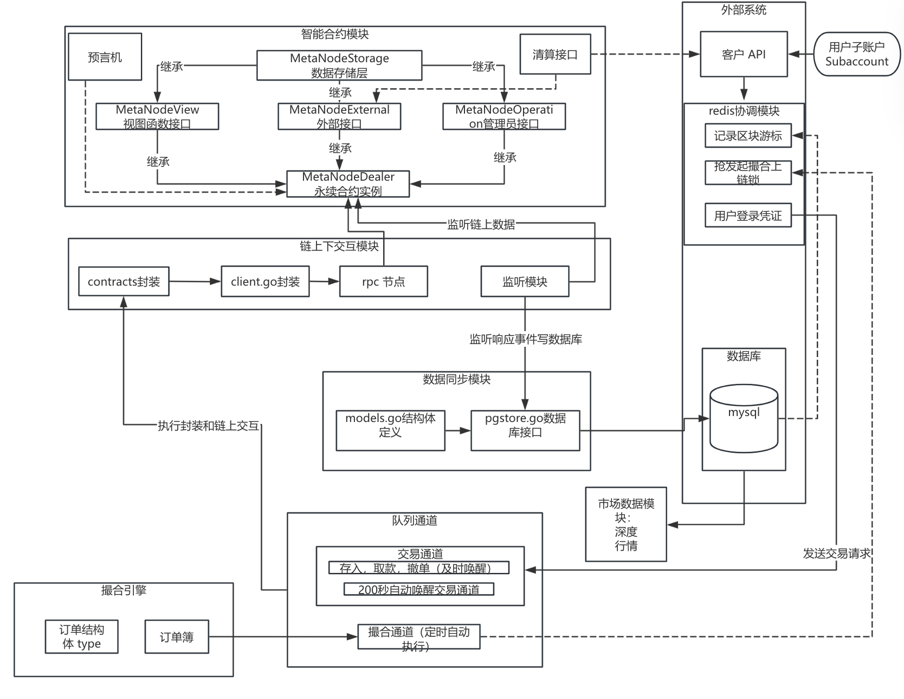
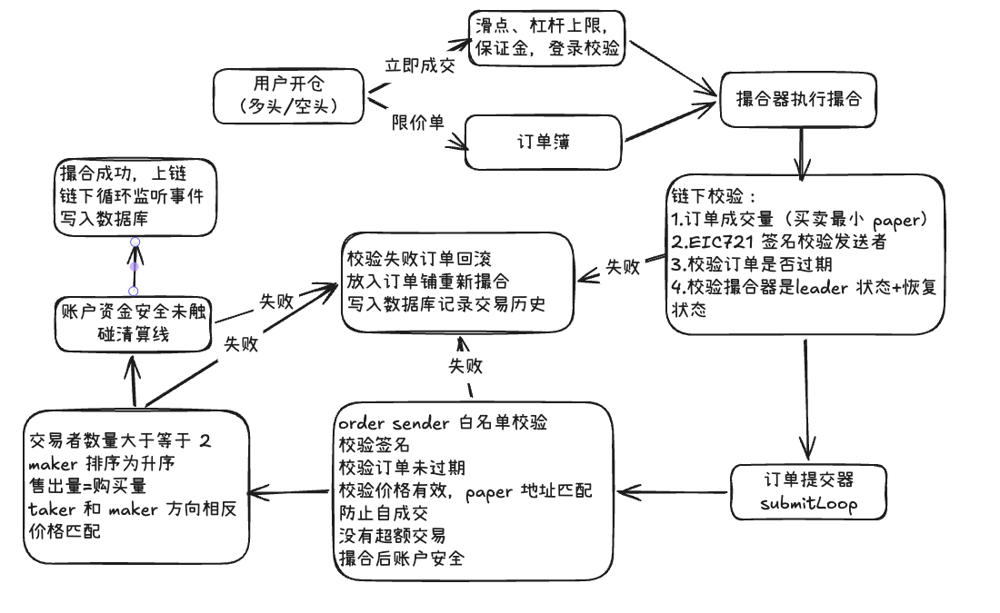
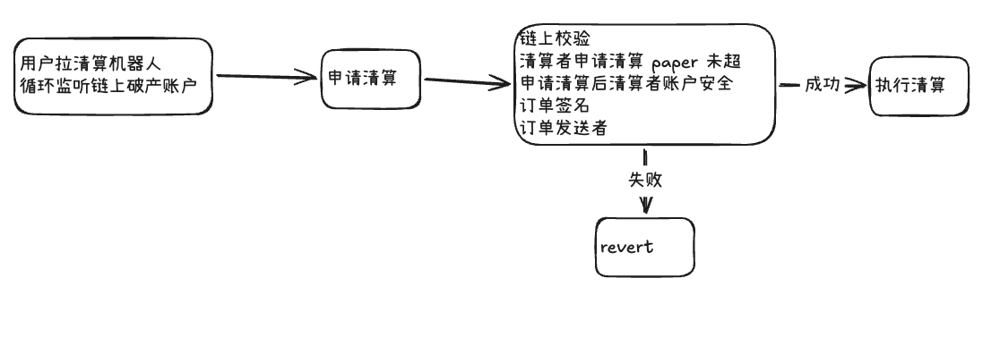
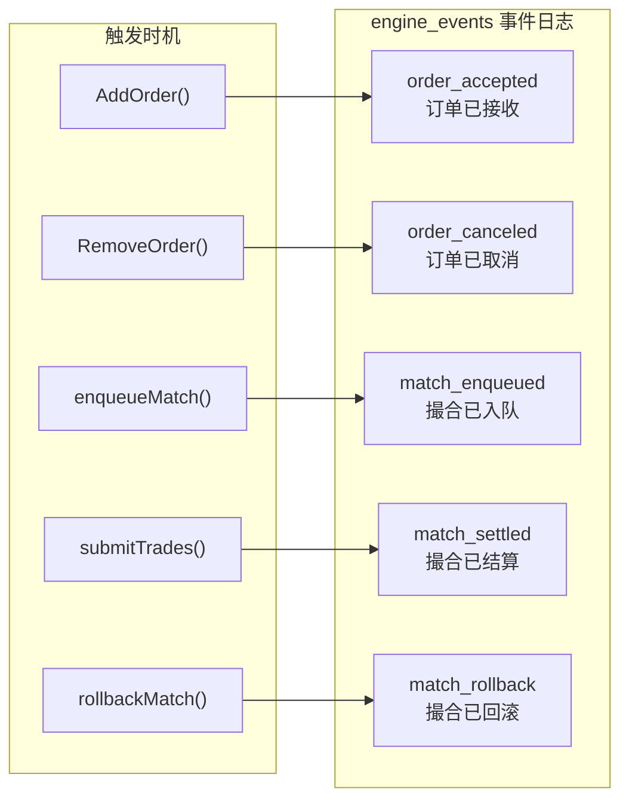

# 永续合约-项目拆解文档

## 整体流程图




~~~mermaid

flowchart TB
    subgraph Client["客户端层"]
        User[用户前端]
        API[REST API网关]
    end

    subgraph Core["核心撮合引擎"]
        MatchEngine[MatchEngine<br/>撮合引擎]
        OrderBook[OrderBook<br/>内存订单簿]
        EventQueue[eventQueue<br/>事件通道 8192缓冲]
        LeaderElection[Leader选举<br/>Redis分布式锁]
    end

    subgraph Storage["存储层"]
        PostgreSQL[(PostgreSQL<br/>订单/事件/成交)]
        Redis[(Redis<br/>Leader锁)]
        Chain[Blockchain<br/>链上结算]
    end

    subgraph Background["后台任务"]
        EventLoop[eventLoop<br/>事件循环]
        MatchLoop[match<br/>定时撮合]
        SubmitLoop[submitLoop<br/>链上提交]
        PruneExpired[pruneExpired<br/>过期清理]
    end

    User -->|1. 提交订单| API
    API -->|2. AddOrder| MatchEngine
    MatchEngine -->|3. appendOrderEvent| PostgreSQL
    MatchEngine -->|4. enqueueLocalEvent| EventQueue
    EventQueue -->|5. consumeEngineEvent| EventLoop
    EventLoop -->|6. match| MatchLoop
    MatchLoop -->|7. insertResting| OrderBook
    OrderBook -->|8. 成交| MatchEngine
    MatchEngine -->|9. queuePendingTrade| SubmitLoop
    SubmitLoop -->|10. BuildMatchTradeData| Chain
    MatchEngine -->|11. Leader选举| Redis
    MatchEngine -->|12. RestorePendingOrders| PostgreSQL


~~~

系统启动流程：

1. 启动配置项，启动日志
2. 初始化上下文，并在上下文中初始化数据库，获得数据库操作句柄
3. 初始化 client，给上下文配置上和链上交互的句柄
4. 启动监听器，监听链上事件，同时获得监听币安等交易所成交价信息，作为指数价
5. 将监听到的指数价做加权平均给上下文
6. 配置撮合器，
7. 注册路由，注册TickerWebSocket
8. 根据市场列表，启动撮合器
9. 启动清算机器人
10. 启动资金费率自动更新

系统运行流程：

1. 用户通过api，经过网关
2. 提交订单，
3. 后端校验订单的格式是否正确，时间是否有效
4. 校验通过，则将其插入到 engine_events 列表中，并通知 puller 有新的交易进来
5. puller 接收到信号后，立刻从 trade 列表中按照订单 id 号，批量拉取订单，并执行撮合
6. 如果长时间puller 没有收到新订单来的信号，会在定时器触发的时候拉取新的订单，执行撮合
7. 撮合成功后，将撮合好的订单加入上链交易列表中
8. 如果待上链交易达到了，预定的容量，则执行上链操作，如果未达到则在指定时间长度内且有订单不管订单量是否达标，都执行一次推送
9. 发送上链交易前，首先预估一下本次上链大概花费多少 gas 费
10. 实际发送链上交易，等到结果返回
11. 链上交易返回成功，拿到回执，根据回执去取对应的数据
12. 写入链下的数据库中


## 核心模块详解

### 1.链上合约层

链上拍卖场主入口：统一部署拍卖场，永续合约的顶层入口

链上数据存储：存储state 相关的市场数据，风险参数，用户开仓数据，资产记录

链上视图函数：获得链上相关数据，市场、账户、风险参数、权限信息

链上外部操作函数：用户通过外部调用进行相关操作，比如开仓、取款、清算等

链上系统管理函数：市场管理（注册和设置风险参数），系统配置（保险账户，时间锁，最大仓位），权限管理（订单发送者，取款白名单），资金费率（更改各市场资金费率）

### 2.链上子账户

通过SubaccountFactory 创建子账户，并对不同子账户设置不同的权限

例如对子账户 A 设置为交易操作员，子账户 B 设置为资金管理员

用户通过对 子账户 A 和 B 操作合约市场交易

一个交易管理员同时在多个永续合约市场开仓，在全仓模式中，有一个爆仓所有的账户都会收到影响，触发清算，影响收益。通过使用子账户可以实现仓位隔离，减少某个市场爆仓对全账户的影响

### 3.链上预言机

本项目采用四种预言机：

ConstOracle：自定义预言机，通常在测试环境中使用

EmergencyOracle：应急预言机，当市场波动剧烈，混合预言机失效时使用，仅管理员可使用

OracleAdaptor：Chainlink 和自定义双重模式，（例如：借贷、现货 、NFT 市场）普通订单簿主流使用 chainlink，可以获取实时价格比较稳定，有心跳检查，支持自定义价格保护

PythOracleAdaptor：chainlink 和 pyth 混合模式，通过计算偏差和阈值之间的关系判断使用哪个，永续、衍生品、新公链的高额交易使用较多

计算公式为：｜chainlinkPrice-pythPrice｜/chainlinkPrice<=阈值使用chainlinkPrice，否则使用pythPrice，如果pyth不能用则用另一个chainlink

**为什么各个场景用不同的预言机  ？**

单一的预言机不能适用所有的应用场景，没有一个预言机可以完美覆盖各种需求

**为什么使用 chainlink 预言机不使用撮合成交价成为爆仓依据  ？**

 chainlink 有心跳保护机制，间隔每小时会自动检查价格，防止价格过期，chainlink 是实际可查的清算合约会可以随时查到这个价格，不受某一个永续市场合约的影响（全场的 BTC 价格都在涨，本操作市场流动性没有办法实现单币砸穿），chainlink 由数百个节点组成插针攻击成本极高

使用撮合价交易，容易被插针（用户用少量的资金砸盘，拉爆对方仓位，再把价格拉回来，特别是低流动性合约更容易受影响）

流动性黑洞，如果使用撮合价作为爆仓依据，假设撮合价不断降低，清算情况会越来越多

撮合价是链下的，计算清算价是链上的，链上没有办法主动调取链下的数据

延迟不一致，撮合引擎有自己的节奏，而清算需要确实性可实时查询的价格

难以跨市场对冲，做市商 DEX 和 CEX 对冲的时候需要公认的外部基准价，来判断自己的净口

**为什么要基差调整？**

因为纯外部的价格有时候也是有问题的

### 4.链上下数据监听交互

链下通过监听链上固定的事件比如交易事件，获取交易信息，更新链下数据库中信息

链下调用链上的方法，发起撮合，更新 资金费率，执行清算等

断点续传、事件处理幂等、**区块重组的处理**，如何保证链上下数据一致

### 5.Supabase 数据存储层

记录整个永续合约，用户信息，市场交易，K 线数据

数据存储层中 WAL 记录表，会记录所有用户提交的操作日志

订单存储结构，订单状态，数据恢复

### 6.redis 数据协调层

记录最大区块号，扫链，同步数据，这个值来自数据存储层中交易记录的最大区块号

用户执行登录nonce 值的存储，用户登录时 nonce 值会缓存在 redis 中，过期作废

交易所：撮合引擎通过远程命令抢锁，谁抢到，谁能提交撮合交易

### 7.链下通道调用层

本项目通过 go 自带的通道协程实现消息队列的消费

通道 1：当用户执行存款或撤单、提现操作时，立刻唤醒链下执行器执行

通道 2：每间隔 200 毫秒拉取 WAL 中事件按顺序执行

通道 3：每分钟自动执行链下撮合并发送交易，谁拿锁谁撮合谁发送

### 8.链下撮合

采取 FIFO 模式，双向撮合

情况 1：买单或者卖单立即成交，直接撮合，不进订单簿

情况 2：出现限价单，有匹配的订单马上撮合，没有匹配的订单进订单簿

订单簿采取一价一档的方式，每个价位为一当（O1），每档按照时间先后排列 （On）

### 9.数据处理层

使用 构建和数据库统一的数据模型，调用预先写好的 sql 语句，实现和数据库交互

## 重点业务逻辑

### 用户充值

Dealer Deposit ：直接充值，用户付手续费，基于链上信任，充值后直接到链上

 Treasury Transfer：托管充值，用户将资金放到第三方账户上，链下通过代码定时扫链，将资金充值到链上

手续费不需要用户支付，如果第三方账户接受抵押物充值可以方便用户操作  （ 面试时不用讲）直接链上 unitswap

不好的地方是容易遭受信任危机，这个账户是第三方账户有一定的资金丢失风险

### 用户模拟交易

市价单



### 取款操作

取款必须满足这个条件Solid IM Safe: IM Safe + (netValue - secondaryCredit >= 0)  可以取主资产

等待时间多久  等待逻辑    怕挤兑   


### 清算模块



保证金：

敞口=｜paper｜*市场价

初始保证金=敞口*初始保证金率

维持保证金=敞口*维持保证金率

 MM Safe: 净产>=维持保证金不会触发清算，反之触发清算

IM Safe: 净产>=初始保证金可以开新仓，反之不可以

Solid IM Safe: IM Safe + (netValue - secondaryCredit >= 0)  可以取主资产

多头清算价=其他市场维持保证金总额-其他市场净资产-用户抵押资金/paper（1-市场价*维持保证金率）

空头清算价=其他市场维持保证金总额-其他市场净资产-用户抵押资金/paper（1+市场价*维持保证金率）

清算折扣：

多头：市场价（1-清算折扣率），空头：市场价（1+清算折扣率）

清算流程：

用户 A 申请清算用户 B ：1paper多头，假设市场价为 100，清算折扣率为 1%

用户 A 付出 100（1-1%）=99，得到1paper 空头

用户 B 付出 1paper给用户 A，执行清算费计算，假设清算费为 1%，此时用户 B 收到 99（1-1%）=98.01

假设用户 B 当初开多头 1paper 价位是 101，

此时用户 B 剩余资产为 98.01-101=-2.99

如果用户是在逐仓模式下，此时已经没有 paper可清算，触发保底操作，保证金账户将剩余欠款抹平

如果用户是在全仓模式下，此时系统会继续执行清算，直到用户账面资产可以覆盖维持保证金，如果清算完所有仓位还有负债，则保证金账户负责兜底，抹平债务

### 预言机模块

#### 链下资金费率

链下资金费率=（现货价-指数价）/指数价/3，比较和设置好的最大费率与最小费率，如果超过最大费率或者低于最小费率，则用指定的最大或者最小费率

指数价=（CoinbaseProduct\*4+BinanceSymbol\*3+OkxInstId\*3）\10

现货价从链上的预言机拉取

#### 链上预言机

ConstOracle - 固定价格预言机  测试使用

EmergencyOracle - 应急预言机  应急使用

OracleAdaptor - Chainlink 预言机适配器   chainlink 和自定义预言机   适合小币种使用

PythOracleAdaptor - Pyth + Chainlink 混合预言机适配器  链上使用

 Pyth + Chainlink 到底选哪个？

计算 ｜Pyth - Chainlink ｜/Chainlink 如果这个值小于指定的阈值，那么选 chainlink 否则选 Pyth，如果 Pyth 不可用则用Chainlink

### 用户信息

用户总资产=   +=paper\*marketPrice\*资金费率 +reduceCreditAmount

exposure          +=  |paperAmount × price|    

initialMargin     +=  |paperAmount × price| × initialMarginRatio    

maintenanceMargin +=  |paperAmount × price| × liquidationThreshold

### reids数据协调层

主要负责记录缓存数据：

用户的登录凭证

当前扫到的最大区块号

维护撮合引擎锁

### 子账户模式

用户可以通过SubaccountFactory 生成合约级子账户，该账户没有私钥不能执行签名

用户可使用子账户实现资金隔离。通过给不同的子账户设置交易订单的操作，

交易管理子账户：签订单、设权限、清算

资金管理子账户：在项目内部转移资金，提现、入金等

### 全仓和逐仓

| 项目       | 全仓 Cross                                 | 逐仓 Isolated                            |
| ---------- | ------------------------------------------ | ---------------------------------------- |
| 保证金来源 | 同交易对全部余额                           | 开仓单独划拨，隔离资金                   |
| 风险范围   | 一个仓位亏损，吃光同交易对所有资金         | 仅损失分配给本仓的保证金，其余资金安全   |
| 清算距离   | 更远，不容易爆仓                           | 更近，更容易触发清算                     |
| 适用人群   | 趋势交易者，长线持有，愿意承担整体账户风险 | 短线、量化、多仓位，严格限制单笔最大亏损 |

## 订单

### 订单流转

~~~mermaid
stateDiagram-v2
    direction LR
    [*] --> Pending: 用户提交订单（内存入簿）
    Pending --> PartialFill: 内存撮合，部分成交
    Pending --> Filled: 内存撮合，一次性全部成交
    Pending --> Cancelled: 用户撤单 / 订单过期

    PartialFill --> PartialFill: 后续继续撮合，又成交一部分
    PartialFill --> Filled: 剩余余量全部撮合完成
    PartialFill --> Cancelled: 用户撤单（剩余部分取消）

    Filled --> Settled: 成交送入submitBatch，链上交易成功
    Filled --> Rollback: 链上结算失败，触发回滚

    Rollback --> Pending: 数量回写回订单簿，重新变为待成交挂单
    Rollback --> Cancelled: 回滚后订单不再保留

    Settled --> [*]: 订单终态，结算完成
    Cancelled --> [*]: 订单终态，已取消

    note right of Pending: 订单已入订单簿\n尚未成交 / 等待对手盘\nStatus = 0
    note right of PartialFill: 已有部分成交\n还有剩余余量挂在盘口\nStatus = 1
    note right of Filled: 内存撮合全部完成\n等待链上结算（临时状态）\nStatus = 2
    note right of Settled: 链上交易成功、收据Status=1\n写入trade表，MatchSettled事件\n真正终态
    note right of Rollback: 链上revert / 提交失败\n执行rollbackMatch，余量归还订单簿\n产生MatchRollback事件
    note right of Cancelled: 主动撤单 / 超时过期\n从订单簿移除余量\nStatus = 3
~~~


~~~mermaid
flowchart TD
    Start([用户提交订单])

    subgraph Submit["订单提交流程"]
        A1[验证签名]
        A2[写入数据库\nStatus=Pending]
        A3[生成order_accepted事件]
        A4[进入事件队列]
    end

    subgraph Match["撮合处理"]
        B1[作为Taker吃对手簿]
        B2{是否有成交?}
        B3[按Maker价成交]
        B4[更新FilledAmount]
        B5[剩余挂簿\nStatus=PartialFill]
        B6[完全成交\nStatus=Filled]
    end

    subgraph Cancel["取消流程"]
        C1{主动撤单?}
        C2{订单过期?}
        C3[Status=Cancelled]
    end

    subgraph Settle["链上结算"]
        D1[submitLoop批量提交]
        D2[Perpetual.trade]
        D3[链上确认]
        D4[更新DB状态]
    end

    Start --> A1
    A1 --> A2
    A2 --> A3
    A3 --> A4
    A4 --> Route{事件分支}

    Route -->|撮合流转| B1
    Route -->|收到撤单指令| C1

    B1 --> B2
    B2 -->|是| B3
    B2 -->|否| B5
    B3 --> B4
    B4 --> B2
    B5 -->|仍有剩余| B1
    B5 -->|无剩余| B6

    B6 --> D1
    D1 --> D2
    D2 --> D3
    D3 --> D4

    C1 -->|是| C3
    C1 -->|否| C2
    C2 -->|是| C3
    C2 -->|否| B1

    C3 --> D4
~~~


~~~mermaid
flowchart TB
    subgraph Producer["事件生产者"]
        P1[AddOrder\n订单接收]
        P2[RemoveOrder\n订单取消]
        P3[matchAgainstRestingLocked\n撮合生成]
        P4[submitBatch\n链上结算]
        P5[rollbackMatch\n回滚]
    end

    subgraph EventTypes["事件类型"]
        E1["order_accepted\n订单已接收"]
        E2["order_canceled\n订单已取消"]
        E3["match_enqueued\n撮合已入队"]
        E4["match_settled\n撮合已结算"]
        E5["match_rollback\n撮合已回滚"]
    end

    subgraph Channel["事件通道"]
        Queue[(eventQueue\nchan\nbuffer: 8192)]
    end

    subgraph Consumer["事件消费者"]
        C1[eventLoop\n主事件循环]
        C2[pollEngineEvents\n轮询数据库]
        C3[consumeEngineEvent\n消费事件]
        C4[applyEngineEvent\n应用事件]
    end

    subgraph Actions["执行动作"]
        A1[matchIncomingOrder\n撮合订单]
        A2[removeOrderInMemory\n内存删除]
        A3[enqueueMatch\n入队撮合]
        A4[applyFillStatus\n更新成交状态]
        A5[rollbackMatch\n回滚撮合]
    end

    P1 -->|appendOrderEvent| E1
    P2 -->|appendSimpleEvent| E2
    P3 -->|appendMatchEvent| E3
    P4 -->|appendMatchEvent| E4
    P5 -->|appendMatchEvent| E5

    E1 --> Queue
    E2 --> Queue
    E3 --> Queue
    E4 --> Queue
    E5 --> Queue

    Queue -->|<-eventQueue| C1
    C1 --> C3
    C3 --> C4
    
    C4 -->|order_accepted| A1
    C4 -->|order_canceled| A2
    C4 -->|match_enqueued| A3
    C4 -->|match_settled| A4
    C4 -->|match_rollback| A5
~~~


~~~mermaid
sequenceDiagram
    participant User as 用户
    participant API as REST API
    participant Engine as MatchEngine
    participant Queue as eventQueue
    participant DB as PostgreSQL
    participant Book as OrderBook
    participant Chain as Blockchain

    rect rgb(240, 248, 255)
        Note over User,Chain: 订单提交流程
        User->>API: POST /orders
        API->>Engine: AddOrder(order)
        Engine->>Engine: appendOrderEvent()
        Engine->>DB: INSERT engine_events
        Engine->>Queue: enqueueLocalEvent(ev)
    end

    rect rgb(255, 250, 240)
        Note over User,Chain: 事件循环处理 (eventLoop)
        loop pollTicker (100ms)
            Queue-->>Engine: <-eventQueue
            Engine->>Engine: consumeEngineEvent()
            Engine->>Engine: applyEngineEvent(ev)
            alt order_accepted
                Engine->>Book: matchIncomingOrder()
                Book-->>Engine: 撮合结果
            end
        end
    end

    rect rgb(240, 255, 240)
        Note over User,Chain: 定时撮合 (matchTicker)
        loop matchTicker (1s)
            Engine->>Engine: match()
            Engine->>Book: matchOrderBook()
            Book-->>Engine: 交叉撮合
        end
    end

    rect rgb(255, 240, 245)
        Note over User,Chain: 链上提交 (submitTicker)
        loop submitTicker (1s)
            Engine->>Engine: submitTrades()
            Engine->>Chain: BuildMatchTradeData()
            Chain-->>Engine: txHash
            Engine->>DB: UPDATE order status
        end
    end
~~~


~~~mermaid
flowchart TB
    subgraph Triggers["快照触发时机"]
        T1[HTTP请求\nGET /orderbook]
        T2[定时任务\n周期刷新]
        T3[撮合完成\n更新簿]
        T4[深度模拟\norder-preview]
    end

    subgraph Snapshot["快照生成"]
        S1[snapshotBids\n聚合买方档位]
        S2[snapshotAsks\n聚合卖方档位]
        S3[bestBidAsk\n最优买卖价]
        S4[SimulateTakerFill\n深度模拟]
    end

    subgraph Storage["存储位置"]
        Mem[内存\nOrderBook原始簿]
        API[API响应\n返回客户端]
        Cache[(Redis缓存\n可选)]
    end

    T1 --> S1
    T1 --> S2
    T1 --> S3
    T2 --> S1
    T2 --> S2
    T2 --> S3
    T3 --> S1
    T3 --> S2
    T4 --> S4

    Mem --> S1
    Mem --> S2
    Mem --> S3
    Mem --> S4

    S1 --> API
    S2 --> API
    S3 --> API
    S4 --> API
    API --> Cache
~~~


~~~mermaid
sequenceDiagram
    participant Client as 客户端
    participant API as REST API
    participant Engine as MatchEngine
    participant Queue as eventQueue
    participant DB as 数据库
    participant Book as OrderBook
    participant Chain as 区块链

    rect rgb(220, 220, 250)
        Note over Client, Chain: 场景1：用户提交订单并成交
        Client->>API: POST /orders {paperAmount, creditAmount}
        API->>Engine: AddOrder(order)
        
        Engine->>DB: INSERT orders (status=0)
        Engine->>DB: INSERT engine_events (order_accepted)
        
        alt 有eventModel (HA模式)
            Engine->>Queue: enqueueLocalEvent()
            Note over Queue: 非阻塞，队列满则日志警告
        else 无eventModel (单机模式)
            Engine->>Engine: matchIncomingOrder()
        end
        
        Engine-->>API: 订单已接收
        API-->>Client: 202 Accepted
        
        Note over Engine: 等待eventLoop处理
        Queue->>Engine: consumeEngineEvent()
        Engine->>Engine: applyEngineEvent()
        
        Engine->>Book: matchIncomingOrder()
        Book->>Book: 遍历对手盘
        Book->>Book: 价格交叉检查
        Book->>Book: 计算成交数量
        
        alt 有可成交对手
            Book->>Engine: 返回Maker订单
            Engine->>Engine: enqueueMatch()
            Engine->>DB: INSERT engine_events (match_enqueued)
            Engine->>Engine: applyFillLocked()
            
            Note over Engine: 定时任务触发
            Engine->>Engine: submitTrades()
            Engine->>Chain: Perpetual.trade()
            Chain-->>Engine: txReceipt
            
            Engine->>DB: UPDATE orders (status=2)
            Engine->>DB: INSERT engine_events (match_settled)
        else 无可成交对手
            Book->>Book: insertRestingLocked()
            Note over Book: 挂入订单簿等待
        end
    end

    rect rgb(255, 230, 230)
        Note over Client, Chain: 场景2：定时交叉撮合
        loop matchTicker (1秒)
            Engine->>Engine: match()
            Engine->>Book: matchOrderBook()
            
            Book->>Book: bestCrossPairLocked()
            Book->>Book: 找最优买卖交叉对
            
            alt 存在交叉
                Book->>Engine: 返回交叉对
                Engine->>Engine: enqueueMatch()
                Engine->>DB: INSERT engine_events
                Engine->>Engine: applyFillLocked()
            else 无交叉
                Book-->>Engine: 无交叉
            end
        end
    end

    rect rgb(230, 255, 230)
        Note over Client, Chain: 场景3：订单恢复
        Engine->>Engine: recoverLeaderState()
        Engine->>DB: SELECT MAX(id) FROM engine_events
        Engine->>DB: SELECT * FROM orders\nWHERE status IN (0,1)
        Engine->>Book: restoreOrder()
        Engine->>Book: insertRestingLocked()
        
        Engine->>DB: SELECT * FROM engine_events\nWHERE event_type='match_enqueued'
        Engine->>Engine: reserveRestoredMatch()
        Engine->>Engine: queuePendingTrade()
    end
~~~


~~~mermaid
flowchart TB
    subgraph Election["Leader选举"]
        E1[leaderLoop  
定时检查]
        E2{是否有Leadership?}
        E3[tryBecomeLeader  
抢占锁]
        E4[renewLeaderLease  
续约]
        E5[releaseLeaderLease  
释放锁]
    end

```
subgraph RedisOps["Redis操作"]
    R1[SETNX lock<br/>metanode:match-engine:leader]
    R2[EVAL Lua脚本<br/>原子续约]
    R3[DEL key<br/>释放锁]
end

subgraph Recovery["故障恢复"]
    F1[recoverLeaderState]
    F2[resetInMemory<br/>清空内存]
    F3[RestorePendingOrders<br/>恢复pending订单]
    F4[restoreUnresolvedMatches<br/>恢复未结算撮合]
    F5[setLastEventSeq<br/>设置消费位点]
end

E1 --> E2
E2 -->|否| E3
E3 --> R1
R1 -->|成功| F1
F1 --> F2
F2 --> F3
F3 --> F4
F4 --> F5

E2 -->|是| E4
E4 --> R2
R2 -->|失败| E5
E5 --> R3
```
~~~


让我搜索WAL表（engine_events）中的订单状态相关代码。


用户询问WAL表中的订单状态。WAL应该是Write-Ahead Log，也就是engine_events表。让我搜索一下相关代码，看看WAL表中的订单状态是如何存储的。

用户可能想知道：
1. WAL表（engine_events）中存储的订单状态是什么
2. 订单在WAL中的状态变化

让我搜索


用户询问WAL表（engine_events）中的订单状态。让我查看事件类型定义和WAL表结构。


用户问的是WAL表（engine_events）中的订单状态。从搜索结果来看，engine_events表是事件表，不是订单状态表。让我看看实际的WAL/事件流转机制。

主要的事件类型有：
- EngineEventOrderAccepted = "order_accepted"
- EngineEventOrderCanceled = "order_canceled"
- EngineEventMatchEnqueued = "match_enqueued"
- EngineEventMatchSettled = "match_settled"
- EngineEventMatchRollback = "match_rollback"

这些是事件类型，不是订单状态。用户可能误解了。让我详细


## WAL表（engine_events）中的事件类型

你需要区分两个概念：

### 1. **engine_events 表 ≠ 订单状态表**

**engine_events 是事件日志表**，用于保证分布式一致性，而不是订单状态表。

```go
// internal/model/models.go 第183-197行
const (
    EngineEventOrderAccepted = "order_accepted"   // 订单已接收
    EngineEventOrderCanceled = "order_canceled"   // 订单已取消
    EngineEventMatchEnqueued = "match_enqueued"   // 撮合已入队
    EngineEventMatchSettled  = "match_settled"    // 撮合已结算
    EngineEventMatchRollback = "match_rollback"   // 撮合已回滚
)

// engine_events 表结构
type EngineEvent struct {
    Seq        int64     // 事件序号（自增主键）
    EventType  string    // 事件类型（上述5种之一）
    OrderId    string    // 关联订单ID
    MatchId    string    // 关联撮合ID
    Perp       string    // 合约地址
    Payload    string    // JSON格式的事件数据
    NodeId     string    // 产生事件的节点ID
    CreateTime time.Time // 创建时间
}
```

### 2. **订单状态 vs WAL事件**

| 表                | 用途            | 状态/类型                                                    |
| ----------------- | --------------- | ------------------------------------------------------------ |
| **orders**        | 订单主表        | `Status`: Pending(0), PartialFill(1), Filled(2), Cancelled(3) |
| **engine_events** | 事件日志（WAL） | `EventType`: order_accepted, order_canceled, match_enqueued, match_settled, match_rollback |

### 3. **WAL事件流转**



### 4. **完整的事件流程**

```
用户提交订单
     ↓
orders表: Status = Pending(0)
     ↓
engine_events: INSERT order_accepted {orderId, payload=订单数据}
     ↓
     ┌─────────────────────────────┐
     │    撮合处理（异步）           │
     └─────────────────────────────┘
     ↓
有成交?
     ↓                    ↓
是                         否
↓                          ↓
enqueueMatch()          insertResting() 挂簿
↓                          ↓
engine_events:          等待下次撮合
INSERT match_enqueued
     ↓
submitTrades() 提交链上
     ↓
engine_events:
INSERT match_settled
     ↓
orders表: Status = Filled(2)
```

### 5. **为什么需要WAL？**

```
┌──────────────────────────────────────────┐
│          为什么不用 orders 表？           │
└──────────────────────────────────────────┘

问题1：多节点并发
  Node A 和 Node B 同时收到订单
  ↓
  两者都尝试撮合同一个Maker订单
  ↓
  会重复成交！

解决：WAL事件日志
  ↓
  Node A: INSERT order_accepted, INSERT match_enqueued
  Node B: pollEngineEvents() 发现已处理，跳过
  ↓
  保证幂等性

问题2：故障恢复
  Node A 撮合后崩溃，内存订单簿丢失
  ↓
  解决方案：读取 engine_events 重建状态
  ↓
  RestorePendingOrders() 恢复未完成订单
  restoreUnresolvedMatches() 恢复未结算撮合
```

### 6. **事件消费逻辑**

```go
// engine_events 表的查询
func (m *gormEngineEventModel) ListAfter(ctx context.Context, seq int64, limit int) ([]*EngineEvent, error) {
    var rows []engineEventRow
    err := m.db.Where("id > ?", seq).
        Order("id ASC").
        Limit(limit).
        Find(&rows).Error
    // ...
}
```

**消费流程**：
```
pollTicker (100ms)
     ↓
ListAfter(lastSeq, 500)  // 每次最多拉500条
     ↓
逐条 applyEngineEvent()
     ↓
updateLastEventSeq(seq)  // 更新消费位点
     ↓
下次 poll 时从 seq+1 开始
```

这个设计保证了：
- ✅ **幂等性**：相同事件不会重复处理
- ✅ **可靠性**：事件持久化到数据库
- ✅ **一致性**：多节点间通过事件同步状态
- ✅ **可恢复性**：故障后可从事件重建状态

## 问题

持久化事件流是为了解决什么问题

1. 用户下单 → `AddOrder` → `appendOrderEvent` 写入 `EngineEventOrderAccepted`
2. leader poll 拉取事件 → `consumeEngineEvent` → `applyEngineEvent`
3. 进入 `matchIncomingOrder` 撮合
4. 用户撤单 → `RemoveOrder` → 写入 `EngineEventOrderCanceled`
5. 消费到 Cancel 事件 → `removeOrderInMemory` 清内存挂单
6. 清算异常 → 生成 `EngineEventMatchRollback` 事件，消费后反向恢复盘口

| 操作               | 时间复杂度      | 说明                       |
| :----------------- | :-------------- | :------------------------- |
| **插入订单**       | O(log n) + O(k) | n=档位数，k=同价档位订单数 |
| **删除订单**       | O(1)            | 直接通过 elem 指针移除     |
| **部分成交**       | O(1)            | 直接修改 remain            |
| **查找撮合**       | O(n) + O(k)     | 最坏遍历所有档位和订单     |
| **获取最优买卖价** | O(1)            | 直接从 head 获取           |


~~~
┌─────────────────────────────────────────────────────────────────┐
│                        订单生命周期                               │
└─────────────────────────────────────────────────────────────────┘

用户提交订单
     │
     ├─→ POST /api/v1/orders
     │
     ├─→ Status = Pending(0)
     │
     ├─→ 写入数据库: orders 表
     │
     └─→ 进入撮合引擎
              │
              ├─→ 有可成交对手盘?
              │      │
              │      ├─→ 是 → 按Maker价成交
              │      │        │
              │      │        ├─→ 部分成交?
              │      │        │      │
              │      │        │      ├─→ 是 → Status=PartialFill(1)
              │      │        │      │         │
              │      │        │      │         └─→ 剩余挂簿
              │      │        │      │
              │      │        │      └─→ 否 → Status=Filled(2) ✓完成
              │      │        │
              │      │        └─→ 重复直到无法继续成交
              │      │
              │      └─→ 否 → 整单挂簿，Status保持Pending(0)
              │
              ├─→ 定时检查订单簿交叉撮合
              │
              ├─→ 订单过期?
              │      │
              │      ├─→ 是 → Status=Cancelled(3) ✓结束
              │      │
              │      └─→ 否 → 继续等待
              │
              └─→ 用户主动撤单?
                     │
                     ├─→ 是 → Status=Cancelled(3) ✓结束
                     │
                     └─→ 否 → 等待成交或过期
~~~


## 接口


