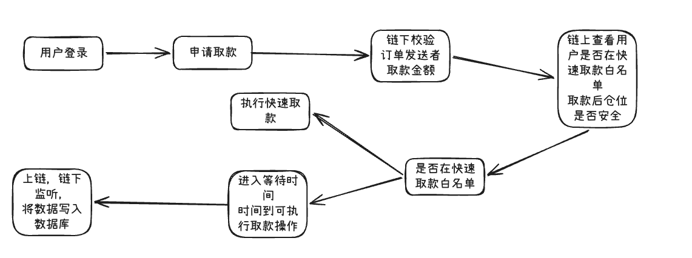

# 永续合约-项目拆解文档

## 整体流程图

## 核心模块详解

### 1.链上合约层

链上拍卖场主入口：统一部署拍卖场，永续合约的顶层入口

链上数据存储：存储state 相关的市场数据，风险参数，用户开仓数据，资产记录

链上视图函数：获得链上相关数据，市场、账户、风险参数、权限信息

链上外部操作函数：用户通过外部调用进行相关操作，比如开仓、取款、清算等

链上系统管理函数：市场管理（注册和设置风险参数），系统配置（保险账户，时间锁，最大仓位），权限管理（订单发送者，取款白名单），资金费率（更改各市场资金费率）

### 2.链上子账户

通过SubaccountFactory 创建子账户，并对不同子账户设置不同的权限

例如对子账户 A 设置为交易操作员，子账户 B 设置为资金管理员

用户通过对 子账户 A 和 B 操作合约市场交易

一个交易管理员同时在多个永续合约市场开仓，在全仓模式中，有一个爆仓所有的账户都会收到影响，触发清算，影响收益。通过使用子账户可以实现仓位隔离，减少某个市场爆仓对全账户的影响

### 3.链上预言机

本项目采用四种预言机：

ConstOracle：自定义预言机，通常在测试环境中使用

EmergencyOracle：应急预言机，当市场波动剧烈，混合预言机失效时使用，仅管理员可使用

OracleAdaptor：Chainlink 和自定义双重模式，（例如：借贷、现货 、NFT 市场）普通订单簿主流使用 chainlink，可以获取实时价格比较稳定，有心跳检查，支持自定义价格保护

PythOracleAdaptor：chainlink 和 pyth 混合模式，通过计算偏差和阈值之间的关系判断使用哪个，永续、衍生品、新公链的高额交易使用较多

计算公式为：｜chainlinkPrice-pythPrice｜/chainlinkPrice<=阈值使用chainlinkPrice，否则使用pythPrice，如果pyth不能用则用另一个chainlink

**为什么各个场景用不同的预言机  ？**

单一的预言机不能适用所有的应用场景，没有一个预言机可以完美覆盖各种需求

**为什么使用 chainlink 预言机不使用撮合成交价成为爆仓依据  ？**

 chainlink 有心跳保护机制，间隔每小时会自动检查价格，防止价格过期，chainlink 是实际可查的清算合约会可以随时查到这个价格，不受某一个永续市场合约的影响（全场的 BTC 价格都在涨，本操作市场流动性没有办法实现单币砸穿），chainlink 由数百个节点组成插针攻击成本极高

使用撮合价交易，容易被插针（用户用少量的资金砸盘，拉爆对方仓位，再把价格拉回来，特别是低流动性合约更容易受影响）

流动性黑洞，如果使用撮合价作为爆仓依据，假设撮合价不断降低，清算情况会越来越多

撮合价是链下的，计算清算价是链上的，链上没有办法主动调取链下的数据

延迟不一致，撮合引擎有自己的节奏，而清算需要确实性可实时查询的价格

难以跨市场对冲，做市商 DEX 和 CEX 对冲的时候需要公认的外部基准价，来判断自己的净口

**为什么要基差调整？**

因为纯外部的价格有时候也是有问题的

### 4.链上下数据监听交互

链下通过监听链上固定的事件比如交易事件，获取交易信息，更新链下数据库中信息

链下调用链上的方法，发起撮合，更新 资金费率，执行清算等

断点续传、事件处理幂等、**区块重组的处理**，如何保证链上下数据一致

### 5.Supabase 数据存储层

记录整个永续合约，用户信息，市场交易，K 线数据

数据存储层中 WAL 记录表，会记录所有用户提交的操作日志

订单存储结构，订单状态，数据恢复

### 6.redis 数据协调层

记录最大区块号，扫链，同步数据，这个值来自数据存储层中交易记录的最大区块号

用户执行登录nonce 值的存储，用户登录时 nonce 值会缓存在 redis 中，过期作废

交易所：撮合引擎通过远程命令抢锁，谁抢到，谁能提交撮合交易

### 7.链下通道调用层

本项目通过 go 自带的通道协程实现消息队列的消费

通道 1：当用户执行存款或撤单、提现操作时，立刻唤醒链下执行器执行

通道 2：每间隔 200 毫秒拉取 WAL 中事件按顺序执行

通道 3：每分钟自动执行链下撮合并发送交易，谁拿锁谁撮合谁发送

### 8.链下撮合

采取 FIFO 模式，双向撮合

情况 1：买单或者卖单立即成交，直接撮合，不进订单簿

情况 2：出现限价单，有匹配的订单马上撮合，没有匹配的订单进订单簿

订单簿采取一价一档的方式，每个价位为一当（O1），每档按照时间先后排列 （On）

### 9.数据处理层

使用 构建和数据库统一的数据模型，调用预先写好的 sql 语句，实现和数据库交互

## 重点业务逻辑

### 用户充值

Dealer Deposit ：直接充值，用户付手续费，基于链上信任，充值后直接到链上

 Treasury Transfer：托管充值，用户将资金放到第三方账户上，链下通过代码定时扫链，将资金充值到链上

手续费不需要用户支付，如果第三方账户接受抵押物充值可以方便用户操作  （ 面试时不用讲）直接链上 unitswap

不好的地方是容易遭受信任危机，这个账户是第三方账户有一定的资金丢失风险

### 用户模拟交易

市价单

### 取款操作

取款必须满足这个条件Solid IM Safe: IM Safe + (netValue - secondaryCredit >= 0)  可以取主资产

等待时间多久  等待逻辑    怕挤兑   

### 清算模块

保证金：

敞口=｜paper｜*市场价

初始保证金=敞口*初始保证金率

维持保证金=敞口*维持保证金率

 MM Safe: 净产>=维持保证金不会触发清算，反之触发清算

IM Safe: 净产>=初始保证金可以开新仓，反之不可以

Solid IM Safe: IM Safe + (netValue - secondaryCredit >= 0)  可以取主资产

多头清算价=其他市场维持保证金总额-其他市场净资产-用户抵押资金/paper（1-市场价*维持保证金率）

空头清算价=其他市场维持保证金总额-其他市场净资产-用户抵押资金/paper（1+市场价*维持保证金率）

清算折扣：

多头：市场价（1-清算折扣率），空头：市场价（1+清算折扣率）

清算流程：

用户 A 申请清算用户 B ：1paper多头，假设市场价为 100，清算折扣率为 1%

用户 A 付出 100（1-1%）=99，得到1paper 空头

用户 B 付出 1paper给用户 A，执行清算费计算，假设清算费为 1%，此时用户 B 收到 99（1-1%）=98.01

假设用户 B 当初开多头 1paper 价位是 101，

此时用户 B 剩余资产为 98.01-101=-2.99

如果用户是在逐仓模式下，此时已经没有 paper可清算，触发保底操作，保证金账户将剩余欠款抹平

如果用户是在全仓模式下，此时系统会继续执行清算，直到用户账面资产可以覆盖维持保证金，如果清算完所有仓位还有负债，则保证金账户负责兜底，抹平债务

### 预言机模块

#### 链下资金费率

链下资金费率=（现货价-指数价）/指数价/3，比较和设置好的最大费率与最小费率，如果超过最大费率或者低于最小费率，则用指定的最大或者最小费率

指数价=（CoinbaseProduct\*4+BinanceSymbol\*3+OkxInstId\*3）\10

现货价从链上的预言机拉取

#### 链上预言机

ConstOracle - 固定价格预言机  测试使用

EmergencyOracle - 应急预言机  应急使用

OracleAdaptor - Chainlink 预言机适配器   chainlink 和自定义预言机   适合小币种使用

PythOracleAdaptor - Pyth + Chainlink 混合预言机适配器  链上使用

 Pyth + Chainlink 到底选哪个？

计算 ｜Pyth - Chainlink ｜/Chainlink 如果这个值小于指定的阈值，那么选 chainlink 否则选 Pyth，如果 Pyth 不可用则用Chainlink

### 用户信息

用户总资产=   +=paper\*marketPrice\*资金费率 +reduceCreditAmount

exposure          +=  |paperAmount × price|    

initialMargin     +=  |paperAmount × price| × initialMarginRatio    

maintenanceMargin +=  |paperAmount × price| × liquidationThreshold

### reids数据协调层

主要负责记录缓存数据：

用户的登录凭证

当前扫到的最大区块号

维护撮合引擎锁

### 子账户模式

用户可以通过SubaccountFactory 生成合约级子账户，该账户没有私钥不能执行签名

用户可使用子账户实现资金隔离。通过给不同的子账户设置交易订单的操作，

交易管理子账户：签订单、设权限、清算

资金管理子账户：在项目内部转移资金，提现、入金等

### 3.全仓和逐仓

| 项目       | 全仓 Cross                                 | 逐仓 Isolated                            |
| ---------- | ------------------------------------------ | ---------------------------------------- |
| 保证金来源 | 同交易对全部余额                           | 开仓单独划拨，隔离资金                   |
| 风险范围   | 一个仓位亏损，吃光同交易对所有资金         | 仅损失分配给本仓的保证金，其余资金安全   |
| 清算距离   | 更远，不容易爆仓                           | 更近，更容易触发清算                     |
| 适用人群   | 趋势交易者，长线持有，愿意承担整体账户风险 | 短线、量化、多仓位，严格限制单笔最大亏损 |

## 接口

### IDealer接口

~~~

/**
 * @title IDealer - 交易系统接口
 * @notice MetaNodeDealer 合约的接口定义
 * 
 * 功能分类：
 * 1. 资金管理：存款、取款、内部转账
 * 2. 交易核心：订单验证、结算
 * 3. 风险管理：安全检查、清算
 * 4. 信息查询：账户状态、市场参数
 */
interface IDealer {
    // ==================== 资金管理 ====================

    /**
     * @notice 存入保证金  使用场景：用户存入保证金
     * @param primaryAmount 主资产存款数量
     * @param secondaryAmount 次级资产存款数量
     * @param to 存入的目标账户地址
     * @dev 调用方需提前 approve 足够额度
     */
    function deposit(uint256 primaryAmount, uint256 secondaryAmount, address to) external;

    /**
     * @notice 请求取款（第一步） 使用场景：用户请求取款操作
     * @param from 取款来源账户
     * @param primaryAmount 主资产取款数量
     * @param secondaryAmount 次级资产取款数量
     * @dev 主要目的是避免因取款导致对手方交易失败
     *      取款请求需要等待时间锁后才能执行
     */
    function requestWithdraw(address from, uint256 primaryAmount, uint256 secondaryAmount) external;

    /**
     * @notice 执行取款（第二步） 使用场景：用户执行取款操作
     * @param from 取款来源账户
     * @param to 资金接收地址
     * @param isInternal 是否仅内部转账（不实际转出 ERC20）
     * @param param 回调参数，非空时会调用 to 地址
     */
    function executeWithdraw(address from, address to, bool isInternal, bytes memory param) external;

    /**
     * @notice 快速取款（一步完成） 使用场景：用户执行快速取款操作，前提用户在快速取款白名单内
     * @param from 取款来源账户
     * @param to 资金接收地址
     * @param primaryAmount 主资产数量
     * @param secondaryAmount 次级资产数量
     * @param isInternal 是否仅内部转账
     * @param param 回调参数
     * @dev 跳过时间锁直接取款，需要特殊权限
     */
    function fastWithdraw(
        address from,
        address to,
        uint256 primaryAmount,
        uint256 secondaryAmount,
        bool isInternal,
        bytes memory param
    )
        external;

    // ==================== 交易核心 ====================

    /**
     * @notice 批准交易（核心撮合函数） 使用场景：链上验证撮合交易是否可行
     * @param orderSender 订单发送者（撮合引擎）地址
     * @param tradeData 包含订单、签名和撮合信息的编码数据
     * @return traderList 参与交易的交易者列表
     * @return paperChangeList 各交易者的 paper 变化
     * @return creditChangeList 各交易者的 credit 变化
     * @dev 仅永续合约可调用此函数
     *      解析 tradeData，验证订单并返回各方余额变化
     */
    function approveTrade(
        address orderSender,
        bytes calldata tradeData
    )
        external
        returns (address[] memory traderList, int256[] memory paperChangeList, int256[] memory creditChangeList);

    // ==================== 风险管理 ====================

    /**
     * @notice 检查交易者是否安全（满足维持保证金）使用场景：每次执行撮合后，清算机器人寻找清算目标
     * @param trader 交易者地址
     * @return 是否安全（不会被清算）
     * @dev 如果不安全，该交易者所有市场的仓位都可能被清算
     */
    function isSafe(address trader) external view returns (bool);

    /**
     * @notice 批量检查交易者安全状态  使用场景：清算机器人寻找清算目标
     * @param traderList 交易者列表
     * @return 是否全部安全
     * @dev 通过缓存标记价格提高 gas 效率
     */
    function isAllSafe(address[] calldata traderList) external view returns (bool);

    /**
     * @notice 请求清算  使用场景：清算者发起清算请求申请清算执行，仅仅被清算交易者触发交易安全红线，清算者才可以以一定的仓位折扣接手仓位
     * @param executor 执行清算的地址
     * @param liquidator 清算者（接手仓位）
     * @param liquidatedTrader 被清算者
     * @param requestPaperAmount 请求清算的仓位数量
     *        正数表示清算多头仓位，负数表示清算空头仓位
     * @return liqtorPaperChange 清算者的 paper 变化
     * @return liqtorCreditChange 清算者的 credit 变化
     * @return liqedPaperChange 被清算者的 paper 变化
     * @return liqedCreditChange 被清算者的 credit 变化
     * @dev 仅永续合约可调用
     *      liqtor = liquidator, liqed = liquidated trader
     */
    function requestLiquidation(
        address executor,
        address liquidator,
        address liquidatedTrader,
        int256 requestPaperAmount
    )
        external
        returns (int256 liqtorPaperChange, int256 liqtorCreditChange, int256 liqedPaperChange, int256 liqedCreditChange);

    /**
     * @notice 处理坏账 使用场景：在被清算用户仓位为 0 且还有坏账存在，由保证金账户兜底
     * @param liquidatedTrader 被清算者地址
     * @dev 将所有坏账（包括主资产和次级资产）转移给保险账户
     */
    function handleBadDebt(address liquidatedTrader) external;

    // ==================== 仓位管理 ====================

    /**
     * @notice 注册开仓  使用场景：交易者在某个币对交易市场开仓
     * @param trader 交易者地址
     * @dev 仅永续合约可调用
     *      当交易者开仓时由 Perpetual 合约调用
     */
    function openPosition(address trader) external;

    /**
     * @notice 实现盈亏并移除仓位  使用场景：交易者在某个币对交易市场平仓实现盈亏
     * @param trader 交易者地址
     * @param pnl 盈亏金额
     * @dev 仅永续合约可调用
     *      当交易者平仓时由 Perpetual 合约调用
     */
    function realizePnl(address trader, int256 pnl) external;

    // ==================== 权限管理 ====================

    /**
     * @notice 设置操作员  使用场景：给子账户设置权限，可以设置的角色分为操作交易管理员（专门替用户签名交易，不能流转资金，常用语机器人或者子账户），资金管理员（专门管理资金流转，不能操作交易）
     * @param operator 操作员地址
     * @param isValid 是否授权
     * @dev 操作员可以代替用户签名订单
     */
    function setOperator(address operator, bool isValid) external;

    // ==================== 查询函数 ====================

    /**
     * @notice 获取永续合约的风险参数  使用场景：前端页面获取永续合约市场风险参数
     * @param perp 永续合约地址
     * @return params 风险参数结构体
     */
    function getRiskParams(address perp) external view returns (Types.RiskParams memory params);

    /**
     * @notice 获取所有已注册的永续合约市场  使用场景：前端页面获得该交易所已经注册的永续合约市场
     * @return 永续合约地址数组
     */
    function getAllRegisteredPerps() external view returns (address[] memory);

    /**
     * @notice 获取标记价格  使用场景：用户账户安全校验，资金费率，用户计算总盈亏，清算执行，都需要用到这个价格
     * @param perp 永续合约地址
     * @return 标记价格（1e18 精度）
     */
    function getMarkPrice(address perp) external view returns (uint256);

    /**
     * @notice 获取交易者的所有持仓市场  使用场景：用户获取自己在本交易所内都持有哪些仓位
     * @param trader 交易者地址
     * @return 持仓的永续合约地址数组
     */
    function getPositions(address trader) external view returns (address[] memory);

    /**
     * @notice 获取交易者的资金详情  使用场景：用户获取自己在该交易所，所有的资产情况
     * @param trader 交易者地址
     * @return primaryCredit 主资产余额
     * @return secondaryCredit 次级资产余额
     * @return pendingPrimaryWithdraw 待取款主资产
     * @return pendingSecondaryWithdraw 待取款次级资产
     * @return executionTimestamp 取款可执行时间
     * @dev 注意：不能直接将 credit 作为净值或保证金
     *      需要结合仓位价值一起计算
     */
    function getCreditOf(address trader)
        external
        view
        returns (
            int256 primaryCredit,
            uint256 secondaryCredit,
            uint256 pendingPrimaryWithdraw,
            uint256 pendingSecondaryWithdraw,
            uint256 executionTimestamp
        );

    /**
     * @notice 获取交易者的风险概况  使用场景：用户获取自己在交易所内持有的仓位和净资产以及所需要的初始保证金和维持保证金
     * @param trader 交易者地址
     * @return netValue 净值（包含 credit 和仓位价值）
     * @return exposure 敞口（所有市场仓位价值绝对值之和）
     * @return initialMargin 初始保证金要求
     * @return maintenanceMargin 维持保证金要求
     */
    function getTraderRisk(address trader)
        external
        view
        returns (int256 netValue, uint256 exposure, uint256 initialMargin, uint256 maintenanceMargin);

    /**
     * @notice 获取清算价格  使用场景：通过计算清算价格和现在的价格做比较，判断资金是否安全，
     * @param trader 交易者地址
     * @param perp 永续合约地址
     * @return liquidationPrice 清算价格，0 表示无清算价格
     * @dev 此函数用于参考，误差通常在 10 wei 以内
     */
    function getLiquidationPrice(address trader, address perp) external view returns (uint256 liquidationPrice);

    /**
     * @notice 预览清算成本  使用场景：被清算者在执行清算请求前预览结果，计算自己的paper 和 credit 变化
     * @param perp 永续合约地址
     * @param liquidatedTrader 被清算者
     * @param requestPaperAmount 请求清算数量
     * @return liqtorPaperChange 清算者的 paper 变化
     * @return liqtorCreditChange 清算者的 credit 变化
     * @dev 清算者可用此函数提前计算需要支付的金额
     */
    function getLiquidationCost(
        address perp,
        address liquidatedTrader,
        int256 requestPaperAmount
    )
        external
        view
        returns (int256 liqtorPaperChange, int256 liqtorCreditChange);

    /**
     * @notice 获取订单已成交数量  使用场景：获取某用户已经成交的量，订单校验总成交量不允许超过订单总量
     * @param orderHash 订单哈希
     * @return filledAmount 已成交的 paper 数量
     * @dev 用于避免重复撮合
     */
    function getOrderFilledAmount(bytes32 orderHash) external view returns (uint256 filledAmount);

    /**
     * @notice 获取资金费率  使用场景：链下计算新的资金费率调用此接口获取旧资金费率
     * @param perp 永续合约地址
     * @return 资金费率（1e18 精度）
     */
    function getFundingRate(address perp) external view returns (int256);

    /**
     * @notice 批量更新资金费率  使用场景：链下定期执行批量更新资金费率
     * @param perpList 永续合约地址列表
     * @param rateList 资金费率列表
     * @dev 仅资金费率更新者可调用
     */
    function updateFundingRate(address[] calldata perpList, int256[] calldata rateList) external;

    // ==================== 权限检查 ====================

    /**
     * @notice 检查订单发送者是否有效  使用场景：判断订单发送者是否为撮合地址
     * @param orderSender 订单发送者地址
     * @return 是否为有效的订单发送者
     */
    function isOrderSenderValid(address orderSender) external view returns (bool);

    /**
     * @notice 检查快速取款操作员是否有效  使用场景：在用户执行快速取款前校验
     * @param fastWithdrawOperator 操作员地址
     * @return 是否有效
     */
    function isFastWithdrawalValid(address fastWithdrawOperator) external view returns (bool);

    /**
     * @notice 检查操作员是否有效  使用场景：批转交易时判断该订单发起者是否为用户本身或者是用户授权的交易者
     * @param client 用户地址
     * @param operator 操作员地址
     * @return 操作员是否被授权
     */
    function isOperatorValid(address client, address operator) external view returns (bool);

    /**
     * @notice 查询资金操作授权额度  使用场景：资金流转时，判断用的子资金管理员是否有足够的主次资产额度
     * @param from 授权者
     * @param spender 被授权者
     * @return primaryCreditAllowed 主资产授权额度
     * @return secondaryCreditAllowed 次级资产授权额度
     */
    function isCreditAllowed(
        address from,
        address spender
    )
        external
        view
        returns (uint256 primaryCreditAllowed, uint256 secondaryCreditAllowed);
}

~~~

### IPerpetual 接口

~~~

/**
 * @title IPerpetual - 永续合约接口
 * @notice Perpetual 合约的接口定义
 * 
 * 永续合约是单个交易市场（如 BTC-PERP）的核心合约
 * 负责记录交易者的仓位和处理交易/清算
 * 
 * 核心概念：
 * - paper: 仓位数量（正=多头，负=空头）
 * - credit: 资金量，与 paper 配合计算盈亏
 */
interface IPerpetual {
    /**
     * @notice 查询交易者的仓位余额  使用场景：计算用户敞口等数据时会用到这个接口，同时也为前端页面提供对应的数据
     * @param trader 交易者地址
     * @return paper 仓位数量
     *         正数表示多头，负数表示空头
     * @return credit 资金量
     *         不直接反映仓位方向或入场价格
     *         仅用于计算风险比率和净值
     */
    function balanceOf(address trader) external view returns (int256 paper, int256 credit);

    /**
     * @notice 执行交易  使用场景：链下将撮合结果发送到链上，链上执行交易撮合验证
     * @param tradeData 编码的交易数据
     * @dev 交易数据会转发给 Dealer 合约进行验证和撮合
     *      然后 Perpetual 合约执行结算
     */
    function trade(bytes calldata tradeData) external;

    /**
     * @notice 清算仓位  使用场景：提交清算申请时调用这个接口
     * @param liquidator 清算者地址
     * @param liquidatedTrader 被清算者地址
     * @param requestPaper 请求清算的仓位数量
     *        正数表示清算多头，负数表示清算空头
     * @param expectCredit 期望的 credit 变化（价格保护）
     *        清算多头时期望收到的金额，清算空头时期望支付的金额
     * @return liqtorPaperChange 清算者最终的 paper 变化
     * @return liqtorCreditChange 清算者最终的 credit 变化
     * 
     * @dev 清算是公开的，任何人都可以清算不安全的仓位
     *      清算可能不会执行或部分执行，原因包括：
     *      1. 其他人先提交了清算请求
     *      2. 交易者及时补充了保证金
     *      3. 标记价格变化超出了价格保护范围
     * 
     *      清算数量会被限制在实际仓位大小内
     *      例如：仓位剩余 10 ETH，请求清算 15 ETH，只会执行 10 ETH
     */
    function liquidate(
        address liquidator,
        address liquidatedTrader,
        int256 requestPaper,
        int256 expectCredit
    )
        external
        returns (int256 liqtorPaperChange, int256 liqtorCreditChange);

    /**
     * @notice 获取当前资金费率  使用场景：链下获取当亲的资金费率
     * @return 资金费率（1e18 精度，累计值）
     * @dev 资金费率是累计值，其变化量才是实际的费率
     *      正费率：多头支付给空头
     *      负费率：空头支付给多头
     */
    function getFundingRate() external view returns (int256);

    /**
     * @notice 更新资金费率  使用场景：批量更新资金费率
     * @param newFundingRate 新的资金费率
     * @dev 仅 owner（Dealer 合约）可调用
     */
    function updateFundingRate(int256 newFundingRate) external;
}

~~~

### IChainlink 接口

~~~

/**
 * @title IChainlink - Chainlink 预言机接口
 * @notice 定义与 Chainlink 价格预言机交互的接口
 * 
 * Chainlink 是最广泛使用的去中心化预言机网络
 * 提供可靠的链下数据到链上的传输
 * 
 * @dev 完整接口参见 Chainlink 官方文档
 *      https://docs.chain.link/data-feeds/price-feeds
 */
interface IChainlink {
    /**
     * @notice 获取最新一轮的价格数据  使用场景：获取新的编辑价格
     * @return roundId 当前轮次 ID
     * @return answer 价格（需要根据 decimals 调整精度）
     * @return startedAt 本轮开始时间戳
     * @return updatedAt 最后更新时间戳
     * @return answeredInRound 回答所在的轮次
     * 
     * @dev 使用注意事项：
     *      1. 检查 updatedAt 确保数据新鲜度
     *      2. 检查 answer > 0 确保价格有效
     *      3. 考虑不同预言机有不同的 decimals
     */
    function latestRoundData()
        external
        view
        returns (uint80 roundId, int256 answer, uint256 startedAt, uint256 updatedAt, uint80 answeredInRound);
}

~~~

### 链下后端接口

~~~

用户鉴权
func RegisterHandlers(server *rest.Server, serverCtx *svc.ServiceContext) {
	server.AddRoutes(
		[]rest.Route{
			{
				Method:  http.MethodPost,
				Path:    "/auth/nonce",
				Handler: AuthNonceHandler(serverCtx),
			},
			{
				Method:  http.MethodPost,
				Path:    "/auth/verify",
				Handler: AuthVerifyHandler(serverCtx),
			},
		},
		rest.WithPrefix("/api/v1"),
	)

	server.AddRoutes(
		[]rest.Route{
			{
				// 查询账户余额
				Method:  http.MethodGet,
				Path:    "/balance",
				Handler: account.GetBalanceHandler(serverCtx),
			},
			{
				// 查询存款记录
				Method:  http.MethodGet,
				Path:    "/deposits",
				Handler: account.ListDepositsHandler(serverCtx),
			},
			{
				// 查询取款记录
				Method:  http.MethodGet,
				Path:    "/withdraws",
				Handler: account.ListWithdrawsHandler(serverCtx),
			},
		},
		rest.WithPrefix("/api/v1"),
	)

	server.AddRoutes(
		[]rest.Route{
			{
				// 获取资金费率历史
				Method:  http.MethodGet,
				Path:    "/funding-rates",
				Handler: funding.ListFundingRatesHandler(serverCtx),
			},
			{
				// 当前合约资金费率与下期结算时间
				Method:  http.MethodGet,
				Path:    "/funding-rate/latest",
				Handler: funding.GetLatestFundingRateHandler(serverCtx),
			},
		},
		rest.WithPrefix("/api/v1"),
	)

	server.AddRoutes(
		[]rest.Route{
			{
				// 获取清算记录
				Method:  http.MethodGet,
				Path:    "/liquidations",
				Handler: liquidation.ListLiquidationsHandler(serverCtx),
			},
		},
		rest.WithPrefix("/api/v1"),
	)

	server.AddRoutes(
		[]rest.Route{
			{
				// 获取K线数据
				Method:  http.MethodGet,
				Path:    "/klines",
				Handler: market.GetKlinesHandler(serverCtx),
			},
			{
				// 获取所有市场
				Method:  http.MethodGet,
				Path:    "/markets",
				Handler: market.ListMarketsHandler(serverCtx),
			},
			{
				// 获取市场详情
				Method:  http.MethodGet,
				Path:    "/markets/:address",
				Handler: market.GetMarketHandler(serverCtx),
			},
			{
				// 开仓参考价（做多卖一/做空买一）
				Method:  http.MethodGet,
				Path:    "/open-quote",
				Handler: market.GetOpenQuoteHandler(serverCtx),
			},
			{
				// 下单前滑点/深度模拟
				Method:  http.MethodGet,
				Path:    "/order-preview",
				Handler: market.GetOrderPreviewHandler(serverCtx),
			},
			{
				// 获取深度
				Method:  http.MethodGet,
				Path:    "/orderbook",
				Handler: market.GetOrderBookHandler(serverCtx),
			},
			{
				// 获取行情
				Method:  http.MethodGet,
				Path:    "/ticker",
				Handler: market.GetTickerHandler(serverCtx),
			},
		},
		rest.WithPrefix("/api/v1"),
	)

	server.AddRoutes(
		[]rest.Route{
			{
				// 创建订单
				Method:  http.MethodPost,
				Path:    "/orders",
				Handler: order.CreateOrderHandler(serverCtx),
			},
			{
				// 查询订单列表
				Method:  http.MethodGet,
				Path:    "/orders",
				Handler: order.ListOrdersHandler(serverCtx),
			},
			{
				// 查询订单
				Method:  http.MethodGet,
				Path:    "/orders/:orderId",
				Handler: order.GetOrderHandler(serverCtx),
			},
			{
				// 取消订单
				Method:  http.MethodPost,
				Path:    "/orders/cancel",
				Handler: order.CancelOrderHandler(serverCtx),
			},
		},
		rest.WithPrefix("/api/v1"),
	)

	server.AddRoutes(
		[]rest.Route{
			{
				// 查询用户仓位
				Method:  http.MethodGet,
				Path:    "/positions",
				Handler: position.GetPositionsHandler(serverCtx),
			},
			{
				// 查询风险信息
				Method:  http.MethodGet,
				Path:    "/risk",
				Handler: position.GetRiskInfoHandler(serverCtx),
			},
		},
		rest.WithPrefix("/api/v1"),
	)

	server.AddRoutes(
		[]rest.Route{
			{
				// 查询成交记录
				Method:  http.MethodGet,
				Path:    "/trades",
				Handler: trade.ListTradesHandler(serverCtx),
			},
		},
		rest.WithPrefix("/api/v1"),
	)
}

~~~

