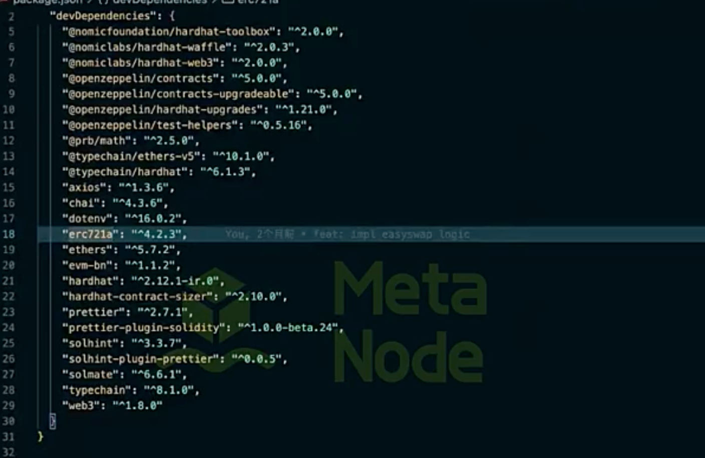

 

waffle

evn-bn

JWT  redis  mysql  kafka

go-zreo   go-cline  go-descride 

go 开发 C    L   D 分层 

并发查询提高速度 利用 go 的协程加锁

异步拿数据

# NFT 交易市场项目（EasySwap）掌握程度测试卷

考试说明 ：共 6 部分、50 题，覆盖项目全部模块。建议用时 120 分钟，闭卷作答。

## 第一部分：项目总体架构（第 1–6 题）
1. 本项目由哪几个子服务/仓库组成？请分别说明各自职责及相互依赖关系。
2. API 服务、交易同步服务、NFT 导入服务三个核心微服务各解决什么问题？它们之间的数据流是怎样的？
3. 项目数据模型中的 Collection、Item、Ownership、Order、Activity 五个实体分别代表什么？相互关系如何？
4. NFT 订单有“链下订单簿（非 DEX）”与“链上订单簿（DEX）”两种模式，本项目采用哪种？链下服务承担了哪些链上无法完成的工作？
5. 三个 Go 服务在`go.mod` 中如何建立本地依赖？完整部署环境需要按什么顺序准备哪些外部组件（MySQL、Redis、RPC 节点、合约）？
6. 订单簿合约地址为什么要同时配置到 Backend 和 Sync 的配置文件里？缺一份会分别导致什么现象？
## 第二部分：智能合约模块 EasySwapContract（第 7–26 题）
### 选择题
7. `EasySwapOrderBook` 支持的两种订单方向（Side）是：
   - A. Buy / Sell　B. List / Bid　C. Ask / Offer　D. Mint / Burn
8. `LibOrder.SaleKind` 的两种销售类型是：
   - A. 按件 / 按捆绑定价　B. FixedPriceForCollection / FixedPriceForItem　C. 英式拍卖 / 荷兰拍　D. Once / Always
9. `OrderKey` 的底层类型是：
   - A. uint256　B. address　C. bytes32　D. string
10. `OrderKey` 的生成方式是：
    - A. 自增计数器　B. 对订单结构体做 EIP712 风格哈希　C. maker 与 tokenId 拼接　D. salt 本身
11. 同一价格下多个订单的存储结构`OrderQueue` 属于：
    - A. 动态数组　B. 双向链表　C. 映射＋计数器　D. 堆
12. 价格排序使用的数据结构是：
    - A. 有序数组　B. 跳表　C. 红黑树　D. 最小堆
### 填空题
13. 红黑树库中`Price` 基于`uint128` ，插入/删除/查找复杂度为 ______；取最高 Bid 价调用 ______，取最低 List 价调用 ______。
14. 卖家挂单后 NFT 转入 ______ 合约托管；买家出价后 ETH 存入 ______ 合约。
15. `EasySwapVault.depositNFT` 依赖 ERC721 的 ______ 回调完成入账，该回调必须校验 ______ 才能正确记账。
16. 订单 EIP712 签名验证由 ______ 合约负责，初始化需传入域名 ______ 与 ______。
### 判断改错题
17. `EasySwapOrderBook` 使用`initializer` 初始化，因此是不可升级的普通合约。（　）
18. 批量匹配用`onlyDelegateCall` 限制 delegatecall 调用，目的是让子调用失败不回滚主流程，并抛出`BatchMatchInnerError` 事件。（　）
19. `multicall` 中某个子调用失败会导致整体回滚。（　）
20. 订单创建/取消失败时触发`LogSkipOrder` 事件而非直接 revert。（　）
### 简答题
21. 完整描述“挂单 → 出价 → 匹配成交”的链上调用流程（涉及合约、函数、资产流转、协议费计算与分配）。
22. `LibPayInfo` 的作用？匹配时买卖双方的付款信息如何校验和使用？
23. 修改已挂单价格调用哪个函数？`EditDetail` 中`oldOrderKey` 与`newOrder` 各起什么作用？编辑对链表和红黑树分别做了什么操作？
24. `ProtocolManager` 负责什么？协议费存哪里？`ProtocolManagerV2Test` 暗示了怎样的升级演进？
25. 合约的安全机制分别防什么：`ReentrancyGuard` 、`Pausable` 、`LibTransferSafeUpgradeable` 、`self` 地址 delegatecall 校验？
26. `updateUseUpgradeProxy.js` 与`verify-orderbook-impl.js` 各用于什么场景？升级代理合约最需防止的操作错误是什么？
## 第三部分：后端 API 模块 EasySwapBackend（第 27–38 题）
### 选择题
27. Backend 分层自外向内依次是：
    - A. dao → service → api　B. api → service → dao　C. service → api → dao　D. api → dao → service
28. 路由与中间件（auth/cache/logger/recover）注册在：
    - A. dao 层　B. gin Engine 全局与路由分组　C. main.go 手动调用　D. 配置文件声明
29. `ob_order` 表`order_type` 取值含义是：
    - A. 1:listing 2:offer 3:collection bid 4:item bid　B. 1:buy 2:sell 3:cancel 4:match　C. 0:open 1:filled 2:expired　D. 无关随机值
### 填空题
30. `auth.go` 中间件完成 ______ 校验；`cacheapi.go` 实现 ______ 功能以降低数据库压力。
31. 订单状态来源于 ______ 服务同步的链上事件，API 本身 ______（会/不会）直接与合约交互发起交易。
32. `types/v1` 下的结构体用于定义 API 层的 ______ 与 ______，与 dao 层 model 相互隔离。
### 简答题
33. 描述“查询某 Collection 在售 NFT 列表”从 HTTP 请求到数据库查询的完整链路（经过哪些文件/函数，各层做什么）。
34. `portfolio.go` 与`portfolio_import.go` 支持什么功能？导入外部钱包资产的数据来源可能是什么？
35. 排行榜（`ranking.go` ）的数据从哪张表/哪个服务来？为什么排行榜不适合由 API 实时计算？
36. `service/mq/metadata.go` 在 Backend 中承担什么职责？什么场景需要引入消息队列？
37. `common/utils` 中`crypto.go` 、`retry.go` 分别被哪些业务场景使用？
38. Swagger 文档如何生成？新加接口后开发者需要做什么才能生效？
## 第四部分：公共基础库模块 EasySwapBase（第 39–46 题）
39. `ordermanager` 包四个文件各职责：`expiredorder.go` 、`floorprice.go` 、`listcount.go` 、`queue.go` 。
40. `stores/gdb/orderbookmodel` 的`base` 与`multi` 两个子包表模型差异是什么？表名（如`ob_order_sepolia` ）如何按链动态生成（`tablename.go` ）？
41. `stores/xkv` 封装什么中间件？在 Sync/Backend 中分别用来做什么（高度游标、缓存）？
42. `chain/nftchainservice` 中`transferevent.go` 与`bind_erc721` 各自作用？`CheckNFTApprovalStatus` 能力最终依赖此包哪部分？
43. `evm/eip/eip55.go` 解决什么问题？地址校验和为什么对系统安全重要？
44. `logger/xzap` 针对 gRPC 与 HTTP 各提供了什么能力（interceptors）？日志 context 如何透传 trace 信息？
45. `retry.go` 与`strategy.go` 的关系？列举项目中最需要重试机制的一个外部调用场景。
46. `kit/slice` 、`kit/math` 、`kit/convert` 各举一个真实业务用法（如订单去重、价格精度换算）。
## 第五部分：同步服务模块 EasySwapSync（第 47–50 题）
47. `SyncOrderBookEventLoop` 的工作原理：起止区块游标存在哪里、如何通过`evmclient` 拉取日志、`circularsleep.go` 起什么作用？
48. 监听到`LogMake` /`LogCancel` /`LogMatch` 后，分别更新数据库哪些表、哪些字段（结合`model/model.go` 与`01_create.sql` ）？
49. `UpKeepingCollectionFloorChangeLoop` 与`QueryCollectionsFloorPrice` 解决什么问题？地板价为什么需要定时维护而非纯事件驱动？
50. 综合场景题：
    - a)`CanMarketBuyNFT` 返回三元值`(bool, string, error)` ，三种返回各对应什么业务语义？
    - b)`collectionfilter` 在导入 Collection 时过滤什么？为什么需要白/黑名单机制？
    - c) 同步服务停机 2 小时后重启，事件会不会丢？会不会重复入库？项目靠什么机制保证至少一次/恰好一次处理？
## 附录：实操附加题（选做，不占分）
1. 从零跑通项目：列出完整命令序列（MySQL/Redis → 建表 → 部署合约 → 三份 config.toml → 启动 Sync 与 Backend），并描述验证成功的标志。
2. 基于`TestEasySwap.js` 写 Hardhat 用例：挂单后加价编辑、再出价成交，断言卖家 ETH 增量正确扣除了协议费。
3. 为`EasySwapOrderBook` 增加“批量取消订单”函数，说明需考虑的重入、gas 上限与事件顺序问题。

