# 撮合引擎项目拆解

## 整体架构

### 架构图

### 核心理念：分层设计

数据接入层->调度层->逻辑处理层->数据展示

### 核心模块讲解

#### 1.外部系统：

**用户API**：用户提交订单入口

**mysql**：持久化数据

**redis**：缓存实时行情数据

**RabbitMQ**：消息通道，确保订单顺序和不丢失

#### 2.数据拉取层

**puller**：从订单列表拉取数据

**validate**：校验服务是否正常开启，快照和行情是否存在不一致，校验币种唯一存在性

#### 3.撮合核心层：

**matcher**：撮合订单，匹配买卖订单

**orderbook**：订单簿，记录所有未成交的订单

4.市场数据层：

**L2Quote**：展示实时成交价、成交量等数据

5.数据处理层：

**Snapshotter**：生成快照

**Statistics**：监控统计

**dogstate**：监控性能指标，并上报

## 撮合引擎核心

### 撮合引擎架构图

### 撮合引擎运行逻辑

#### 1.拉取和存储数据

1. 用户提交交易信息，交易信息入库，

2. puller 通过定时任务定时拉取定量的交易信息，

#### 2.按照订单的指定模式进行撮合

##### 订单类型：

Market：市价单，按照市场价格成交，如果存在未成交部分，则撤销剩余部分

Limit：限价单，只有在高于最低限度的价格，订单才会开始成交

GTC：一致挂载盘口，直到完全成交或者用户撤销（限价单常用）

IOC：立刻成交有剩余则撤单

FOK：全部成交或者全部不成交

Post Only：只允许挂单，只允许对手方来吃掉自己，不能立刻吃掉对手盘

##### 自成交：

AST：允许自成交，正常交易收取手续费

DC：减量撤单，用户开 10 空头，后开 12 多头，自成交DC 模式直接撤销用户的空头，然后成交 2个多头

CO：撤销老订单，撮合时撤销老订单

CN：撤销新订单，撮合时撤销新订单

CB：撮合时两个订单都撤销

##### 撮合逻辑：

1. 根据价格档位排序，同等价格档位中，谁时间靠前，谁先成交
2. 买单价必须大于或者等于卖单价
3. 买卖价中使用最低价成交
4. 当订单成交价波动幅度超过市场阈值，触发市场熔断，停止撮合逻辑，等待恢复
5. 用户允许自成交按照指定的自成交模式撮合，未指定自成交撮合其他订单

## 订单处理时序

### 流程图

### 顺序讲解

1. puller 按照记录的 last_id+1 条开始按照顺序从数据库中拉取订单放入 channel 中
2. 撮合引擎按照顺序逐条进行撮合
3. 撮合成功后，将撮合结果写入 mysql持久化，通过RabbitMQ 发送给下游业务进行处理，通过RabbitMQ 发送给 l2quote

## 定时器

定时任务按照配置的指定周期触发

任务：

1. 定时备份撮合快照，防止系统崩溃
2. 定时备份市场交易数据，即买单和卖单列表
3. 定时计算市场深度并推送
4. 定时更新 k 线数据

## 撮合系统架构分析

### 各模块分布图

### 性能设计

订单数据存储采取红黑树查找，实现不同价位 O（1）同价位 O（n）

内存缓存，热点数据存在 redis，减少 mysql 的负载压力

异步处理，消息推送采取异步推送

### 可靠性

快照：如果系统奔溃，快速从本地快照获取到最新处理到的订单 id号，买单和卖单队列，后再 mysql 中查id+1 号，重新进行撮合

​	如果快照也崩溃，那么需要从mysql 表中 1id 重放

持久化存储：所有数据都放到 mysql 中只要 mysql 中数据不丢失，系统就可以在崩溃中恢复

消息队列：使用RabbitMQ 处理消息，确保不丢失

### 实时性

利用RabbitMQ，实现 k 线数据，**L2行情**，深度数据，用户订阅信息毫秒级推送

### 可扩展性

模块化设计：系统中每个模块功能都互相独立，方便横向扩展

多交易对支持：不同的交易对可以独立运行不会互相干扰

