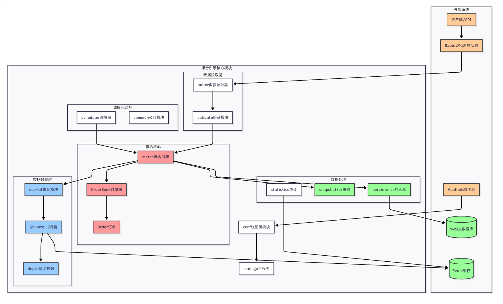

需求 → 业务流程 → 模块拆分 → 数据结构 → 状态变化 → 核心算法/公式 → 接口 → 代码实现 → 测试 → 边界条件 → 安全性




**权限**

onlyOwner

onlyFundingRateKeeper

vaildOrderSender

**角色**

合约所有者：Owner

费率保持者：FundingRateKeeper

订单撮合者：OrderSender

清算执行者：Liquidtor

系统账户：Insurance

普通用户

项目：永续合约（链上链下结合）

链上负责订单校验，校验通过上链，不通过revert

链下负责订单撮合

前端：

EIP 订单构造，用户登录签名

后端（链下）：

查询 K 线数据

充值 usdc

​	充值资金：用户链接钱包，签名授权给市场合约，市场合约执行转账充值，充值成功发送时间，链下轮询监听充值事件，将数据写到数据库持久化存储

​	这个过程存在两笔交易，比较费 gas 费

​	托管资金：用户将资金存放到托管账户中，链下数据库记账（此时用户可以挂单），链下过固定时间或者资金超过固定额度，托管账户授权市场合约，市场合约将资金转入（附带记账账表），转账成功后，链上数据根据账表中每个用户转入的资金修改链上数据

​	这个过程相对于直接充值 省 gas，永续合约通过这种方式获得资金，这种方式下一般由三方支付花费，或者向用户收取对应手续费。

提现

​	等待提现：合约设置白名单，用户提交提现申请链上判断可以提现金额是否大于等于提现金额，不符合revert，符合流程用户进入等待，等待固定时间后，可以提现

​	直接提现：用户在特殊的白名单，用户可直接申请提现，审核通过直接提现

​	资金委托者可执行

开仓

​	用户开多头或者空头，paper 和 credit 异号，链上数据只记录用户账户中主资产和次级资产余额，真实的用户净值通过计算得到。

​	如果用户开仓有可匹配的对手仓，直接进入撮合交易，撮合成功后，发送给链上，执行校验，校验通过，修改链上数据，发送相关时间，链下轮询，更改数据库

​	如果用户可匹配的对手仓，直接挂单，等单撮合引擎进行撮合。

​	仓位委托人可执行

加减仓仓

​	用户申请加仓，撮合交易执行撮合，链上合约校验用户资金状态，如果资金允许执行开仓，发送时间，链下轮询更改数据库。如果资金不允许直接revert

​	仓位委托人可执行

平仓

​	用户申请平仓，撮合器执行撮合，建议发送到链上，交易成功后，更改用户 paper 和 reducecredit，此时 paper=0，reducecredit =0，更新realizePnl。

​	计算公式为realizePnl=priceCriditAmout+secondCreditAomut+｜paper｜*fundingRate+creditChange

​	仓位委托人可执行

清算

​	用户申请执行清算，撮合器进行撮合，发送单链上校验，校验通过，发送事件，链上更新数据，同步数据库。

​	如果出现串仓（清算所有市场的仓位后依然亏损），保险账户回收剩下的所有 paper，亏损的资金保险金库承担

​	校验项：清算人清算成功后资金依然安全，清算人申请 paper 小于等于被清算人 paper，发送交易者为清算机器人，paper 和 credit 之间异号，禁止自清算，校验时间戳，校验签名

​	被清算者被用折扣价清算，需要缴纳清算费，清算费最终入保险账户

​	仓位委托人可执行

查用户信息

​	查询用户历史成交记录

​	查用户资金状况是否安全

​		敞口：｜paper｜*maketprice 累计和

​		净资产：每个市场 paper*maketprice+reduceprice 累计和+主级资产

​		维持保证金：每个市场 paper*maketprice\*维持保证金率累计和

​		清算价：

​			多头：（出目标市场外的维持保证金和-主级资产-除目标市场外的累计净值）/paper（1-维持保证金率）

​			空头：（出目标市场外的维持保证金和-主级资产-除目标市场外的累计净值）/paper（1+维持保证金率）

​		维持安全：净资产=净资产保证金

​		相对安全：净资产大于等于资产保证金

​		绝对安全：净资产大于等于资产保证金，净资产减去次级抵押资产大于等于 0

查市场相关信息

​	查市场交易记录

查资金费率历史记录

更新资金费累计值：由维持资金费者发起，获取链上指数价和标记价，进行计算，调用链上函数数，链上函数校验（发送者），上链成功发送事件，链下轮询更新数据库。（资金费率=（标记价-指数价）/指数价*时间间隔）

标记价从 预言机获取，指数价从交易链上的真实交易值得到。

预言机：备用预言机，混合预言机，单一预言机，测试预言机

合约部分：

永续市场合约：开永续合约市场，设置永续合约市场配置，初始保证金，维持保证金，保证金账户

交易合约：

​	存储合约：存储交易场合约的相关变量

​	配置合约：配置权限检测，维持资金率检测，注册市场者检测

​	操作合约：设置保险账户，时间锁，最大仓位。设置订单发送者，白名单。注册永续市场，设置风险参数。更新市场费率

​	外部合约：资金：充值-待提现-提现，交易：发起签名订单-撮合-验证结算，清算：请求清算-计算金额-结算

​		撮合验证：方法调用者为撮合引擎，校验签名，订单时间戳，是否自成交，订单 paper 是否对冲为 0，购买价是否大于或等于售卖价，累计交易 paper 是否小于等于交易申请 paper 。

​	视图合约：市场：风险参数，资金费率，标记价格。账户：余额，持仓，订单状态。风险：保证金，前端价格，账户状态。权限：操作员，白名单


用户想看到项目中所有数据库表和链上存储结构体的中文说明。让我先找到所有相关的表定义和链上合约中的 struct 定义。

继续扫描其他表结构和链上合约中的 struct。

现在我需要找到 Order、Trade、LedgerBalance 等剩余的表结构，以及链上合约中的 struct。

现在找 Order 和 Trade 表的结构定义。

现在找 Order 和 Trade 的 model 定义。

让我找 Order 和 Trade 的完整 struct 定义。

现在我需要找到链上合约中的结构体定义。

让我用不同的方式搜索 Solidity 结构体。

现在我需要找到 MetaNodeStorage 中的 mapping 存储以及 Types.sol 中更多的结构体定义。

现在我有足够的信息来整理所有数据库表和链上结构体的中文说明了。让我先读完 Types.sol 里剩余的结构体定义。

现在我有了所有需要的信息，可以整理出完整的数据库表和链上结构体的中文说明了。
全部扫完了。下面分两部分：Postgres 数据库表 + 链上 Solidity 存储结构。

---

## 第一部分：Postgres 数据库表（共 10 张）

### 1. deposits（入金记录表）—— treasury 扫链结果

| 字段             | 类型        | 中文含义                     |
| ---------------- | ----------- | ---------------------------- |
| id               | int64       | 自增主键                     |
| tx_hash          | varchar(66) | 链上交易哈希                 |
| log_index        | int64       | 该交易里 Transfer 日志的序号 |
| trader           | varchar(42) | 入金者地址                   |
| primary_amount   | varchar     | 主资产（USDC）入账数量       |
| secondary_amount | varchar     | 次级资产入账数量（一般为 0） |
| block_number     | int64       | 这笔转账所在的链上区块号     |
| create_time      | timestamp   | 记录创建时间                 |

唯一约束：(tx_hash, log_index)

---

### 2. ledger_balances（用户主资产余额表）

| 字段            | 类型        | 中文含义           |
| --------------- | ----------- | ------------------ |
| trader          | varchar(42) | 用户地址（主键）   |
| primary_balance | varchar     | 用户 USDC 可用余额 |
| updated_at      | timestamp   | 最后更新时间       |

这个表和链上的 `primaryCredit` 是**互补关系**——链上余额是权威的（包含持仓盈亏），DB 里这个只是**可用 USDC 的缓存视图**，扫到入金时直接加，不等链上结算。

---

### 3. orders（订单表）

| 字段           | 类型        | 中文含义                                               |
| -------------- | ----------- | ------------------------------------------------------ |
| id             | int64       | 自增主键                                               |
| order_id       | varchar(66) | 订单唯一标识（= EIP-712 签名 digest，唯一索引）        |
| chain_id       | int64       | 签名时的链 ID（防重放）                                |
| perp           | varchar(42) | 目标永续合约地址                                       |
| perp_address   | varchar(42) | 同 perp，兼容旧字段名                                  |
| signer         | varchar(42) | 签名者地址（= trader）                                 |
| paper_amount   | varchar     | 订单仓位数量（正数做多，负数做空）                     |
| credit_amount  | varchar     | 订单资金数量（与 paper 异号）                          |
| maker_fee_rate | varchar     | maker 手续费率                                         |
| taker_fee_rate | varchar     | taker 手续费率                                         |
| expiration     | int64       | 订单过期时间戳（Unix 秒）                              |
| nonce          | int64       | 随机数（防重放）                                       |
| signature      | varchar     | 用户钱包签名原始字节                                   |
| status         | int         | 订单状态（0=pending, 1=filled, 2=canceled, 3=expired） |
| filled_amount  | varchar     | 已成交 paper 数量                                      |
| create_time    | timestamp   | 创建时间                                               |
| update_time    | timestamp   | 最后更新时间                                           |

---

### 4. trades（成交记录表）

| 字段           | 类型        | 中文含义                        |
| -------------- | ----------- | ------------------------------- |
| id             | int64       | 自增主键                        |
| trade_id       | varchar(64) | 成交唯一 ID（唯一索引）         |
| perp           | varchar(42) | 永续合约地址                    |
| taker_order_id | varchar(66) | taker 订单的 order_id           |
| maker_order_id | varchar(66) | maker 订单的 order_id           |
| taker          | varchar(42) | taker 地址                      |
| maker          | varchar(42) | maker 地址                      |
| paper_amount   | varchar     | 本次成交的 paper 数量           |
| price          | varchar     | 成交价格                        |
| taker_fee      | varchar     | taker 手续费                    |
| maker_fee      | varchar     | maker 手续费（可能是负数=返佣） |
| tx_hash        | varchar(66) | 链上结算交易哈希                |
| block_number   | int64       | 结算所在区块号                  |
| create_time    | timestamp   | 创建时间                        |

---

### 5. engine_events（WAL 事件表——撮合引擎核心）

| 字段        | 类型         | 中文含义                                                     |
| ----------- | ------------ | ------------------------------------------------------------ |
| id          | int64        | 自增序号（BIGSERIAL，主键，事件顺序靠它保证）                |
| event_type  | varchar(64)  | 事件类型字符串（5 种：order_accepted / order_canceled / match_enqueued / match_settled / match_rollback） |
| order_id    | varchar(66)  | 关联的订单 ID（撮合类事件为空）                              |
| match_id    | varchar(80)  | 关联的撮合对 ID（订单类事件为空）                            |
| perp        | varchar(42)  | 关联的永续合约地址                                           |
| payload     | jsonb        | 完整事件负载（JSON 格式，包含订单对象、撮合结果等完整信息）  |
| node_id     | varchar(128) | 产生这条事件的撮合引擎节点 ID                                |
| create_time | timestamp    | 事件写入时间                                                 |

---

### 6. positions（用户链下持仓快照表）

| 字段        | 类型        | 中文含义                                       |
| ----------- | ----------- | ---------------------------------------------- |
| id          | int64       | 自增主键                                       |
| trader      | varchar(42) | 用户地址                                       |
| perp        | varchar(42) | 永续合约地址                                   |
| paper       | varchar     | 当前 paper 仓位                                |
| credit      | varchar     | 当前 credit 资金量（已包含 funding rate 结算） |
| update_time | timestamp   | 最后更新时间                                   |

查询条件：trader 且 paper != '0'（只展示有仓位的）。这是从链上实时同步下来的缓存。

---

### 7. withdraws（提现记录表）

| 字段             | 类型        | 中文含义                                   |
| ---------------- | ----------- | ------------------------------------------ |
| id               | int64       | 自增主键                                   |
| tx_hash          | varchar(66) | 链上提现交易哈希                           |
| trader           | varchar(42) | 提现者地址                                 |
| primary_amount   | varchar     | 提现主资产数量                             |
| secondary_amount | varchar     | 提现次级资产数量                           |
| status           | int         | 提现状态（0=pending, 1=success, 2=failed） |
| block_number     | int64       | 提现交易所在区块号                         |
| create_time      | timestamp   | 创建时间                                   |

---

### 8. funding_rates（资金费率历史表）

| 字段        | 类型        | 中文含义                            |
| ----------- | ----------- | ----------------------------------- |
| id          | int64       | 自增主键                            |
| perp        | varchar(42) | 永续合约地址                        |
| rate        | varchar     | 本次结算的资金费率（1e18 基数小数） |
| mark_price  | varchar     | 结算时的标记价格                    |
| index_price | varchar     | 结算时的指数价格                    |
| settle_time | timestamp   | 结算时间                            |

---

### 9. liquidations（清算记录表）

| 字段              | 类型        | 中文含义                          |
| ----------------- | ----------- | --------------------------------- |
| id                | int64       | 自增主键                          |
| tx_hash           | varchar(66) | 清算交易哈希                      |
| perp              | varchar(42) | 永续合约地址                      |
| liquidator        | varchar(42) | 执行清算的 bot 地址               |
| liquidated_trader | varchar(42) | 被清算的用户地址                  |
| paper_change      | varchar     | 被清算的 paper 变化量             |
| credit_change     | varchar     | 被清算的 credit 变化量            |
| insurance_fee     | varchar     | 清算保险费（转入 insurance 账户） |
| block_number      | int64       | 清算交易所在区块号                |
| create_time       | timestamp   | 创建时间                          |

---

### 10. markets（永续合约注册表）

| 字段                  | 类型        | 中文含义                                |
| --------------------- | ----------- | --------------------------------------- |
| id                    | int64       | 自增主键                                |
| address               | varchar(42) | 永续合约链上地址（唯一索引）            |
| name                  | varchar     | 市场名称（如 "BTC-PERP"）               |
| initial_margin_ratio  | varchar     | 初始保证金率（1e18 基数，10% = 0.1e18） |
| liquidation_threshold | varchar     | 维持保证金率（清算阈值）                |
| liquidation_price_off | varchar     | 清算价格折扣                            |
| insurance_fee_rate    | varchar     | 清算保险费率                            |
| is_registered         | bool        | 是否已注册激活                          |
| create_time           | timestamp   | 创建时间                                |

---

### 11. klines（K 线数据表）—— 前端展示用

| 字段          | 类型        | 中文含义                                 |
| ------------- | ----------- | ---------------------------------------- |
| id            | int64       | 自增主键                                 |
| perp          | varchar(42) | 永续合约地址                             |
| interval_type | varchar     | K 线周期（1m / 5m / 15m / 1h / 4h / 1d） |
| open_time     | timestamp   | K 线开盘时间                             |
| open_price    | varchar     | 开盘价                                   |
| high_price    | varchar     | 最高价                                   |
| low_price     | varchar     | 最低价                                   |
| close_price   | varchar     | 收盘价                                   |
| volume        | varchar     | 成交量                                   |

---

## 第二部分：链上 Solidity 存储结构

### Perpetual 合约的 balance 结构体（Perpetual.sol:45-48）

```solidity
struct balance {
    int128 paper;          // 仓位数量（正=做多，负=做空）
    int128 reducedCredit;  // 约减后的资金量，和 fundingRate 配合实现 O(1) 资金费率更新
}
```

存储位置：`mapping(address => balance) balanceMap`——用户地址 → 该用户在这个 Perpetual 合约的仓位+资金。

int128 打包存储，一个 slot 塞两个变量，节省 gas。

---

### Dealer 合约的 State 结构体（Types.sol:23-85）——整个系统的核心状态

这是一个**巨型 struct**，通过 Solidity 的 `using for` 模式让所有子合约（External / Operation / View）都 delegatecall 到同一个 Storage 合约共享这份状态：

| 存储项                     | 类型                                            | 中文含义                                     |
| -------------------------- | ----------------------------------------------- | -------------------------------------------- |
| primaryAsset               | address                                         | 主资产合约地址（通常是 USDC）                |
| secondaryAsset             | address                                         | 次级资产合约地址（可选）                     |
| primaryCredit              | mapping(address => int256)                      | 用户主资产信用余额（链上权威余额，可以为负） |
| secondaryCredit            | mapping(address => uint256)                     | 用户次级资产信用余额                         |
| primaryCreditAllowed       | mapping(address => mapping(address => uint256)) | 操作员被授权可以动用某用户多少主资产         |
| secondaryCreditAllowed     | mapping(address => mapping(address => uint256)) | 操作员被授权可以动用某用户多少次资产         |
| withdrawTimeLock           | uint256                                         | 取款时间锁（秒），防止订单成交前提款         |
| pendingPrimaryWithdraw     | mapping(address => uint256)                     | 用户待提取的主资产数量                       |
| pendingSecondaryWithdraw   | mapping(address => uint256)                     | 用户待提取的次级资产数量                     |
| withdrawExecutionTimestamp | mapping(address => uint256)                     | 用户取款可执行的时间戳                       |
| perpRiskParams             | mapping(address => RiskParams)                  | 每个永续合约的风险参数                       |
| registeredPerp             | address[]                                       | 所有已注册的永续合约地址列表                 |
| openPositions              | mapping(address => address[])                   | 每个用户当前有仓位的永续合约列表             |
| positionSerialNum          | mapping(address => mapping(address => uint256)) | 仓位序列号（每次全平仓+1，用于链下盈亏计算） |
| orderFilledPaperAmount     | mapping(bytes32 => uint256)                     | 每个订单已成交的 paper 数量（防超量成交）    |
| validOrderSender           | mapping(address => bool)                        | 允许提交撮合结算的地址（撮合引擎白名单）     |
| fastWithdrawalWhitelist    | mapping(address => bool)                        | 快速取款白名单用户                           |
| fastWithdrawDisabled       | bool                                            | 全局开关：是否禁用快速取款                   |
| operatorRegistry           | mapping(address => mapping(address => bool))    | 用户授权的操作员列表                         |
| isWithdrawalWhitelist      | mapping(address => bool)                        | 取款白名单                                   |
| insurance                  | address                                         | 保险基金地址（收清算费、承担坏账）           |
| fundingRateKeeper          | address                                         | 资金费率更新者地址                           |
| maxPositionAmount          | uint256                                         | 单用户最大同时持仓的市场数                   |

---

### RiskParams 结构体（Types.sol:136-167）

每个永续合约一份，存于 `State.perpRiskParams[perpAddress]`：

| 字段                 | 类型    | 中文含义                                                |
| -------------------- | ------- | ------------------------------------------------------- |
| initialMarginRatio   | uint256 | 初始保证金率（1e18 基数，10% = 0.1e18）                 |
| liquidationThreshold | uint256 | 维持保证金率（低于此值触发清算）                        |
| liquidationPriceOff  | uint256 | 清算价格折扣（清算多头时以 markPrice × (1 - off) 卖出） |
| insuranceFeeRate     | uint256 | 清算保险费率（从被清算者收，进 insurance）              |
| markPriceSource      | address | 预言机价格源合约地址（Pyth）                            |
| name                 | string  | 市场名称（如 "BTC-PERP"）                               |
| isRegistered         | bool    | 是否已注册激活                                          |

---

### Order 结构体（Types.sol:97-126）——链下签名、链上验证格式

| 字段         | 类型    | 中文含义                                                     |
| ------------ | ------- | ------------------------------------------------------------ |
| perp         | address | 目标永续合约地址                                             |
| signer       | address | 签名者（= trader，余额因之变化）                             |
| paperAmount  | int128  | 仓位数量（正=做多开仓 / 负=做空开仓 / 反向=平仓）            |
| creditAmount | int128  | 资金数量（与 paperAmount 异号）                              |
| info         | bytes32 | 打包字段：makerFeeRate(int64) + takerFeeRate(int64) + expiration(uint64) + nonce(uint64) |

---

### MatchResult 结构体（Types.sol:173-182）——链上撮合结算入参

| 字段             | 类型      | 中文含义                                            |
| ---------------- | --------- | --------------------------------------------------- |
| traderList       | address[] | 参与撮合的交易者列表（[0]=taker，其余=maker）       |
| paperChangeList  | int256[]  | 每个交易者的 paper 变化量（与 traderList 一一对应） |
| creditChangeList | int256[]  | 每个交易者的 credit 变化量（已扣手续费）            |
| orderSenderFee   | int256    | 撮合引擎收取的总手续费（可能为负=引擎补贴）         |

---

### SubaccountFactory 的 subaccountRegistry（SubaccountFactory.sol:35）

| 存储项             | 类型                          | 中文含义                                       |
| ------------------ | ----------------------------- | ---------------------------------------------- |
| subaccountRegistry | mapping(address => address[]) | 主地址 → 该主地址下所有子账户（Clone）地址数组 |

---

### IPyth 预言机的 Price 结构体

| 字段        | 类型    | 中文含义                                  |
| ----------- | ------- | ----------------------------------------- |
| price       | int64   | Pyth 价格值                               |
| conf        | uint64  | 置信区间（价格的不确定性）                |
| expo        | int32   | 指数（用于确定实际精度，price × 10^expo） |
| publishTime | uint256 | 价格发布时间戳                            |

---

## 一句话总结分层关系

```
链上合约存储（权威，不可篡改）
  ├── primaryCredit / secondaryCredit     ← 用户余额真相
  ├── balanceMap (Perpetual.sol)          ← 用户仓位真相（paper + reducedCredit）
  ├── perpRiskParams                      ← 风险参数真相
  └── orderFilledPaperAmount              ← 订单防超量真相

Postgres 数据库（链下缓存 + 撮合引擎日志）
  ├── deposits / ledger_balances          ← 入金同步（扫链）
  ├── orders / trades                     ← 撮合引擎记录
  ├── engine_events                       ← WAL 事件流（崩溃恢复）
  ├── positions                           ← 链上持仓快照
  ├── funding_rates / liquidations        ← 历史记录
  └── markets / klines                    ← 配置 + 前端展示

Redis（临时协调）
  ├── leader 锁                           ← 分布式选主
  ├── 扫链游标                            ← 扫描进度
  └── 登录 nonce                          ← 一次性票据
```


两个问题：
1. orderFilledPaperAmount 怎么来的
2. 项目按功能分模块

让我先找 orderFilledPaperAmount 的写入位置。

好，找到了 orderFilledPaperAmount 的写入位置。现在我需要看完整的 settleMatch 函数来理解它的上下文，然后再看整个项目的模块划分。

好，现在我有了完整的 `orderFilledPaperAmount` 的写入逻辑。让我先回答第一个问题，然后整理项目模块划分。
现在完整了。先回答 `orderFilledPaperAmount` 的来源，再讲项目模块划分。

---

## orderFilledPaperAmount 怎么来的

### 写入位置：链上撮合结算时累加

**写入点在 `MetaNodeExternal.sol:255`**——撮合引擎调用链上 `settleMatch` 函数时，合约在验证完每个订单后立即累加：

```solidity
// MetaNodeExternal.sol:254-264
state.orderFilledPaperAmount[orderHash] += matchPaperAmount[i];
require(
    state.orderFilledPaperAmount[orderHash] <= int256(orderList[i].paperAmount).abs(),
    Errors.ORDER_FILLED_OVERFLOW
);
```

流程是这样的：

```
撮合引擎在链下内存里撮合出一个 MatchResult
    ↓
批量打包多个 MatchResult，调用 Perpetual 合约的 settleMatch
    ↓
链上 for 循环遍历每个参与撮合的订单：
    ① 验证 EIP-712 签名
    ② 验证订单没过期、paper/credit 异号、perp 正确
    ③ 累计: orderFilledPaperAmount[orderHash] += 本次撮合的 matchPaperAmount
    ④ 检查: 累计值 <= 订单的 paperAmount 绝对值（不能超量成交）
    ↓
全部通过后，Trading._matchOrders 执行实际的余额变更
```

### 为什么需要这个字段

因为一个订单可能被**部分撮合多次**：

```
用户挂买单 100 BTC，price = 60000
    ↓
第 1 次撮合: 和卖单 A 成交 30 BTC
    orderFilledPaperAmount[hash] = 30 <= 100 ✓
    ↓
第 2 次撮合: 和卖单 B 成交 40 BTC
    orderFilledPaperAmount[hash] = 30 + 40 = 70 <= 100 ✓
    ↓
第 3 次撮合: 撮合引擎恶意或出错，想让这个订单再成交 50 BTC
    orderFilledPaperAmount[hash] = 70 + 50 = 120 > 100 ✗ → revert!
```

这就是**链上防超量成交的护栏**——链下撮合引擎可能出错或作恶，链上合约用这个字段独立校验，保证：

> 一个订单无论被撮合多少次，链上累计成交的 paper 总量一定 ≤ 用户原始签名的 paperAmount 绝对值。

**读取位置**：`MetaNodeView.sol:242-244`，前端可以用 `eth_call` 查询某个订单已经成交了多少。

### 存储结构

```solidity
// Types.sol:64
mapping(bytes32 => uint256) orderFilledPaperAmount;
// key: EIP-712 签名的 orderHash（bytes32）
// value: 已成交的 paper 数量（绝对值，累计值）
```

初始值为 0（Solidity mapping 默认零值），每撮合一次就加一次。

---

## 项目模块划分

整个项目可以分成**7 个独立模块**，各司其职，边界清晰：

### 模块一：智能合约层（src/ 目录）

负责链上权威存储和链上结算执行，全部 Solidity 代码。

子模块：
- **合约本体**：`MetaNodeStorage`（状态）+ `MetaNodeExternal`（用户/引擎接口）+ `MetaNodeOperation`（管理员操作）+ `MetaNodeView`（只读查询），四个子合约通过 delegatecall 共享同一份 storage layout，解决 EIP-170 24KB 限制
- **Perpetual 合约**（`Perpetual.sol`）：单个市场的仓位管理、资金费率累计指数、int128 打包存储
- **子账户工厂**（`SubaccountFactory.sol` + `Subaccount.sol`）：EIP-1167 Clone 批量部署子账户，gas 从 20 万降到 4.5 万
- **预言机集成**（`IPyth.sol` + 适配层）：从 Pyth Network 拉取 BTC/ETH 等标记价格
- **核心库**（`libraries/`）：`Trading.sol` 撮合数学、`Liquidation.sol` 清算判断、`SignedDecimalMath.sol` 18 位定点小数、`EIP712.sol` 签名哈希

### 模块二：撮合引擎（others/backend/internal/engine/）

负责内存订单簿维护和撮合对产生，Go 代码。

核心文件：
- `matchengine.go`：eventLoop 单协程驱动、WAL 读写、Redis leader 锁、pendingTrades 管理、上链提交器
- `orderbook.go`：三层内存订单簿实现（价档链表 + FIFO + orderIndex map），撤单 O(1)、撮合时 O(N) 扫深度
- `types.go`：订单、撮合结果、engineEvent 等内存结构体定义

### 模块三：链上交互层（others/backend/internal/chain/）

负责封装所有和以太坊节点的 RPC 交互，Go 代码。

- `client.go`：eth_call / eth_sendRawTransaction / nonce 管理 / gas 估算
- `contracts.go`：MetaNodeDealer / Perpetual 合约的 ABI 绑定 + 包装函数（settleMatch、getBalance、getOrderFilledAmount）
- `pyth.go`：Pyth 预言机价格拉取

### 模块四：数据同步层（others/backend/internal/...）

负责从链上和后端同步数据到 Postgres，Go 代码。

- `treasurydepositwatcher.go`：扫 USDC Transfer 日志 → deposits 表 + ledger_balances 表，Redis 游标 + DB 兜底 + 幂等唯一约束
- `positionwatcher.go`：扫链上 Perpetual 合约的 BalanceChanged 事件 → positions 表
- `fundingratewatcher.go`：扫资金费率结算事件 → funding_rates 表
- `liquidationwatcher.go`：扫清算事件 → liquidations 表

### 模块五：Postgres 数据模型层（others/backend/internal/model/）

负责所有数据库表的 Go 结构体定义和 CRUD 操作，是撮合引擎、数据同步层、API 层的共享依赖。

- `models.go`：订单、成交、WAL 事件、入金、余额、持仓等全部结构体定义
- `pgstore.go`：Postgres 实现的 EngineEventModel / OrderModel / TradeModel / DepositModel 等接口

### 模块六：Redis 协调层

不单独是目录，散落在各模块中但功能统一：
- `matchengine.go` 里的 leaderLock（SETNX 抢锁 + Lua 续约/释放）
- `treasurydepositwatcher.go` 里的 last_block 游标读写
- 登录逻辑里的 `wallet_auth_nonce` SETEX

### 模块七：API / Handler 层（others/backend/internal/handler/ + internal/api/）

负责对外 HTTP/WebSocket 接口，Go 代码。

- 下单 / 撤单 / 登录 / 充值查询 / 持仓查询 / K 线 / 订单簿深度
- 所有订单请求走 EIP-712 签名验证，和合约端域分隔符完全一致
- 登录用 ECDSA / ERC-1271 双路径验签

---

## 七个模块的交互关系

```
                    ┌─────────────────────┐
                    │   API / Handler 层  │ ← 对外入口
                    │  验签 + 请求路由    │
                    └────────┬────────────┘
                             │ 订单 / 撤单请求
                    ┌────────▼────────────┐
                    │     撮合引擎        │ ← eventLoop 驱动
                    │  WAL + Channel +    │
                    │  Redis leader 锁    │
                    └──┬──────┬──────────┘
                       │      │
              内存撮合对    WAL 写入
                       │      │
          ┌────────────▼──┐  ┌▼──────────────────┐
          │   链上交互层   │  │ Postgres 数据模型层│
          │ nonce/gas/tx  │  │ orders/trades/    │
          └──────┬────────┘  │ engine_events/    │
                 │           │ deposits/...       │
          ┌──────▼────────┐  └─────▲─────────────┘
          │   智能合约层   │        │ 读写
          │  Perpetual +  │        │
          │  Dealer +     │  ┌─────┴─────────────┐
          │  Subaccount   │  │   数据同步层       │
          └───────────────┘  │  treasury watcher  │
                             │ position watcher   │
                             └────────────────────┘
                                      ▲
                                      │ 扫链 FilterLogs
                                      │
                               以太坊节点 RPC
```

Redis 协调层是横向贯穿的——leader 锁在撮合引擎里用，扫链游标在 treasury watcher 里用，登录 nonce 在 API handler 里用。它不单独成层，而是**每个需要临时协调的地方直接用**。


用户需要这个项目里所有核心计算公式的完整列表，包括资金费率、预言机、账户权益、保证金、清算等。让我先搜索一下合约里的核心计算逻辑，确保公式准确。

好的，让我读取关键的计算逻辑文件，包括 Perpetual.sol、Liquidation.sol、OracleAdaptor、MetaNodeView.sol 等。

好的，我还需要看 OracleAdaptor 的公式、Dealer 的 getTotalExposure 和资金费率的链下计算，以及 Types.sol 里的风险参数。

现在我有了所有需要的公式。让我整理成一份完整的清单，按主题分类，每个公式都用纯文字描述变量含义 + 数学表达式 + 代码位置。
现在可以把所有公式完整列出来了。按主题分 7 大类，每个公式都说明**变量含义、数学表达式、代码位置、精度约定**。

---

## 一、预言机价格公式（链上 OracleAdaptor）

### 1. Chainlink 双源加权（BTC/USDC 的 USDC 标价）
- **目的**：把 BTC/USD Chainlink 价 + USDC/USD Chainlink 价合成 BTC/USDC 价
- **公式**：`chainLinkPrice = (BTC/USD_rawPrice × 1e8) / USDC/USD_price`
- **代码位置**：`PythOracleAdaptor.sol:122`
- **精度**：Chainlink 原始价是 8 位小数，1e8 是校正因子
- **心跳检查**：`block.timestamp - updatedAt <= heartbeatInterval`，超时 revert

### 2. Pyth 与 Chainlink 偏差判断（选择哪个价）
- **目的**：两个预言机价格不一致时选更可靠的
- **偏差公式**：`diff = |pythPrice - chainLinkPrice|`
- **判断公式**：`(diff × 1e18) / chainLinkPrice ≤ priceThreshold` → 选 Chainlink（稳定），否则选 Pyth（波动期更及时）
- **代码位置**：`PythOracleAdaptor.sol:140-147`
- **精度**：priceThreshold 是 1e18 精度的百分比，比如 0.01e18 表示偏差 1% 就切换

### 3. 最终标记价输出
- **公式**：`markPrice = selectedPrice × 1e18 / decimalsCorrection`
- **代码位置**：`PythOracleAdaptor.sol:158-160`
- **精度**：输出统一为 1e18 精度（以太坊 uint256 标准）

---

## 二、仓位资产负债表公式（Perpetual.sol 核心存储）

### 4. reducedCredit 反推真实 credit（惰性结算核心技巧）
- **目的**：不直接存 credit，存 reducedCredit，资金费率变化时所有用户 credit 自动跟随
- **公式**：`credit = paper × fundingRate + reducedCredit`
- **反推公式**（结算时存 reducedCredit）：`reducedCredit = credit - paper × fundingRate`
- **代码位置**：`Perpetual.sol:107`（查询）、`Perpetual.sol:265`（结算存值）
- **精度**：paper 是 int128（有符号仓位数量，正=多头，负=空头），fundingRate 是 1e18 精度的累计整数，decimalMul 做 1e18 定点乘法

### 5. paper × fundingRate 的定点乘法
- **公式**：`result = (paper × fundingRate) / 1e18`
- **代码位置**：`SignedDecimalMath.sol` 的 `decimalMul` 函数
- **精度**：两个 1e18 精度数相乘后除回去，保证结果仍是 1e18 精度

### 6. 开仓时的初始 credit 设置
- **做多 1 BTC @ $30,000**：`paper = 1e18`，`credit = -30000e6`（负号因为你"借"了钱买币）
- **做空 1 BTC @ $30,000**：`paper = -1e18`，`credit = +30000e6`（正号因为你"借入卖出"得到了钱）
- **代码位置**：`Perpetual.sol` 注释行 28-29

---

## 三、资金费率公式（链下 Keeper 计算 + 链上更新）

### 7. 溢价计算（mark 与 index 的偏离度）
- **目的**：算永续合约价格和现货指数的偏离
- **公式**：`premium = (markPrice - indexPrice) / indexPrice`
- **代码位置**：`fundingratekeeper.go:172-178`
- **精度**：markPrice 从链上 eth_call 拿（1e18），indexPrice 从内存现货指数拿（1e6，转 1e18），premium 是 1e18 精度的定点数
- **语义**：premium > 0 → 永续比现货贵，多头付钱；premium < 0 → 空头付钱

### 8. 单次结算 delta（溢价缩放到 8 小时周期）
- **公式**：`delta = premium / 3`（假设每日 3 次结算，8 小时一次）
- **最大限制**：`delta = clamp(delta, -maxRate, +maxRate)`，防止极端行情资金费率爆炸
- **代码位置**：`fundingratekeeper.go:180-191`
- **精度**：1e18 定点整数

### 9. 链上累计资金费率更新
- **公式**：`newFundingRate = oldFundingRate + delta`
- **代码位置**：`Perpetual.sol:116-119`
- **关键**：这是唯一的"全局变量更新"，所有用户的 credit 靠公式 4 自动反推，O(1) 完成，不需要遍历每个用户

### 10. 现货指数价（链下三所加权）
- **公式**：`indexPrice = (coinbasePrice × 4 + okxPrice × 3 + binancePrice × 3) / (4 + 3 + 3)`
- **代码位置**：`compositespotindex.go` 的 `WeightedSpotUSD` 计算
- **有效性过滤**：价格 > 0 且 120 秒内有更新的交易所才参与加权，超时自动丢弃
- **精度**：1e6（6 位 USDC 小数），如 "64321000" = $64.321

---

## 四、账户风险指标公式（Liquidation.sol）

### 11. 单市场仓位价值（netPositionValue 累加项）
- **公式**：`单市场仓位价值 = paperAmount × markPrice + creditAmount`
- **代码位置**：`Liquidation.sol:118`
- **精度**：paperAmount 是 int256，markPrice 是 1e18 精度 uint256，decimalMul 后做 1e18 定点乘法

### 12. 总敞口（exposure）
- **目的**：所有市场仓位的"名义价值"绝对值之和
- **公式**：`exposure = Σ |paperAmount_i × markPrice_i|`，遍历用户所有开仓市场
- **代码位置**：`Liquidation.sol:120-121`
- **语义**：不管多空，绝对值加起来——代表你控制了多大名义价值的头寸

### 13. 初始保证金（initialMargin）
- **目的**：开新仓和取款时的门槛，比维持保证金严格
- **公式**：`initialMargin = Σ (|paperAmount_i × markPrice_i| × initialMarginRatio) / 1e18`
- **代码位置**：`Liquidation.sol:124`
- **参数**：`initialMarginRatio` 注册永续合约时配置，存在 `RiskParams.initialMarginRatio`
- **精度**：1e18 定点整数，Types.ONE = 1e18

### 14. 维持保证金（maintenanceMargin）
- **目的**：清算触发阈值，比初始保证金松
- **公式**：`maintenanceMargin = Σ (|paperAmount_i × markPrice_i| × liquidationThreshold) / 1e18`
- **代码位置**：`Liquidation.sol:123`
- **参数**：`liquidationThreshold` 注册永续合约时配置，存在 `RiskParams.liquidationThreshold`

### 15. 账户总权益（netValue）
- **公式**：`netValue = Σ (paperAmount_i × markPrice_i + creditAmount_i) + primaryCredit + secondaryCredit`
- **代码位置**：`Liquidation.sol:130`
- **组成**：所有永续合约的仓位价值（paper × price + credit）+ 主资产余额（USDC）+ 次级资产余额（可选）
- **关键**：netValue 可以为负（爆仓时），exposure、initialMargin、maintenanceMargin 永远 ≥ 0

---

## 五、安全判断公式（三条防线）

### 16. MM Safe（维持保证金安全，不被清算）
- **判断**：`netValue ≥ maintenanceMargin`
- **代码位置**：`Liquidation.sol:139-142`
- **用途**：**清算的唯一触发条件**——不满足就可以被任何人清算

### 17. IM Safe（初始保证金安全，可以开新仓）
- **判断**：`netValue ≥ initialMargin`
- **代码位置**：`Liquidation.sol:150-153`
- **用途**：撮合引擎撮合后检查双方是否仍安全；开仓前的前置检查

### 18. Solid IM Safe（严格 IM Safe，可以取主资产）
- **判断**：`netValue ≥ initialMargin` **且** `netValue - secondaryCredit ≥ 0`
- **代码位置**：`Liquidation.sol:163-168`
- **用途**：用户取主资产（USDC）时的检查——不能靠次级资产抵押取主资产

---

## 六、清算价格与金额公式

### 19. 清算价格（Liquidation Price，用户看到的"爆仓价"）
- **推导条件**：`netValue' + paper × price + credit ≥ maintenanceMargin' + |paper| × price × liquidationThreshold`
  （netValue' = 除目标市场外的净值和主/次资产余额，maintenanceMargin' = 除目标市场外的维持保证金）
- **多头（paper > 0）**：`liquidationPrice = (maintenanceMargin' - netValue' - credit) / paper / (1 - liquidationThreshold)`
- **空头（paper < 0）**：`liquidationPrice = (maintenanceMargin' - netValue' - credit) / paper / (1 + liquidationThreshold)`
- **代码位置**：`Liquidation.sol:268-275`
- **返回 0 的含义**：无仓位、或绝对安全（永远不会爆仓）、或已被清算

### 20. 清算执行价格（固定折扣模型）
- **目的**：清算者接盘时的成交价，给折扣让清算者有动力
- **清算多头（给折扣价）**：`liquidationPrice = markPrice - markPrice × liquidationPriceOff / 1e18`
- **清算空头（加溢价）**：`liquidationPrice = markPrice + markPrice × liquidationPriceOff / 1e18`
- **代码位置**：`Liquidation.sol:317-319`
- **参数**：`liquidationPriceOff` 注册永续合约时配置，存在 `RiskParams.liquidationPriceOff`
- **注意**：这个和公式 19 的"爆仓价"是两个东西——公式 19 是用户看到的"什么价会爆"，公式 20 是爆仓实际执行时的成交价

### 21. 清算者支付的 credit
- **公式**：`liqtorCreditChange = -1 × liqtorPaperChange × liquidationPrice`
- **代码位置**：`Liquidation.sol:322`
- **语义**：清算者付 credit（花钱），拿 paper（拿仓位），paperChange 为正

### 22. 保险费
- **公式**：`insuranceFee = |liqtorCreditChange| × insuranceFeeRate / 1e18`
- **代码位置**：`Liquidation.sol:324`
- **参数**：`insuranceFeeRate` 注册永续合约时配置，存在 `RiskParams.insuranceFeeRate`
- **去向**：转入保险账户（`state.insurance`），坏账时用保险基金兜底

### 23. 被清算者的 credit 变化
- **公式**：`liqedCreditChange = -liqtorCreditChange - insuranceFee`
- **代码位置**：`Liquidation.sol:373`
- **语义**：被清算者获得清算对价的反向，再额外扣保险费

---

## 七、坏账处理公式

### 24. 坏账转移（仓位清零但账户仍不安全）
- **触发条件**：`openPositions[trader].length == 0` 且 `!_isMMSafe(trader)`
- **公式**：`insurance.primaryCredit += trader.primaryCredit`（负数意味着保险账户承担损失）
- **代码位置**：`Liquidation.sol:403-414`
- **最终**：被清算者 primaryCredit 和 secondaryCredit 都归零

---

## 公式依赖关系图（从下往上推导）

```
预言机价格（Chainlink+Pyth 混合）
    │
    ├──→ 标记价（markPrice，链上权威价格）
    │       │
    │       ├──→ 公式 11 仓位价值 = paper × mark + credit
    │       ├──→ 公式 12 敞口 = Σ |paper × mark|
    │       ├──→ 公式 13 初始保证金 = 敞口 × initialMarginRatio
    │       ├──→ 公式 14 维持保证金 = 敞口 × liquidationThreshold
    │       ├──→ 公式 15 总权益 = 仓位价值 + primaryCredit + secondaryCredit
    │       │       │
    │       │       ├──→ 公式 16 MM Safe（不被清算）
    │       │       ├──→ 公式 17 IM Safe（能开仓）
    │       │       └──→ 公式 18 Solid IM Safe（能取款）
    │       │
    │       ├──→ 公式 19 清算价格（爆仓价推导）
    │       └──→ 公式 20 清算执行价（折扣模型）
    │
    └──→ 资金费率公式 7 premium = (mark - index) / index
            │
现货指数价（链下三所加权 indexPrice）←──┘
    │
    └──→ 公式 8 delta = premium / 3
            │
            └──→ 公式 9 新 fundingRate = 旧 + delta
                    │
                    └──→ 公式 4 credit = paper × fundingRate + reducedCredit
                            │
                            └──→ 所有用户 credit 自动更新（O(1)）
```

所有风险参数（`initialMarginRatio`、`liquidationThreshold`、`liquidationPriceOff`、`insuranceFeeRate`）都是注册永续合约时配置，存在 `Types.RiskParams` 结构体里（`Types.sol:136-160`），1e18 精度的定点数。
