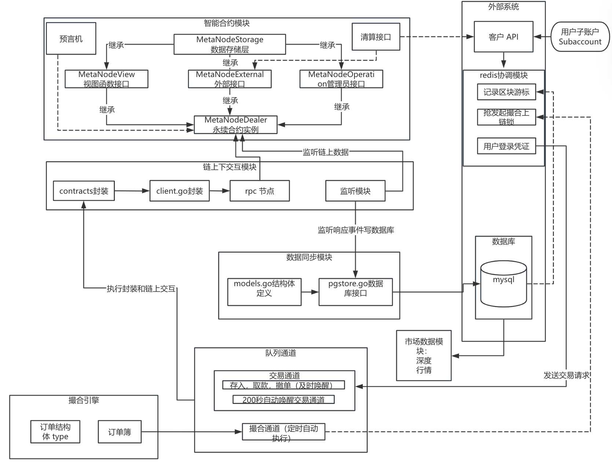
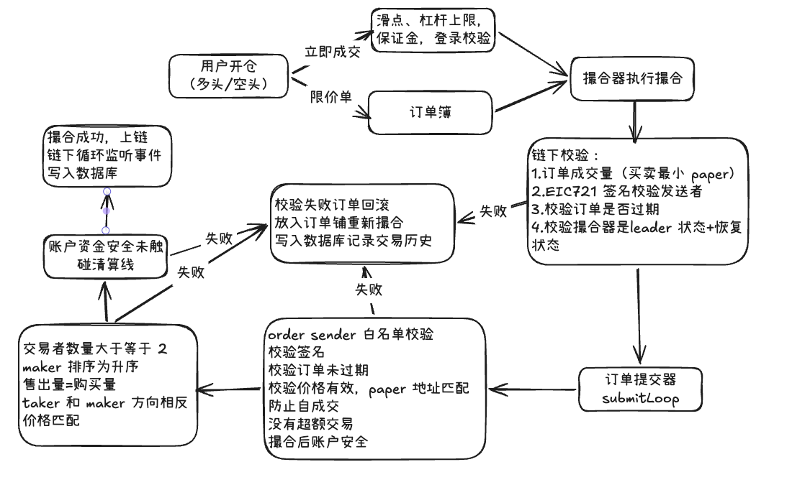
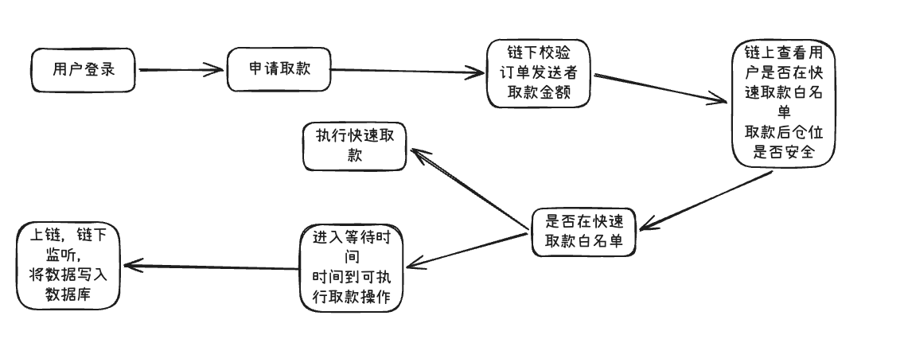
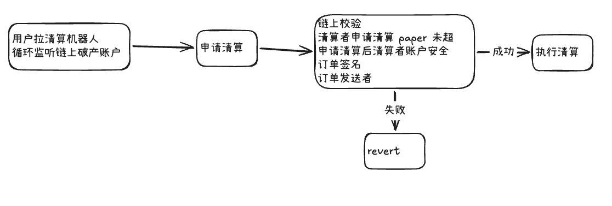

# 永续合约-项目拆解文档

## 整体流程图

## 核心模块详解

### 1.链上合约层

链上拍卖场主入口：统一部署拍卖场，永续合约的顶层入口

链上数据存储：存储state 相关的市场数据，风险参数，用户开仓数据，资产记录

链上视图函数：获得链上相关数据，市场、账户、风险参数、权限信息

链上外部操作函数：用户通过外部调用进行相关操作，比如开仓、取款、清算等

链上系统管理函数：市场管理（注册和设置风险参数），系统配置（保险账户，时间锁，最大仓位），权限管理（订单发送者，取款白名单），资金费率（更改各市场资金费率）

### 2.链上子账户

通过SubaccountFactory 创建子账户，并对不同子账户设置不同的权限

例如对子账户 A 设置为交易操作员，子账户 B 设置为资金管理员

用户通过对 子账户 A 和 B 操作合约市场交易

一个交易管理员同时在多个永续合约市场开仓，在全仓模式中，有一个爆仓所有的账户都会收到影响，触发清算，影响收益。通过使用子账户可以实现仓位隔离，减少某个市场爆仓对全账户的影响

### 3.链上预言机

本项目采用四种预言机：

ConstOracle：自定义预言机，通常在测试环境中使用

EmergencyOracle：应急预言机，当市场波动剧烈，混合预言机失效时使用，仅管理员可使用

OracleAdaptor：Chainlink 和自定义双重模式，（例如：借贷、现货 、NFT 市场）普通订单簿主流使用 chainlink，可以获取实时价格比较稳定，有心跳检查，支持自定义价格保护

PythOracleAdaptor：chainlink 和 pyth 混合模式，通过计算偏差和阈值之间的关系判断使用哪个，永续、衍生品、新公链的高额交易使用较多

计算公式为：｜chainlinkPrice-pythPrice｜/chainlinkPrice<=阈值使用chainlinkPrice，否则使用pythPrice，如果pyth不能用则用另一个chainlink

**为什么各个场景用不同的预言机  ？**

单一的预言机不能适用所有的应用场景，没有一个预言机可以完美覆盖各种需求

**为什么使用 chainlink 预言机不使用撮合成交价成为爆仓依据  ？**

 chainlink 有心跳保护机制，间隔每小时会自动检查价格，防止价格过期，chainlink 是实际可查的清算合约会可以随时查到这个价格，不受某一个永续市场合约的影响（全场的 BTC 价格都在涨，本操作市场流动性没有办法实现单币砸穿），chainlink 由数百个节点组成插针攻击成本极高

使用撮合价交易，容易被插针（用户用少量的资金砸盘，拉爆对方仓位，再把价格拉回来，特别是低流动性合约更容易受影响）

流动性黑洞，如果使用撮合价作为爆仓依据，假设撮合价不断降低，清算情况会越来越多

撮合价是链下的，计算清算价是链上的，链上没有办法主动调取链下的数据

延迟不一致，撮合引擎有自己的节奏，而清算需要确实性可实时查询的价格

难以跨市场对冲，做市商 DEX 和 CEX 对冲的时候需要公认的外部基准价，来判断自己的净口

**为什么要基差调整？**

因为纯外部的价格有时候也是有问题的

### 4.链上下数据监听交互

链下通过监听链上固定的事件比如交易事件，获取交易信息，更新链下数据库中信息

链下调用链上的方法，发起撮合，更新 资金费率，执行清算等

断点续传、事件处理幂等、**区块重组的处理**，如何保证链上下数据一致

### 5.Supabase 数据存储层

记录整个永续合约，用户信息，市场交易，K 线数据

数据存储层中 WAL 记录表，会记录所有用户提交的操作日志

订单存储结构，订单状态，数据恢复

### 6.redis 数据协调层

记录最大区块号，扫链，同步数据，这个值来自数据存储层中交易记录的最大区块号

用户执行登录nonce 值的存储，用户登录时 nonce 值会缓存在 redis 中，过期作废

交易所：撮合引擎通过远程命令抢锁，谁抢到，谁能提交撮合交易

### 7.链下通道调用层

本项目通过 go 自带的通道协程实现消息队列的消费

通道 1：当用户执行存款或撤单、提现操作时，立刻唤醒链下执行器执行

通道 2：每间隔 200 毫秒拉取 WAL 中事件按顺序执行

通道 3：每分钟自动执行链下撮合并发送交易，谁拿锁谁撮合谁发送

### 8.链下撮合

采取 FIFO 模式，双向撮合

情况 1：买单或者卖单立即成交，直接撮合，不进订单簿

情况 2：出现限价单，有匹配的订单马上撮合，没有匹配的订单进订单簿

订单簿采取一价一档的方式，每个价位为一当（O1），每档按照时间先后排列 （On）

### 9.数据处理层

使用 构建和数据库统一的数据模型，调用预先写好的 sql 语句，实现和数据库交互

## 重点业务逻辑

### 用户充值

Dealer Deposit ：直接充值，用户付手续费，基于链上信任，充值后直接到链上

 Treasury Transfer：托管充值，用户将资金放到第三方账户上，链下通过代码定时扫链，将资金充值到链上

手续费不需要用户支付，如果第三方账户接受抵押物充值可以方便用户操作  （ 面试时不用讲）直接链上 unitswap

不好的地方是容易遭受信任危机，这个账户是第三方账户有一定的资金丢失风险

### 用户模拟交易

市价单

### 取款操作

取款必须满足这个条件Solid IM Safe: IM Safe + (netValue - secondaryCredit >= 0)  可以取主资产

等待时间多久  等待逻辑    怕挤兑   

### 清算模块

保证金：

敞口=｜paper｜*市场价

初始保证金=敞口*初始保证金率

维持保证金=敞口*维持保证金率

 MM Safe: 净产>=维持保证金不会触发清算，反之触发清算

IM Safe: 净产>=初始保证金可以开新仓，反之不可以

Solid IM Safe: IM Safe + (netValue - secondaryCredit >= 0)  可以取主资产

多头清算价=其他市场维持保证金总额-其他市场净资产-用户抵押资金/paper（1-市场价*维持保证金率）

空头清算价=其他市场维持保证金总额-其他市场净资产-用户抵押资金/paper（1+市场价*维持保证金率）

清算折扣：

多头：市场价（1-清算折扣率），空头：市场价（1+清算折扣率）

清算流程：

用户 A 申请清算用户 B ：1paper多头，假设市场价为 100，清算折扣率为 1%

用户 A 付出 100（1-1%）=99，得到1paper 空头

用户 B 付出 1paper给用户 A，执行清算费计算，假设清算费为 1%，此时用户 B 收到 99（1-1%）=98.01

假设用户 B 当初开多头 1paper 价位是 101，

此时用户 B 剩余资产为 98.01-101=-2.99

如果用户是在逐仓模式下，此时已经没有 paper可清算，触发保底操作，保证金账户将剩余欠款抹平

如果用户是在全仓模式下，此时系统会继续执行清算，直到用户账面资产可以覆盖维持保证金，如果清算完所有仓位还有负债，则保证金账户负责兜底，抹平债务

### 预言机模块

#### 链下资金费率

链下资金费率=（现货价-指数价）/指数价/3，比较和设置好的最大费率与最小费率，如果超过最大费率或者低于最小费率，则用指定的最大或者最小费率

指数价=（CoinbaseProduct\*4+BinanceSymbol\*3+OkxInstId\*3）\10

现货价从链上的预言机拉取

#### 链上预言机

ConstOracle - 固定价格预言机  测试使用

EmergencyOracle - 应急预言机  应急使用

OracleAdaptor - Chainlink 预言机适配器   chainlink 和自定义预言机   适合小币种使用

PythOracleAdaptor - Pyth + Chainlink 混合预言机适配器  链上使用

 Pyth + Chainlink 到底选哪个？

计算 ｜Pyth - Chainlink ｜/Chainlink 如果这个值小于指定的阈值，那么选 chainlink 否则选 Pyth，如果 Pyth 不可用则用Chainlink

### 用户信息

用户总资产=   +=paper\*marketPrice\*资金费率 +reduceCreditAmount

exposure          +=  |paperAmount × price|    

initialMargin     +=  |paperAmount × price| × initialMarginRatio    

maintenanceMargin +=  |paperAmount × price| × liquidationThreshold

### reids数据协调层

主要负责记录缓存数据：

用户的登录凭证

当前扫到的最大区块号

维护撮合引擎锁

### 子账户模式

用户可以通过SubaccountFactory 生成合约级子账户，该账户没有私钥不能执行签名

用户可使用子账户实现资金隔离。通过给不同的子账户设置交易订单的操作，

交易管理子账户：签订单、设权限、清算

资金管理子账户：在项目内部转移资金，提现、入金等

### 3.全仓和逐仓

| 项目       | 全仓 Cross                                 | 逐仓 Isolated                            |
| ---------- | ------------------------------------------ | ---------------------------------------- |
| 保证金来源 | 同交易对全部余额                           | 开仓单独划拨，隔离资金                   |
| 风险范围   | 一个仓位亏损，吃光同交易对所有资金         | 仅损失分配给本仓的保证金，其余资金安全   |
| 清算距离   | 更远，不容易爆仓                           | 更近，更容易触发清算                     |
| 适用人群   | 趋势交易者，长线持有，愿意承担整体账户风险 | 短线、量化、多仓位，严格限制单笔最大亏损 |

